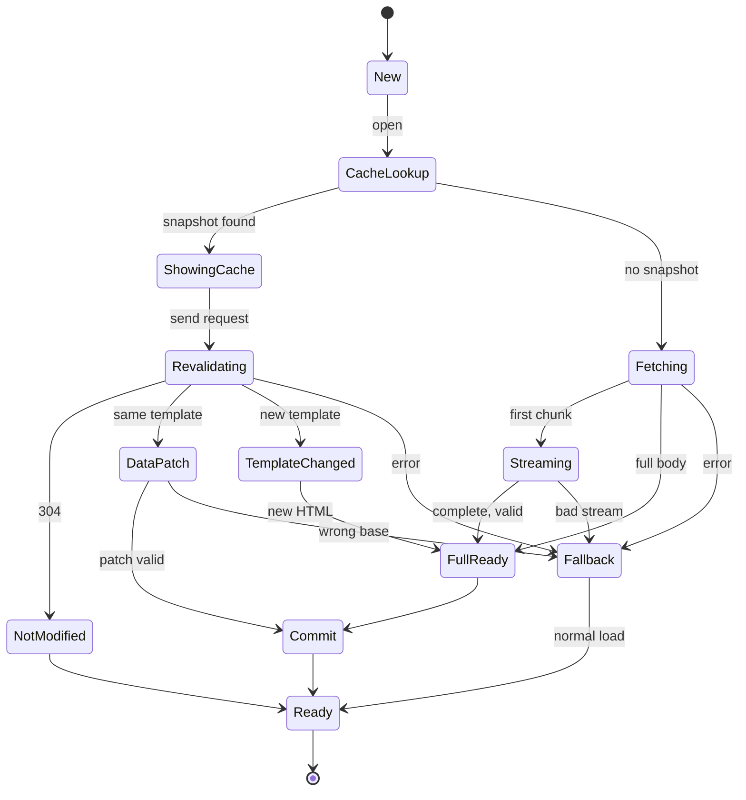

# Session state machine

The session state machine (`rivqen-session`) decides, for one navigation, what to show and when. It is deterministic: the same events in the same order give the same actions.

**Status:** <Badge type="info" text="DESIGN" /> Based on the upstream flow documented in [legacy client behavior](/engineering/protocol/legacy-client).

[[toc]]

## 1. States

| State | Meaning | Exit conditions |
|---|---|---|
| `New` | Created, nothing started | `open` |
| `CacheLookup` | Waiting for the storage driver | `CacheResult` |
| `ShowingCache` | Cached snapshot delivered to the WebView | Request sent |
| `Fetching` | Request sent, no body yet (cold path) | First chunk, full body, error, timeout |
| `Streaming` | Body chunks flow to the WebView | Completion, truncation, cancel |
| `Revalidating` | Conditional request for a cached page | Status and headers decide |
| `NotModified` | Server confirmed the snapshot | Metadata update |
| `DataPatch` | Data update validated or being validated | Commit or fallback |
| `TemplateChanged` | Full new document needed | New document ready |
| `FullReady` | A complete, validated document exists | Commit |
| `Commit` | Cache transaction planned and executed | Done |
| `Fallback` | Normal HTTPS load requested | WebView loads normally |
| `Ready` | The UI operation for this generation is finished | Close, reload, cancel |

## 2. Rules

| ID | Rule |
|---|---|
| FSM-01 | Only `reload`, `cancel` and a partition change increment the **generation**. Normal state changes do not. |
| FSM-02 | Every event carries `generation`; events of an older generation are ignored. |
| FSM-03 | `Ready` means the UI operation for this generation is done. Background revalidation is a **separate operation** with its own request id. |
| FSM-04 | `cancel` from any state goes to the terminal state and returns cleanup actions (close streams, drop buffers). |
| FSM-05 | Every non-terminal state has a deadline. A missed deadline is an event (`Tick`) that leads to `Fallback`. |
| FSM-06 | `Fallback` is always reachable and always ends in a normal load. |
| FSM-07 | A commit happens only from `FullReady` or a validated `DataPatch`. |

## 3. Mapping to upstream modes

<Badge type="tip" text="FACT" /> Upstream has **four session states** only (none, running, ready, destroy) and boolean flags for the rest, the same in Quick and Standard mode ([legacy client](/engineering/protocol/legacy-client#_2-1-upstream-state-model) §2.1). The 13 states of section 1 are a Rivqen design; there is no one-to-one map. Upstream "ready" means "the session can answer the intercepted request", not "the UI operation is done" (Rivqen `Ready`).

| Upstream state or flag | Nearest Rivqen state |
|---|---|
| none | `New` |
| running | `CacheLookup` to `Streaming`, `Revalidating`, `DataPatch`, `TemplateChanged` (several) |
| ready | No state: a condition inside `ShowingCache`, `Streaming` or `FullReady` |
| destroy | Terminal state after `cancel` (FSM-04) |
| `wasLoadDataInvoked` (Quick) | `ShowingCache` entered (cached page given as data) |
| `wasInterceptInvoked` | The WebView asked for the main document |

| Upstream | Rivqen |
|---|---|
| Quick mode: the cached or rebuilt HTML goes to the client as data after `clientReady()`; a data update goes to the page as a diff only if the cached page was **already given as data**, else the rebuilt page is loaded as data | Policy `presentation = quick`: show cached or rebuilt HTML directly when the WebView is ready; deliver data updates through the bridge after load. On Android, Rivqen keeps response security headers (see U-05). |
| Standard mode: always `loadUrl`; the session answers the intercepted request; a data update goes to the page as a diff only if the WebView **already intercepted**, else the rebuilt page replaces the pending stream | Policy `presentation = standard`: always navigate normally; answer the main document request from the session (intercepted stream). |
| `cache-offline: http`: the session id (URL and account) is unavailable for 6 h. With a cached page, Quick loads the URL normally and Standard **keeps serving the cached page**; with no cache, both let the WebView load normally ([legacy client](/engineering/protocol/legacy-client) Q5, Q16, S4) | `Fallback(ServiceUnavailable)` + per-origin disable timer (default 6 h) |
| Result codes `src / final` 1000 / 2000 / 200 / 304, and `-1` when no branch reports (errors, `http`, cache removed, no request). The final code can differ from the source code (for example 200 / 304) | Outcomes `FirstLoad` / `TemplateChanged` / `DataUpdated` / `CacheHitNotModified`, mapped in the compatibility shim |

Notes on the mapping (no change to the design above):

1. <Badge type="tip" text="FACT" /> The Rivqen `cache-offline: http` row matches Quick with a cached page. It does not match Standard (cached page kept), and the upstream timer is per session id, not per origin. The architect decides whether the `standard` policy follows upstream here (open design question, WP-01 S1 T-01 report).
2. <Badge type="tip" text="FACT" /> Upstream keeps a shown cached page on an HTTP error or a connection error (default `RELOAD_IN_BAD_NETWORK` off; Q15, S13), and it removes the cache without an update on `cache-offline` absent or `false` (Q17, S14). The Rivqen transitions `Revalidating → Fallback` and `DataPatch`/`TemplateChanged` do not name these cases (open design question, same report).

## 4. Races

The core must give the same final result for every interleaving of these events:

| Event A | Event B | Required result |
|---|---|---|
| `WebViewReady` | `HttpCompleted` | Same bytes rendered; one cache commit |
| `HttpResponseHead(304)` | `ShowCachedDocument` not yet executed | Cached page shown once; no reload |
| Data update ready | Page not yet loaded | Rebuilt page loaded directly; no separate patch |
| Data update ready | Page loaded | Patch delivered through the bridge |
| `cancel` | Any I/O completion | No action after cancel |
| `PartitionChanged` | Any event | Session stops; snapshot of the old partition never shown again |

These are property tests in `rivqen-testkit` (random interleavings, fixed seeds in CI).

### Compatibility notes

The required results above are Rivqen design. They are stricter than upstream in several orders. Upstream behavior, from [legacy client](/engineering/protocol/legacy-client) §2 and §3:

| Topic | Upstream behavior | Rows |
|---|---|---|
| "Page loaded" | Upstream does not use page load to choose the path. Quick asks "was the cached page given as data?" (`wasLoadDataInvoked`); Standard asks "did the WebView intercept?" (`wasInterceptInvoked`). Page finish matters only for the template-change read | Q8, Q10, S6, S7 |
| Data update, page loaded | <Badge type="warning" text="RESEARCH" /> Upstream can lose the update: if the Quick preload runs between the check and the message, the page reports 200 / 304 and keeps the old content. Standard can report 200 / 304 while the old cached page shows. No upstream parity is claimed for the row "Patch delivered through the bridge" | Q8 note 4, S7 note 3 |
| `HttpResponseHead(304)` | The cached page is shown once and the result is 304 / 304 in both modes; matches the required result | Q7, S5 |
| One-slot hold (Quick) | Before `clientReady()`, a newer core message replaces the held one | §3.1 |
| `store` | Quick: 200 / 304 with no diff; Standard data update: no result at all | M-15 |
| Cache writes | Standard can post two saves for one first load; a delayed save (1.5 s) stops if the page closes first; Standard writes a data update even when the write is not allowed | M-12, M-13, §2.6 |
| `cancel` | Upstream `destroy()` blocks no I/O completion; it drops later messages and waits up to 6 s for open saves. A forced destroy does not disconnect | §2.6 |
| `PartitionChanged` | No upstream counterpart: the account is fixed at session creation and no code detects a change | §2.8 |

## Related

- [Core API](/engineering/core/api)
- [Streaming](/engineering/core/streaming)
- [legacy client behavior](/engineering/protocol/legacy-client)
