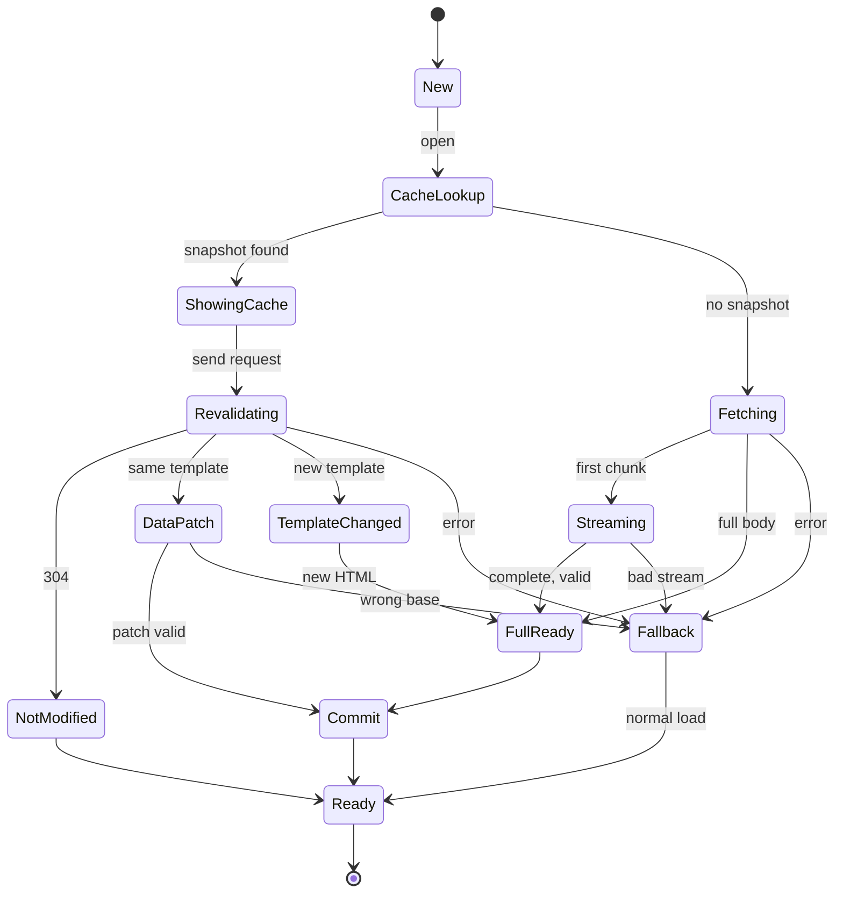

# Session state machine

The session state machine (`rivqen-session`) decides, for one navigation, what to show and when. It is deterministic: the same events in the same order give the same actions.

**Status:** <Badge type="info" text="DESIGN" /> Based on the upstream flow documented in [legacy client behavior](/engineering/protocol/legacy-client).

[[toc]]

## 1. States

| State | Meaning | Exit conditions |
|---|---|---|
| `New` | Created, nothing started | `open` |
| `CacheLookup` | Waiting for the storage driver | `CacheResult` |
| `ShowingCache` | Cached snapshot delivered to the WebView | Request sent |
| `Fetching` | Request sent, no body yet (cold path) | First chunk, full body, error, timeout |
| `Streaming` | Body chunks flow to the WebView | Completion, truncation, cancel |
| `Revalidating` | Conditional request for a cached page | Status and headers decide |
| `NotModified` | Server confirmed the snapshot | Metadata update |
| `DataPatch` | Data update validated or being validated | Commit or fallback |
| `TemplateChanged` | Full new document needed | New document ready |
| `FullReady` | A complete, validated document exists | Commit |
| `Commit` | Cache transaction planned and executed | Done |
| `Fallback` | Normal HTTPS load requested | WebView loads normally |
| `Ready` | The UI operation for this generation is finished | Close, reload, cancel |

## 2. Rules

| ID | Rule |
|---|---|
| FSM-01 | Only `reload`, `cancel` and a partition change increment the **generation**. Normal state changes do not. |
| FSM-02 | Every event carries `generation`; events of an older generation are ignored. |
| FSM-03 | `Ready` means the UI operation for this generation is done. Background revalidation is a **separate operation** with its own request id. |
| FSM-04 | `cancel` from any state goes to the terminal state and returns cleanup actions (close streams, drop buffers). |
| FSM-05 | Every non-terminal state has a deadline. A missed deadline is an event (`Tick`) that leads to `Fallback`. |
| FSM-06 | `Fallback` is always reachable and always ends in a normal load. |
| FSM-07 | A commit happens only from `FullReady` or a validated `DataPatch`. |

## 3. Mapping to upstream modes

<Badge type="tip" text="FACT" /> Upstream has **four session states** only (none, running, ready, destroy) and boolean flags for the rest, the same in Quick and Standard mode ([legacy client](/engineering/protocol/legacy-client#_2-1-upstream-state-model) §2.1). The 13 states of section 1 are a Rivqen design; there is no one-to-one map. Upstream "ready" means "the session can answer the intercepted request", not "the UI operation is done" (Rivqen `Ready`).

| Upstream state or flag | Nearest Rivqen state |
|---|---|
| none | `New` |
| running | `CacheLookup` to `Streaming`, `Revalidating`, `DataPatch`, `TemplateChanged` (several) |
| ready | No state: a condition inside `ShowingCache`, `Streaming` or `FullReady` |
| destroy | Terminal state after `cancel` (FSM-04) |
| `wasLoadDataInvoked` (Quick) | `ShowingCache` entered (cached page given as data) |
| `wasInterceptInvoked` | The WebView asked for the main document |

| Upstream | Rivqen |
|---|---|
| Quick mode: the cached or rebuilt HTML goes to the client as data after `clientReady()`; a data update goes to the page as a diff only if the cached page was **already given as data**, else the rebuilt page is loaded as data | Policy `presentation = quick`: show cached or rebuilt HTML directly when the WebView is ready; deliver data updates through the bridge after load. On Android, Rivqen keeps response security headers (see U-05). |
| Standard mode: always `loadUrl`; the session answers the intercepted request; a data update goes to the page as a diff only if the WebView **already intercepted**, else the rebuilt page replaces the pending stream | Policy `presentation = standard`: always navigate normally; answer the main document request from the session (intercepted stream). |
| `cache-offline: http`: the session id (URL and account) is unavailable for 6 h. With a cached page, Quick loads the URL normally and Standard **keeps serving the cached page**; with no cache, both let the WebView load normally ([legacy client](/engineering/protocol/legacy-client) Q5, Q16, S4) | `Fallback(ServiceUnavailable)` + per-origin disable timer (default 6 h) |
| Result codes `src / final` 1000 / 2000 / 200 / 304, and `-1` when no branch reports (errors, `http`, cache removed, no request). The final code can differ from the source code (for example 200 / 304) | Outcomes `FirstLoad` / `TemplateChanged` / `DataUpdated` / `CacheHitNotModified`, mapped in the compatibility shim |

Notes on the mapping (no change to the design above):

1. <Badge type="tip" text="FACT" /> The Rivqen `cache-offline: http` row matches Quick with a cached page. It does not match Standard (cached page kept), and the upstream timer is per session id, not per origin. The architect decides whether the `standard` policy follows upstream here (open design question, WP-01 S1 T-01 report).
2. <Badge type="tip" text="FACT" /> Upstream keeps a shown cached page on an HTTP error or a connection error (default `RELOAD_IN_BAD_NETWORK` off; Q15, S13), and it removes the cache without an update on `cache-offline` absent or `false` (Q17, S14). The Rivqen transitions `Revalidating → Fallback` and `DataPatch`/`TemplateChanged` do not name these cases (open design question, same report).

## 4. Races

The core must give the same final result for every interleaving of these events:

| Event A | Event B | Required result |
|---|---|---|
| `WebViewReady` | `HttpCompleted` | Same bytes rendered; one cache commit |
| `HttpResponseHead(304)` | `ShowCachedDocument` not yet executed | Cached page shown once; no reload |
| Data update ready | Page not yet loaded | Rebuilt page loaded directly; no separate patch |
| Data update ready | Page loaded | Patch delivered through the bridge |
| `cancel` | Any I/O completion | No action after cancel |
| `PartitionChanged` | Any event | Session stops; snapshot of the old partition never shown again |

These are property tests in `rivqen-testkit` (random interleavings, fixed seeds in CI).

### Compatibility notes

The required results above are Rivqen design. They are stricter than upstream in several orders. Upstream behavior, from [legacy client](/engineering/protocol/legacy-client) §2 and §3:

| Topic | Upstream behavior | Rows |
|---|---|---|
| "Page loaded" | Upstream does not use page load to choose the path. Quick asks "was the cached page given as data?" (`wasLoadDataInvoked`); Standard asks "did the WebView intercept?" (`wasInterceptInvoked`). Page finish matters only for the template-change read | Q8, Q10, S6, S7 |
| Data update, page loaded | <Badge type="warning" text="RESEARCH" /> Upstream can lose the update: if the Quick preload runs between the check and the message, the page reports 200 / 304 and keeps the old content. Standard can report 200 / 304 while the old cached page shows. No upstream parity is claimed for the row "Patch delivered through the bridge" | Q8 note 4, S7 note 3 |
| `HttpResponseHead(304)` | The cached page is shown once and the result is 304 / 304 in both modes; matches the required result | Q7, S5 |
| One-slot hold (Quick) | Before `clientReady()`, a newer core message replaces the held one | §3.1 |
| `store` | Quick: 200 / 304 with no diff; Standard data update: no result at all | M-15 |
| Cache writes | Standard can post two saves for one first load; a delayed save (1.5 s) stops if the page closes first; Standard writes a data update even when the write is not allowed | M-12, M-13, §2.6 |
| `cancel` | Upstream `destroy()` blocks no I/O completion; it drops later messages and waits up to 6 s for open saves. A forced destroy does not disconnect | §2.6 |
| `PartitionChanged` | No upstream counterpart: the account is fixed at session creation and no code detects a change | §2.8 |

## 5. The legacy session (WP-08 S2)

<Badge type="tip" text="FACT" /> The crate `rivqen-session` (feature `legacy`) runs the rules of the Rivqen canonical client ([legacy client](/engineering/protocol/legacy-client) §9, CL-05 to CL-37) as a sans-I/O state machine. `legacy::engine::LegacyEngine` holds the sessions of one engine; the private module `legacy::fsm` holds the logic of one session. Inputs are `legacy::types::Input`; effects are `legacy::types::Effect`, in order.

<Badge type="tip" text="FACT" /> The session is a product of small parts, not one enum: the request flow (lookup, cookie read, request), the current document and its delivery (CL-20), the result (CL-22) and the exchanges (one per request). The 13 states of section 1 are views of these parts.

### 5.1 States

| State | Legacy session | CL rules | Effects |
|---|---|---|---|
| `New` | Before `LegacyEngine::open` | CL-05 | — |
| `CacheLookup` | Waiting for the lookup, then for the cookie; the cookie answer decides the visible entry | CL-07, CL-08, CL-12, CL-40 | `Lookup`, `ReadCookie`, `Closed`, `Cache` (remove a damaged entry) |
| `ShowingCache` | The current document is the cached page | CL-10, CL-20 | `LoadData`, `AnswerDocument` |
| `Fetching` | A request without a head, no visible entry | CL-09, CL-11, CL-18 | `Send`, `StoreCookies` |
| `Revalidating` | A request without a head, with the validators of a visible entry | CL-09, CL-13 | `Send`, `StoreCookies` |
| `Streaming` | A first load or a template change whose body is open | CL-16, CL-20, CL-32, CL-33 | `AnswerDocument`, `StreamChunk` |
| `NotModified` | A `304` (or a `200` with the stored etag) that passed `is_safe_head` | CL-17, DL-226 | `Cache`, `Result` |
| `DataPatch` | A data update until the end of its body, then a `Rebuilt` | CL-27 to CL-30 | `Message`, `Result`, `Cache` |
| `TemplateChanged` | A template change after the delivery of the cached page | CL-30, CL-31 | `LoadData` or `LoadUrl` |
| `FullReady` | The body ended complete, is not empty and is valid UTF-8 | CL-16, CL-25, CL-32 | `StreamEnd` |
| `Commit` | A transaction of `record::commit` | CL-26, CL-38 | `Cache` |
| `Fallback` | A normal load | CL-14, CL-18, CL-19, CL-29, CL-32, CL-33, CL-44 | `LoadUrl`, `AnswerNull`, `Cache` |
| `Ready` | The result is set; the end is `Closed` | CL-22, CL-34, CL-06 | `Result`, `Closed` |

### 5.2 Rules FSM-01 to FSM-07

| Rule | Legacy session |
|---|---|
| FSM-01 | <Badge type="tip" text="FACT" /> Only `Input::Refresh` starts a generation (CL-35). `Destroy` and `partition_changed` end the session with `Closed` |
| FSM-02 | <Badge type="tip" text="FACT" /> Each response input names its exchange. An exchange of an older generation gives only `StoreCookies` for its first head (CL-11 item 2), the bytes of its own streams and, when its body fails, the end of the document that reads it (DL-229 (c)); never a cache effect or a result |
| FSM-03 | <Badge type="tip" text="FACT" /> Not used: the legacy request is the revalidation (CL-39), there is no background request |
| FSM-04 | <Badge type="tip" text="FACT" /> `Destroy`: `Result`, `AnswerNull` for each waiting intercept, `StreamEnd` with `complete: false` for each open stream, then `Closed`. After `Closed` an input of the session gives no effect |
| FSM-05 | <Badge type="info" text="DESIGN" /> S3. In S2 the engine gives no `ScheduleTimer`, and `Input::Tick` gives no effect |
| FSM-06 | <Badge type="tip" text="FACT" /> Every failure ends in a normal load: `LoadUrl` after a delivery, `AnswerNull` for an intercept |
| FSM-07 | <Badge type="tip" text="FACT" /> A commit comes only from a complete page that passed CL-25 (`page_commit`), from a `Rebuilt` (`data_commit`), or from the field update of a checked `304` (CL-17) |

### 5.3 Contract readings

- <Badge type="tip" text="FACT" /> **Open.** `open` gives `Closed` when the key (partition and canonical URL) has a session that is not destroyed (CL-07), and at the bounds below. A disabled key closes the session at the lookup answer (CL-08). The cookie answer decides the visible entry; without a valid network the `Vary` match has no cookie (CL-10 reads no cookie).
- <Badge type="tip" text="FACT" /> **Visible entry.** The session reads an entry through `record::check_visible_in`: an entry whose stored partition or key is not the one of the session is damage (removed, CL-40), before the `Vary` match (DL-229 (f)). The page fields of the entry pass the filter of DL-226 (b) and CL-21: a line that is not a valid field line, or whose name never goes to the web view (`Set-Cookie`, a hop-by-hop field, a legacy control field), never reaches `DocumentHead` or the field update of CL-17 (DL-229 (d)). A record that a commit of the session wrote does not change.
- <Badge type="tip" text="FACT" /> **Epochs.** Every write of a session names the epochs of its opening lookup (DL-220). A later lookup (a refresh, CL-35) that reports another partition epoch or site epoch stops the session as CL-06: `Result`, `AnswerNull` for each waiting intercept, `StreamEnd` with `complete: false` for each open stream, then `Closed`; no write (DL-229 (a), RSK-06).
- <Badge type="tip" text="FACT" /> **Cookies.** `StoreCookies` comes once per exchange, for its first head, before the session acts on it (CL-11 item 2). A head of an unknown exchange, of an exchange that has a head or that ended gives no effect. The session keeps the ids of at most 16 exchanges of older generations that it dropped before their head; the head of such an exchange gives only `StoreCookies`. Over 16 the oldest id is forgotten, and its head gives no effect (DL-229 (e)).
- <Badge type="tip" text="FACT" /> **Result.** `Effect::Result` comes each time the result is set or changed (CL-22, CL-28), and once more before `Closed`. The last `Result` before `Closed` is the result of the session.
- <Badge type="tip" text="FACT" /> **Closed session.** An intercept of a closed session gives no effect: the adapter answers it with no document (CL-20 item 5).
- <Badge type="tip" text="FACT" /> **Partition change.** `partition_changed` gives one `RevokePartition` first (a maintenance write, DL-220), named by the first stopped session or by no session, then the stop effects of each session. A stopped session keeps its key until its `Destroy` (CL-07).
- <Badge type="tip" text="FACT" /> **After a commit.** A commit or a field update makes the version of the entry unknown: no later removal of the same generation runs, so no removal uses `Expect::Any` (DL-229 (g)).
- <Badge type="tip" text="FACT" /> **Body tests.** The session tests CL-16 (valid UTF-8) and CL-32 (not empty) while the body arrives and at its end, for every buffered body, also of an older generation (DL-229 (c)). A stream gets only bytes of the valid UTF-8 prefix, also at a failed end: a chunk with an invalid byte is not kept, and an incomplete tail is never sent (DL-229 (b)). An intercept waits for the first body byte, so an empty body gives `AnswerNull`. A body that fails a test after a stream started ends the stream incomplete, then `LoadUrl` (as CL-33). A failed body is never a complete document. When the failed body is of an older generation, the session has no document until the current generation gives one, and it gives no cache effect and no result (CL-35).
- <Badge type="tip" text="FACT" /> **CL-33 scope.** A body error ends a first load, a template change or a data update (CL-33). A body error after an outcome that the head decided (CL-17, CL-18, CL-19, CL-44, CL-14) changes nothing.
- <Badge type="tip" text="FACT" /> **Bounds.** A body is buffered only for an outcome that needs it: at most `template.max_document_bytes` for a page and `body.max_bytes` for a data body. A larger body is a body failure (CL-33). An engine holds at most 256 open sessions; a stopped session does not count (DL-229 (h)). The engine keeps only the key of a stopped session until its `Destroy`; at 1024 such keys `open` gives `Closed` until the app destroys a stopped session (fail closed). A session keeps at most 4 exchanges and 16 ids of dropped exchanges whose head is due.

### 5.4 Tests

<Badge type="tip" text="FACT" /> `crates/rivqen-session/tests/legacy_engine_flow.rs` (`legacy_engine_open_*`, `legacy_engine_classify_*`, `legacy_engine_delivery_*`, `legacy_engine_codes_*`, `legacy_engine_outcome_*`, `legacy_engine_stop_*`, `legacy_engine_writes_name_the_request_partition`) tests the public API with `record.rs`. The unit tests in `src/legacy/fsm/tests.rs` give fake record functions for the paths with a visible entry (CL-17, CL-27 to CL-31, CL-40) and check the commit content. Every test checks that each `Cache` effect names the request partition and the epochs of its lookup. `legacy_engine_prop_*` (in `tests/legacy_engine_prop.rs` with the record of `record.rs`, and in `src/legacy/fsm/tests.rs` with a fake record) runs random input sequences: no panic, no effect after `Closed`, no timer, the same effects for the same inputs. The canonical client fixtures run through `rivqen_testkit::legacy_client` (test `legacy_client_fixtures_pass`): all 106 pass (WP-08 S2 T-05).

## Related

- [Core API](/engineering/core/api)
- [Streaming](/engineering/core/streaming)
- [legacy client behavior](/engineering/protocol/legacy-client)
