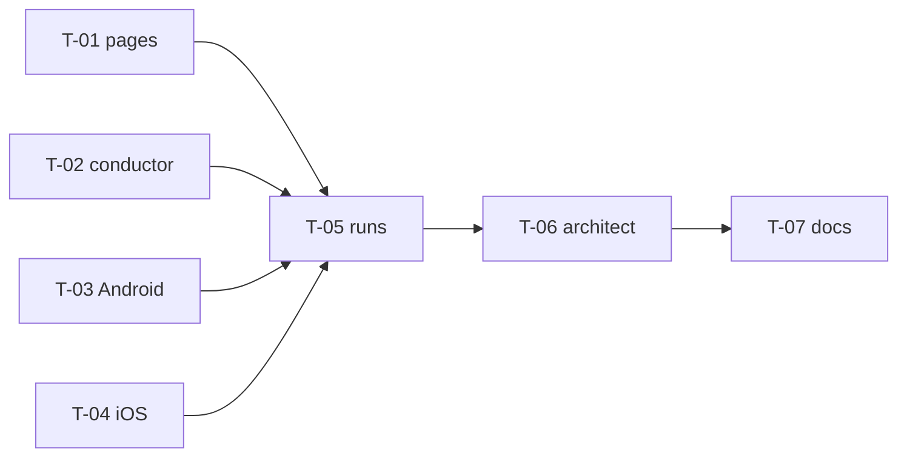

# WP-01 S1 — Legacy client evidence (Android and iOS)

Sprint record for WP-01 ([Upstream evidence](/engineering/plan/work-packages#wp-01)), sprint 1 of the client part (P1 remainder, H-110). A new session reads this page first and continues from it.

**Status:** <Badge type="info" text="DESIGN" />

[[toc]]

## 0. Header

| Field | Value |
|---|---|
| WP | `WP-01` — Upstream evidence (client part, H-110) |
| Sprint | `S1` |
| Integration branch | `wp/WP-01` |
| Base commit | `92c708e` (`main`) |
| State | Running |
| Goal | The legacy client is described as observable behavior with evidence: Q-02 (full Quick and Standard state machine), the client divergences D-20…D-27 checked and the new ones listed, the client traces of Android in Quick and Standard mode, and the runtime checks of the iOS pure functions. The client part of the fixtures follows in S2 (proposed) |

## 1. Kickoff

Kickoff on 2026-11-04. WP-03 is merged into `main` (92c708e, #6, 2026-11-04) and gate G1 is passed (H-116). The P0 part of WP-01 is done (`evidence/source-manifest.lock`, the server audit, the server traces, D-01…D-15). H-110 moved the client part out of WP-02 and G1: it runs before P3, because G3 needs it ("all legacy fixtures pass with the feature on", [roadmap](/engineering/plan/roadmap) P3).

**Dependency WP-00.** Done. The dependency is met.

**Upstream.** Read only through the clone in the scratchpad (`git fetch --depth 1` of `59936bef`, 31 MB). The lab runs only through `tools/upstream-lab`. After the work: delete the clone, the containers, the images, the lab SDK root and the AVD.

### Human decisions

| ID | Question | Decision |
|---|---|---|
| H-118 | Clean-room method for running the upstream Android SDK (the H-110 sub-question). Input: the SDK sources compile unchanged with JDK 21 against API 34 and 37.2; the sample does not build the SDK of the pinned commit (jcenter); Gradle 3.5 and AGP 2.3.0 have no Apple Silicon support | **Rivqen harness, no patches** (human, 2026-11-04). A Rivqen harness app in `tools/upstream-lab/android` compiles the unmodified SDK sources of the read-only clone as a source set, with AGP 9 and JDK 21. The sample is not used. Standard mode is set through the public session configuration. Lab-only build dependencies (not shipped): AGP 9 and `com.android.support:support-annotations:28.0.0`, both Apache-2.0. [Provenance](/legal/provenance) gets a section on the lab: upstream read-only, harness written from the Rivqen pages, not from the sample or the upstream tests (CR-04) |
| H-119 | Scope of iOS (D-27 and the iOS column of D-20…D-26) | **Code reading plus a run of the pure functions** (human, 2026-11-04). A Rivqen macOS runner calls the pure functions of the unmodified iOS SDK (session id, marker split, diff, page message JSON, field parsing), built with flags only (`-fno-objc-arc -fobjc-weak`). No simulator, no `UIWebView`; the session flow of iOS stays code reading |
| H-120 | Scope of the new client divergences D-28…D-44 | **In WP-01** (human, 2026-11-04): evidence and fixtures for all. The architect decides the "Rivqen canonical" value of a minor one with the four-part record; one that touches security or compatibility goes to the human |
| H-121 | Order of WP-01 and WP-04 | **Sequential** (human, 2026-11-04): WP-01 S1 (lab and traces) first; WP-04 starts after it. WP-01 S2 (offline fixtures and generator) can run in parallel with WP-04 |

### Measurements (2026-11-04)

<Badge type="tip" text="FACT" /> Measured on the development Mac (Apple Silicon, 14 cores, 48 GB, macOS 26.6.2) before any decision.

| Item | Result |
|---|---|
| Free disk | System volume 30 GiB (rule: at least 20 GiB); `BackCat` 516 GiB |
| JDK | JDK 21 (Zulu, in `~/.gradle/jdks`) and JBR 25. No JDK 8. Rosetta is installed |
| Android SDK | `~/Library/Android/sdk` on the system volume (30 GiB), emulator 37.2.12, platforms 31…37.2, build-tools 34…37. The API 29 system images in it are incomplete (8.7 MB) |
| Old emulator images | `arm64-v8a` `default` images exist for API 21…30. Download size: API 25 294 MiB, API 28 406 MiB, API 29 474 MiB (`sys-img2-4.xml`). The H-110 estimate of a 6–8 GB image is too high |
| Upstream sample | It does not build the SDK of the pinned commit: it takes `com.tencent.sonic:sdk:3.1.0` from jcenter (`upstream:sonic-android/sample/build.gradle:29`), and jcenter is gone. Gradle 3.5 and AGP 2.3.0 have no Apple Silicon support (RESEARCH; native support from Gradle 7.0) |
| Upstream Android SDK sources | All 63 classes of `sonic-android/sdk/src/main/java` compile **unchanged** with JDK 21 (`javac --release 8`) against `android.jar` of API 34 and of API 37.2, in about 1 s. The only extra symbols are `android.support.annotation.NonNull` and `Nullable` (`com.android.support:support-annotations:28.0.0` is still on Google Maven) |
| WebView in the SDK | The SDK imports no WebView class. Every page action goes through the abstract client (`upstream:sonic-android/sdk/src/main/java/com/tencent/sonic/sdk/SonicSessionClient.java:94-132`). The actions are observable at that boundary |
| Upstream iOS SDK sources | All 14 files of `sonic-iOS/Sonic` compile unchanged for the iOS 27.1 simulator SDK with the build flags `-fno-objc-arc -fobjc-weak` (the code uses manual reference counting). 11 of 14 compile for macOS too; the other 3 import UIKit |
| Docker | 29.9.2, 23 GiB for containers |

### What exists

| Item | Path | State |
|---|---|---|
| Pinned upstream and file hashes | `evidence/source-manifest.lock` | Usable |
| Client behavior page | [Legacy client](/engineering/protocol/legacy-client) | Partial: session flow, modes, result codes and the message are described, but 14 statements of §2 and §3 are wrong or incomplete (kickoff archaeology, see below); timing rows are RESEARCH |
| Client divergences | [Divergences](/engineering/protocol/legacy-divergences) §2, D-20…D-27 | Partial: D-21, D-22, D-23, D-24 confirmed; D-20, D-25, D-26 partly right; no fixture |
| Q-03 (iOS integration) | [Legacy client](/engineering/protocol/legacy-client#_5-3-ios-integration-q-03) §5.3 | Closed by code reading (WP-02 S1) |
| Q-02 (Quick and Standard state machine) | [Open questions](/engineering/plan/open-questions) | Open |
| Session state machine of Rivqen | [Session FSM](/engineering/core/session-fsm) §3, §4 | Partial: the mapping to the upstream modes has 4 errors (kickoff archaeology) |
| Server lab | `tools/upstream-lab/` (Node.js, PHP, Java harnesses, `start.sh`, `run_traces.py`, `conformance.sh`) | Usable: the pattern for Rivqen harness code around unmodified upstream code; the servers answer the emulator at `10.0.2.2` |
| Server traces | `evidence/traces/server/` (117) | Usable as the server side of the client scenarios |
| Legacy fixture format and generator | `fixtures/legacy/README.md`, `tools/legacy-fixtures/` (`gen.mjs --check`, JavaScript model, 1013 lines) | Usable: server part only; the client part is missing (DL-067) |
| RQP client fixtures and reference client | `fixtures/rqp/protocol/FX-RQ-C*`, `tools/rqp-protocol/` | Usable as the pattern for a client case (`context`, `response`, `result`) |
| Rust reference server | `server/rust-reference/` (site mode) | Usable: a second server for the client runs |
| Client traces, Android harness, iOS function runner | — | Missing |
| Catalog rows `FX-LEG-INTERRUPTED`, `-CONCURRENT`, `-AUTH-CHANGE`, client part of `-COOKIE-VARIANCE` | [Fixtures](/engineering/protocol/fixtures) §3 | Missing |

### Kickoff archaeology (code reading at `59936bef`)

<Badge type="tip" text="FACT" /> Three read-only research passes at kickoff (Android state machine, client divergences, toolchain). They give these results; the full tables go into the protocol pages in S1.

1. **Q-02 by code reading.** Upstream has four session states (none, running, ready, destroy; `upstream:sonic-android/sdk/src/main/java/com/tencent/sonic/sdk/SonicSession.java:97-123`) and about ten flags. Quick mode has 19 distinct outcome rows, Standard mode 13. There are 16 differences between the modes, for example: Quick keeps the pending page message in one slot where a newer message replaces an older one (`QuickSonicSession.java:156-160`); on `cache-offline: http` Quick replaces the cached page with a normal load but Standard keeps serving the cache (`QuickSonicSession.java:222-229`, `StandardSonicSession.java:319-327`); an HTTP or connection error loads nothing unless `RELOAD_IN_BAD_NETWORK` is on (default off, `SonicSessionConfig.java:61`).
2. **Timing rows.** About 8 rows depend on the order of client ready, the intercepted request, the network head and the end of the body (for example Quick first load: `loadDataWithBaseUrlAndHeader` with 1000/304 or a bridge stream with 1000/1000). Two of them are probable upstream defects: a data update can be lost in Quick (`QuickSonicSession.java:697`), and Standard can report 304 while the old cache shows (`StandardSonicSession.java:470`). Only a run with a controlled order settles these rows.
3. **Client divergences.** D-21…D-24 are confirmed. D-20 misses the account rule (Android puts the account in clear text before the MD5, iOS hashes it with the URL). D-25 misses two rules (Android drops a new key with an empty value; iOS sends the full data when the diff is empty). D-26: `isReload` on Android is probably the string `"false"`, not a boolean (RESEARCH). The pass found 15 candidate divergences D-28…D-44 (for example what counts as a legacy response, the parsing of `template-change`, the weak `ETag` rule, the case of `cache-offline`).
4. **Pure functions.** D-20…D-26 and most new candidates are pure functions of their input (session id, marker split, title step, diff, message JSON, header parsing). They can be data fixtures that need no device. Runtime library facts (org.json output on Android, `NSJSONSerialization` pretty print, `NSDictionary` order, `NSString boolValue`, `NSURL` host case) stay RESEARCH until a run of the unmodified code.
5. **Catalog rows.** Stream cut: a read error gives no message and no cache write; the WebView loads by itself. Concurrent: a second session for a running id is refused (`SonicEngine.java:257-276`); no queue or merge exists. Account change: the id is fixed at creation, so a running session keeps the old account; no code detects the change. Cookies: the request cookie is read when the session is created (`GET_COOKIE_WHEN_SESSION_CREATE`, default on), and `Set-Cookie` of every status goes to the runtime.

### What is needed

| Acceptance item | Gap | Approach |
|---|---|---|
| WP-01 acceptance for the client: every header, `cache-offline` value, marker rule, hash rule and result code of the **client** has a source reference or NOT FOUND | Client tables partly wrong; new divergences not listed | Correct [legacy client](/engineering/protocol/legacy-client) §2–§5 and [session FSM](/engineering/core/session-fsm) §3–§4 from the kickoff archaeology; full Quick and Standard tables with `upstream:` references; D-20…D-27 corrected, D-28 and later added with a "Rivqen canonical" column |
| Q-02 | Open | Code-reading tables (FACT) plus traces for the timing rows (RESEARCH → FACT) |
| Android client traces, Quick and Standard (WP-01 task 4) | No lab for the client | Rivqen harness around the unmodified SDK sources (H-118), recording proxy (DL-099), scripted order (DL-100), API 28 emulator (DL-102) |
| iOS (D-27 and the iOS column) | Code reading only | Code reading plus a macOS runner for the pure functions (H-119) |
| Catalog rows `INTERRUPTED`, `CONCURRENT`, `AUTH-CHANGE`, `COOKIE-VARIANCE` client part | No trace, no fixture | Traces in S1 (scenarios with a cut stream, a second session, an account change, cookies); fixtures in S2 |
| Client part of each legacy fixture (DL-067) for G3 | Missing | S2: format DL-101, generator, model, `spec` commit |
| Offline check in `fulltest.sh` and CI | Missing | DL-103 |

### Decisions of the architect

| ID | Decision |
|---|---|
| DL-099 | Recording of a client run: two sides. A Rivqen recording proxy in `tools/upstream-lab` between the device and the lab server writes each exchange in the `.http` format of `evidence/traces/server`; the harness writes one JSON Lines event log (client calls, result codes, the page message, the cache files with SHA-256). Test pages and `example.com` names only; no real account, cookie or token; the device log is filtered to the harness tag |
| DL-100 | Order control: the harness calls the SDK entry points in a scripted order (client ready, page request, destroy) and the proxy holds the response head or body until a script step. A real WebView runs one smoke scenario per mode. A free race is never the evidence of a timing row |
| DL-101 | Format of the client part (S2): `case.json` gets a `client` member written by a person (platform profile, mode, cache before, schedule); `expected.json` gets a generated `client` member (actions, codes, message, cache after) from a Rivqen JavaScript client model in `tools/legacy-fixtures`; `gen.mjs --check` compares it with the stored client trace. Pure-function divergences get their own function fixtures per platform profile (`legacy-android`, `legacy-ios`). The oracle is the stored upstream trace, as for the server (DL-068, DL-087); the Rust core (WP-08) runs the same fixtures |
| DL-102 | Environment: emulator image API 28 `default` `arm64-v8a` (Android 9, 2018: the era of the pinned SDK of 2019; download 406 MiB; fallback API 29). A separate lab SDK root, the AVD (`ANDROID_AVD_HOME`) and `GRADLE_USER_HOME` of the lab are on `BackCat`; nothing new on the system volume. Delete all of them after the run |
| DL-103 | Offline checks: `fulltest.sh` group `node` and CI run `gen.mjs --check` with the client part against the stored traces, the unit tests of the model, the proxy and the pure parts of the harness. The Android and iOS lab builds need the upstream clone and stay outside CI, as the server lab |

The full records are in the [decision log](/engineering/plan/decision-log).

### Risks and questions

| ID | Risk or question | Class | Owner | State |
|---|---|---|---|---|
| H-118 | Clean-room method for running the upstream Android SDK (the H-110 sub-question) | Human | Human | Decided |
| H-119 | Scope of iOS | Human | Human | Decided |
| H-120 | Scope of the new client divergences D-28…D-44 | Human | Human | Decided |
| H-121 | Order of WP-01 and WP-04 | Human | Human | Decided |
| R-1 | The harness copies the upstream sample or test code (CR-04) | Architect | Lane | Open: the brief gives the spec pages and the public SDK entry points only; the harness is written from [legacy client](/engineering/protocol/legacy-client); review against the sample at sprint close |
| R-2 | A timing row is recorded from a free race and is not repeatable | Architect | Lane | Decided: DL-100; each timing scenario runs 3 times with the same result |
| R-3 | The emulator or AGP build fails on this Mac | Architect | First lab task | Open: smoke task first (boot the API 28 image, build an empty harness); fallback API 29 |
| R-4 | Disk use on the system volume | Architect | Architect | Decided: DL-102; check `df -h /` before and after each lab task |
| R-5 | The kickoff archaeology has errors | Architect | Lane | Open: each table row is checked again against the code when it goes into a page; a trace overrides code reading |
| R-6 | Scratchpad is wiped on reboot (kickoff reports) | Architect | Architect | Open: the reports are in the scratchpad until S1 T-01 puts them into the pages |

## 2. Plan

### Slice

S1 ends with stored, stable client evidence and pages that state it: the Q-02 tables and the client divergences in the protocol pages (code reading), the client lab (conductor, Android harness, iOS function runner), the client traces of Android in Quick and Standard mode, the function results of Android and iOS, and an offline check of the stored evidence in `fulltest.sh`. The client part of the fixtures (DL-101) is S2.

### Contracts (architect, before lanes start)

- `tools/upstream-lab/client/CONTRACT.md` — topology and ports, scenario file, step vocabulary, control channel, event log, determinism rule, function cases, evidence layout
- `.gitignore` — build output of the lab harnesses
- Scenario catalog (below) — the minimum set; the conductor lane writes it as `scenarios.json`
- Lab paths: `UPSTREAM` = the read-only clone in the architect scratchpad (`…/scratchpad/vassonic`, commit `59936bef`); `LAB_HOME=/Volumes/BackCat/rivqen-lab` (outside the repository: lab SDK root, AVD, `GRADLE_USER_HOME`; DL-102)

### Scenario catalog (minimum)

Each scenario runs in both modes unless noted, 3 times. Every scenario calls `get_diff` after each `request_resource` and before the cache snapshot (T-05). Rows: the Q-02 row IDs of the kickoff archaeology (T-01 fixes the final IDs in [legacy client](/engineering/protocol/legacy-client)).

| ID | Cache before | Server | Order or fault | Rows | Catalog row |
|---|---|---|---|---|---|
| CS-01 | none | first load | body complete before client ready | Q1, S1 | `FX-LEG-FIRST-LOAD` |
| CS-02 | none | first load | client ready and page request before the head | Q2, S1 | `FX-LEG-FIRST-LOAD` |
| CS-03 | page `a` | `304` | — | Q7, S5 | `FX-LEG-304` |
| CS-04 | page `a` | data update (`b`) | cached page loaded first | Q8, S6 | `FX-LEG-DATA-CHANGE` |
| CS-05 | page `a` | data update (`b`) | body complete before client ready | Q10, S7 | `FX-LEG-DATA-CHANGE` |
| CS-06 | page `a` | template change (`c`) | cached page loaded first | Q12, S9 | `FX-LEG-TEMPLATE-CHANGE` |
| CS-07 | page `a` | template change (`c`) | body complete before client ready | Q14, S11 | `FX-LEG-TEMPLATE-CHANGE` |
| CS-08 | page `a` | `cache-offline: http` (origin `lab-java`: it sends the two fields `true` and `http`, joined to `true,http` on Android; Node.js and PHP replace the application value) | — | — (no rule matches `true,http`; Q16 and S4 stay code reading; `set_field` in S2) | `FX-LEG-OFFLINE-HTTP` |
| CS-09 | page `a` | data update (`b`), `drop_field` `cache-offline` (absent; the same branch as `false`) | — | Q17, S14 | `FX-LEG-OFFLINE-FALSE` |
| CS-10 | page `a` | data update with `cache-offline: store` (origin `lab-java`, as CS-08) | — | — (Q9 and the `store` form of S8 stay code reading; `set_field` in S2) | `FX-LEG-OFFLINE-STORE` |
| CS-11 | page `a` | application status `500`, page `b` (with page `a` the middleware answers `304` first) | — | Q15, S13 | — |
| CS-12 | none | server down | `server_down` | Q4, S3 | — |
| CS-13a | none | first load | `cut` after 512 body bytes, client first | Q22, S17 | `FX-LEG-INTERRUPTED` |
| CS-13b | none | first load | `cut` after 512 body bytes, network first | Q20, S2 | `FX-LEG-INTERRUPTED` |
| CS-14 | page `a` | data update | `drop_field` `etag` | Q18, S15 | — |
| CS-15 | none | first load (held) | second `create_session` for the same URL while the first runs | — | `FX-LEG-CONCURRENT` |
| CS-16 | page `a` (account 1) | first load | `set_account` to account 2 between sessions, and during a held session | — | `FX-LEG-AUTH-CHANGE` |
| CS-17 | none / page `a` | first load, `304` with `Set-Cookie` | `set_cookie` after `create_session` and before the request | — | `FX-LEG-COOKIE-VARIANCE` |
| CS-18 | none | first load | `destroy` before the end of the body, and within 1.5 s after it | — | — |
| CS-19 | none, then page `a` | first load, data update | real WebView smoke run with `client_ready` (one repeat per mode) | — | — |

### Tasks

| ID | Title | Tier | Lane | Depends on | State |
|---|---|---|---|---|---|
| T-01 | Q-02 tables and client divergences in the protocol pages (code reading) | Senior | L1 | — | Done |
| T-02 | Conductor: recording proxy, step control, runner, offline check, scenario and function files | Middle | L2 | — | Done |
| T-03 | Android lab: environment script and harness around the unmodified SDK | Senior | L3 | — | Done |
| T-04 | iOS function runner on macOS | Middle | L4 | — | Done |
| T-05 | Client runs, stored evidence, trace report, Q-02 closed | Senior | L5 | T-01…T-04 | Done |
| T-06 | Canonical values D-28…D-44, provenance, `fulltest.sh` and CI, cleanup | Architect | — | T-05 | Planned |
| T-07 | Shared doc pages | Docs steward | — | T-06 | Planned |



### Briefs

```yaml
id: WP-01/S1/T-01
title: Q-02 tables and client divergences in the protocol pages
tier: senior
goal: The protocol pages state the full Quick and Standard behavior and every client divergence with upstream references, checked again against the code.
source_of_truth:
  - upstream clone ($UPSTREAM, 59936bef), read-only: sonic-android/sdk/src/main/java, sonic-iOS/Sonic
  - kickoff reports: <scratchpad>/kickoff/q02-fsm.md, divergences.md (inputs, not truth; R-5)
  - docs/legal/provenance.md (CR-01…CR-04)
owns:
  - docs/engineering/protocol/legacy-client.md
  - docs/engineering/protocol/legacy-divergences.md (section 2 only)
  - docs/engineering/core/session-fsm.md (sections 3 and 4: mapping to upstream and compatibility notes only)
reads: [docs/engineering/protocol/*, docs/engineering/core/*, tools/upstream-lab/client/CONTRACT.md]
contracts: [row IDs Q1… and S1… are stable once published; T-05 cites them]
acceptance:
  - legacy-client.md §2 and §3: one table per mode with every row of the archaeology (cache, server outcome, order, client action, codes, cache write, upstream lines), the 16 differences, the timing rows marked RESEARCH
  - the 14 statements that the archaeology found wrong are corrected
  - legacy-divergences.md §2: D-20…D-27 corrected; D-28 and later added (only real Android/iOS differences; D-40 and D-43 are not divergences); column "Rivqen canonical" = "Open (T-06)" for the new rows
  - every row re-checked against the code; a row that the code does not settle is RESEARCH or NOT FOUND
  - session-fsm.md: states that upstream has 4 states and flags; fixes the 4 mapping errors; no change to the Rivqen design (a design gap goes to questions)
checks: [npm run docs:build]
docs: [the owned pages]
non_goals: [fixtures, lab code, Rivqen canonical values of new rows, other pages]
security: [no upstream code or comments in the pages (CR-02, CR-03 allow names, constants, header names, marker strings)]
```

```yaml
id: WP-01/S1/T-02
title: Conductor — recording proxy, step control, runner, offline check
tier: middle
goal: One Node.js process records every exchange between the harness and a lab server, executes the scripted steps, and an offline check validates stored client evidence.
source_of_truth: [tools/upstream-lab/client/CONTRACT.md, DL-099, DL-100, DL-103, the scenario catalog in this record]
owns: [tools/upstream-lab/client/** except CONTRACT.md]
reads: [tools/upstream-lab/run_traces.py (the .http format), evidence/traces/server/**, tools/upstream-lab/node/control.cjs, server/conformance/CONTRACT.md §2]
contracts: [tools/upstream-lab/client/CONTRACT.md]
acceptance:
  - proxy forwards request and response bytes unchanged unless a fault step says otherwise (test proxy_forwards_bytes_unchanged)
  - hold at request, head and body; release; cut after n body bytes; drop_field; server_down and server_up (one test each)
  - control channel of CONTRACT §4 with long poll and sequence numbers (tests control_*)
  - event log and .http files exactly as CONTRACT §5 (test event_log_format)
  - runner (run.mjs) runs one scenario and mode and repeat end to end against a fake harness (test runner_fake_harness); adb commands are built, not run, in tests
  - check.mjs validates a stored evidence tree: schema, sequence, the determinism rule of CONTRACT §6, run.json (tests check_*)
  - scenarios.json holds the catalog of this record; functions.json holds at least the cases for D-20…D-26 and D-28…D-35, D-39, D-44 with the edge cases of the kickoff archaeology (port, host case, scheme, repeated name, percent-encoding, empty sonic_remain_params, name both sonic_ and listed, no sonic_, no account; marker case, opening vs closing name, title; new key, empty value, empty diff)
  - binds 127.0.0.1 only; no dependency at run time (Node.js 22 standard library)
tests:
  unit: [node --test tools/upstream-lab/client/test]
  mutation: Stryker on tools/upstream-lab/client/src, changed lines, kill rate >= 80 %; one Stryker run at a time; check git status after it
checks: [node --test tools/upstream-lab/client/test, node --check on each file]
docs: [tools/upstream-lab/client/README.md (new)]
non_goals: [the Android or iOS code, real runs, fixtures]
security: [loopback only; no real hosts; no secrets in logs; bounded buffers (8 MiB per exchange)]
```

```yaml
id: WP-01/S1/T-03
title: Android lab — environment and harness around the unmodified SDK
tier: senior
goal: A Rivqen harness app runs one scripted scenario or the function cases on an API 28 emulator against the unmodified upstream SDK sources.
source_of_truth: [H-118, DL-102, tools/upstream-lab/client/CONTRACT.md, docs/engineering/protocol/legacy-client.md]
owns: [tools/upstream-lab/android/**]
reads: [$UPSTREAM/sonic-android/sdk/src/main/java (public entry points and package-private pure functions; read-only)]
forbidden_reads: [$UPSTREAM/sonic-android/sample/**, $UPSTREAM/sonic-android/sdk/src/androidTest/**]
contracts: [tools/upstream-lab/client/CONTRACT.md]
acceptance:
  - env.sh creates $LAB_HOME (lab SDK root with emulator and the API 28 default arm64-v8a image, AVD, GRADLE_USER_HOME) and clean.sh deletes it; nothing new under the system volume (df -h / before and after in the report)
  - the Gradle build (AGP 9, JDK 21) compiles $UPSTREAM sources as a source set with no copy and no change; support-annotations 28.0.0 is the only extra library; the build fails if UPSTREAM is not the pinned commit
  - the harness implements the SDK runtime and session client as Rivqen classes from the spec; every client call and callback becomes a CONTRACT §5 event
  - it executes every harness step of CONTRACT §3 through the control channel; Standard mode set through the public session configuration
  - mode functions runs functions.json cases (reachable functions only, CONTRACT §7)
  - smoke: one first load in each mode against the conductor (a fake conductor is fine before T-02 lands) and one real WebView run
checks: [sh tools/upstream-lab/android/build.sh, the smoke run]
docs: [tools/upstream-lab/android/README.md (new)]
non_goals: [the full scenario runs (T-05), fixtures, any change to upstream]
security: [synthetic account and cookies; cleartext only to 10.0.2.2; logcat tag RivqenLab only]
mutation: not applicable (lab code with no unit tests; checked by the determinism rule of the runs); record it
```

```yaml
id: WP-01/S1/T-04
title: iOS function runner on macOS
tier: middle
goal: A Rivqen macOS command-line runner calls the pure functions of the unmodified iOS SDK and writes CONTRACT §7 results.
source_of_truth: [H-119, tools/upstream-lab/client/CONTRACT.md §7]
owns: [tools/upstream-lab/ios/**]
reads: [$UPSTREAM/sonic-iOS/Sonic/** (read-only)]
forbidden_reads: [$UPSTREAM/sonic-iOS/SonicSample/**]
acceptance:
  - build.sh compiles the Foundation-only upstream files unchanged with -fno-objc-arc -fobjc-weak plus the Rivqen runner into tools/upstream-lab/ios/build/; fails if UPSTREAM is not the pinned commit
  - run.sh reads functions.json and writes functions.jsonl; a function with no iOS equivalent is unsupported with a reason
  - the runner records the macOS and SDK versions (Foundation behavior can differ from old iOS: note it as a limit)
checks: [sh tools/upstream-lab/ios/build.sh, sh tools/upstream-lab/ios/run.sh on a sample case file]
docs: [tools/upstream-lab/ios/README.md (new)]
non_goals: [sessions, NSURLProtocol, UIWebView, the simulator]
security: [no network; reads only the case file]
mutation: not applicable (lab code); record it
```

```yaml
id: WP-01/S1/T-05
title: Client runs, stored evidence and trace report
tier: senior
goal: Every scenario of the catalog has 3 stored stable runs per mode (or is recorded as unstable with the reason), the function results of both platforms are stored, and the pages state the results.
source_of_truth: [tools/upstream-lab/client/CONTRACT.md, the T-01 pages]
owns: [evidence/traces/client/**, docs/engineering/protocol/legacy-client-traces.md (new), status columns of the Q and S rows and of D-20…D-44 in legacy-client.md and legacy-divergences.md §2]
acceptance:
  - check.mjs passes on evidence/traces/client
  - each timing row is FACT (stable) or stays RESEARCH with the observed variants
  - the probable defects (Quick data update lost, Standard 304 with the old cache) are confirmed or refuted
  - function results: each D-row with a pure-function observation names its cases; RESEARCH items of org.json, NSJSONSerialization, NSDictionary, NSString boolValue, NSURL become FACT or NOT FOUND
  - the report page: method, environment, scenario table with results, limits (macOS Foundation vs old iOS, API 28)
  - a trace overrides code reading: a row that differs is corrected, and the difference is listed
checks: [node tools/upstream-lab/client/check.mjs evidence/traces/client, npm run docs:build]
non_goals: [fixtures, canonical values]
security: [reviews the stored evidence for real hosts, accounts, cookies before commit]
```

```yaml
id: WP-01/S1/T-06
title: Canonical values, provenance, offline checks, cleanup (architect)
tier: architect
acceptance:
  - "Rivqen canonical" for D-28…D-44: four-part records for minor ones; security or compatibility ones to the human (H-120)
  - docs/legal/provenance.md: section on the lab (H-118, H-119)
  - tools/fulltest.sh group node and CI: client/test and check.mjs on the stored evidence (DL-103)
  - tools/upstream-lab/README.md links the client lab; Q-02 moved to answered in open-questions.md
  - cleanup: clean.sh, docker rm and image rm of the lab, delete the clone; df -h / and /Volumes/BackCat recorded
```

```yaml
id: WP-01/S1/T-07
title: Shared doc pages
tier: docs-steward
owns: [docs/guide/status.md, docs/engineering/plan/work-packages.md, docs/engineering/protocol/fixtures.md (state column notes only), docs/engineering/plan/sprints/index.md]
acceptance: [the pages state the S1 results without planned behavior as current; docs build passes]
```

### Ownership

| Lane | Tier | Owns | Reads |
|---|---|---|---|
| L1 pages | Senior | `docs/engineering/protocol/legacy-client.md`, `legacy-divergences.md` §2, `docs/engineering/core/session-fsm.md` §3–§4 | Upstream clone, kickoff reports |
| L2 conductor | Middle | `tools/upstream-lab/client/**` except `CONTRACT.md` | `tools/upstream-lab/run_traces.py`, `evidence/traces/server/**` |
| L3 Android | Senior | `tools/upstream-lab/android/**` | Upstream SDK sources (no sample, no tests) |
| L4 iOS | Middle | `tools/upstream-lab/ios/**` | Upstream iOS SDK (no sample) |
| L5 runs | Senior | `evidence/traces/client/**`, `docs/engineering/protocol/legacy-client-traces.md`, status cells of the L1 pages | All lab parts |

Shared files (architect only): `tools/upstream-lab/client/CONTRACT.md`, `.gitignore`, `docs/.vitepress/config.mts`, `docs/engineering/plan/decision-log.md`, `docs/engineering/plan/open-questions.md`, `docs/legal/provenance.md`, `tools/fulltest.sh`, `.github/workflows/**`, `tools/upstream-lab/README.md`, this record.

Load rule: one emulator and one mutation run at a time on the Mac. L3 owns the emulator until T-05 starts; L2 runs Stryker only after the architect gives it the slot.

### Exit criteria

- [ ] All tasks done or moved with a reason
- [ ] All tests green (full repository run)
- [ ] Mutation kill rate ≥ 80 % on the changed lines of `tools/upstream-lab/client` (the Android and iOS lab code: not applicable, recorded)
- [ ] `/code-review` findings fixed or recorded
- [ ] Docs updated; site builds
- [ ] Q-02 answered; D-20…D-27 corrected; D-28 and later listed with a canonical value or a human question
- [ ] Every catalog scenario stored with 3 stable runs per mode, or recorded as unstable with the reason
- [ ] No upstream file copied or changed; the harnesses read no sample or upstream test code (review at close, R-1)
- [ ] Lab deleted: clone, containers, images, `$LAB_HOME`; system volume ≥ 20 GiB free

## 3. Progress log

| Date | Event |
|---|---|
| 2026-11-04 | Kickoff; measurements; archaeology passes; DL-099…DL-103; H-118…H-121 decided by the human |
| 2026-11-04 | Plan: T-01…T-07, lanes L1…L4 in parallel, then L5; contract `tools/upstream-lab/client/CONTRACT.md` |
| 2026-11-05 | L4 integrated (T-04, 63f78a4): iOS runner builds all 14 upstream files unchanged for macOS with a Rivqen stand-in UIKit header (one notification name); 6 functions supported (`session_id`, `split`, `diff`, `is_legacy_response`, `etag`, `charset`), `message` and `template_change` unsupported (private session state; code reading); `charset` calls a method that the upstream class defines but does not declare (a category declaration, listed as non-public call). Architect accepts both (no upstream change, no reflection; provenance in T-06). Mutation not applicable |
| 2026-11-05 | L1 integrated (T-01, d2a58b9): [legacy client](/engineering/protocol/legacy-client) has the upstream state model, flow rules F1–F14, Quick rows Q1–Q22, Standard rows S1–S18, mode differences M-01–M-16 and the catalog edge cases; 20 timing rows and 5 probable upstream defects are RESEARCH for T-05. [Divergences](/engineering/protocol/legacy-divergences) §2: D-20…D-27 corrected, D-28…D-52 added (D-38, D-40, D-43 are not divergences). The re-check corrected 10 kickoff statements (R-5). Catalog rows of CS-09, CS-13a, CS-13b, CS-14 updated to the final row IDs. D-45…D-52 (found by the re-check) get the H-120 treatment (architect reading of H-120: "evidence and fixtures for all"; listed in the MR). Two FSM mapping questions (`cache-offline: http` in Standard; errors and absent `cache-offline` with a cached page) go to T-06 with the canonical values |
| 2026-11-05 | L3 returned (T-03, d19bf67): harness builds the unmodified SDK (AGP 9.5.0, Gradle 9.8.2, JDK 21; wrapper jar and distribution match the published SHA-256), smoke runs pass in both modes, scripted and with a real WebView (AOSP WebView 66). Measured: `env.sh` 52 s, first Gradle build 53 s, cold boot 25 s, `$LAB_HOME` 5.4 GiB on `BackCat`, nothing new on the system volume. Architect: no field writes into upstream objects (Android `message` function becomes unsupported; the message is observed in session runs); CONTRACT updated (48e4936: extra events, step members, normalization and per-source comparison of §6). The user's own emulator ran beside the lab emulator; the lab pins every adb call to `emulator-5600`, so both may run |
| 2026-11-05 | L3 integrated (4e400b9): Android `message` function unsupported, no field writes (6 package-access members, all calls); harness matches CONTRACT 48e4936; build in the integration branch passes |
| 2026-11-05 | L2 integrated (T-02, a34ab94): conductor (proxy, control channel, runner, `check.mjs`), `scenarios.json` (20 scenarios), `functions.json` (214 cases); 147 tests. Mutation (Stryker 10.0.0, all of `src/`, run by the architect after the lane stalled waiting for a finished background job): 2403 killed + 307 timeout of 2998 (90.4 %), every file ≥ 80 % except `errors.mjs` (1 of 2: the message text of one error class). A mutant made a test write `evidence/traces/client/run.json` into the worktree; deleted. Assumptions of the README table "Behavior that CONTRACT leaves open" accepted (cut after 128 bytes: the lab pages are 296–315 bytes; the proxy buffers the full answer before delivery, so a partial body reaches the client only through `hold` at `body`). D-30 and D-39 have no function case on either platform (`message` is unsupported): session runs or code reading only (T-05) |
| 2026-11-05 | L5 started; T-06 part done ahead (459a398): [provenance](/legal/provenance) §5 "Upstream lab", client lab in `fulltest.sh` group `node`, lab README. The architect session restarted during L5; L5 resumed from its worktree. System volume 22 GiB free (from 29 GiB; the user's own Gradle and Android Studio work, not the lab): L5 stops below 21 GiB |
| 2026-11-05 | L5 integrated (T-05, 3beb834): 119 Android session runs stored (`evidence/traces/client/`, 331 files, 1.7 MB; `--all` in 607 s), 214 function cases per platform, a Foundation probe of `boolValue`. `check.mjs`: 0 errors. All 40 scenario modes stable in the outcome projection (DL-104); 7 of 40 under the strict rule. No Q or S row is contradicted by a trace; 7 Quick and 6 Standard timing rows are FACT now; Q3, Q9, Q11, Q13, S10, S12, S16 stay RESEARCH (not reached). The four probable Android defects: not seen in the scripted orders; each stays RESEARCH for a thread window that a script cannot place. New facts: the first data update after a first load sends every block (the first-load data file has another shape than the diff reads); a second `get_diff` after a data update gives `{}`; Java's two `cache-offline` fields reach Android as `true,http`. 14 lab bugs and 5 catalog defects fixed with tests (156 tests); mutation on the changed lines 166/180 (92.2 %), 14 equivalent. Report: [client traces](/engineering/protocol/legacy-client-traces). Lab emulator stopped, containers removed; images and `$LAB_HOME` left for T-06 |

## 4. Results

Filled at sprint close.

## 5. Decisions and follow-ups

- Decisions: DL-099…DL-103; H-118…H-121
- Follow-ups outside WP-01: see the [WP-03 S2](/engineering/plan/sprints/WP-03-S2) follow-ups (WP-20, WP-18, WP-19, WP-13; tsc and ESLint wait for the human)
