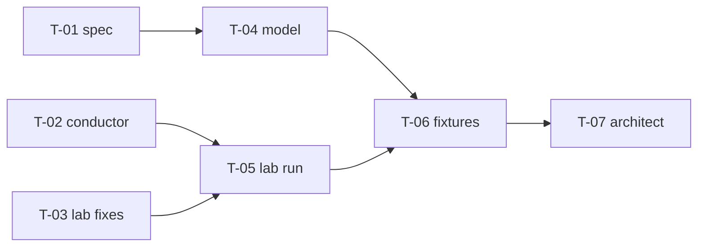

# WP-01 S2 — Client part of the legacy fixtures

Sprint record for WP-01 ([Upstream evidence](/engineering/plan/work-packages#wp-01)), sprint 2 of the client part (H-110). A new session reads this page first and continues from it.

**Status:** <Badge type="info" text="DESIGN" />

[[toc]]

## 0. Header

| Field | Value |
|---|---|
| WP | `WP-01` — Upstream evidence (client part, H-110) |
| Sprint | `S2` |
| Integration branch | `wp/WP-01` (new from `main` after the merge of S1) |
| Base commit | `06b7c7e` (`main`, #7) |
| State | Running (from 2026-11-06) |
| Goal | Every legacy client behavior that G3 checks has a golden fixture: a client part with a generated expected result from a Rivqen client model, checked offline against the stored upstream client traces. WP-01 is complete after this sprint |

## 1. Kickoff

Kickoff on 2026-11-06. S1 is merged into `main` (`06b7c7e`, #7). This sprint continues the [S1 record](/engineering/plan/sprints/WP-01-S1) (§5 follow-ups); the decisions H-118…H-121 and DL-099…DL-109 stay in force. H-121: S2 can run in parallel with WP-04.

### Measurements (2026-11-06)

<Badge type="tip" text="FACT" /> Measured on the development Mac before any decision.

| Item | Result |
|---|---|
| Free disk | System data volume 19 GiB (rule: at least 20 GiB). The lab does not use it (DL-102); the largest items there are not Rivqen data (`~/Library/Android` 30 GiB, `~/Library/Caches` 15 GiB, `~/.gradle` 13 GiB). `BackCat` 312 GiB |
| Stored client traces | `evidence/traces/client/`: 20 scenarios, 40 modes, 119 runs; 214 function cases each for Android and iOS; `check.mjs`: 0 errors |
| Events in run 1 of each mode | Client actions: `proxy.request` 72, `client.intercept` 70, `session.result` 70, `session.message` 49, `cache.snapshot` 46, `client.load_url` 42, `client.load_data` 30, `runtime.*` 78. SDK internals: `session.callback` 418 (`onSessionStateChange` 138), `session.created` 72 |
| Server part of the fixtures | `fixtures/legacy`: 173 fixtures (61 canonical, the rest profile overrides); model and generator in `tools/legacy-fixtures` (1 317 lines of code, 1 754 lines of tests) |
| RQP client cases | `fixtures/rqp/protocol/FX-RQ-C*`: `kind: "client"`, one response, a client context, a generated result. One exchange only: no timing |
| Lab | Rebuild from S1 numbers: `env.sh` 52 s, first Gradle build 53 s, `$LAB_HOME` 5.4 GiB on `BackCat`; `run.mjs --all` 607 s |

### What exists

| Item | Path | State |
|---|---|---|
| Client behavior, Quick and Standard | [Legacy client](/engineering/protocol/legacy-client) §2–§3 | Usable: rows Q1–Q22, S1–S18; 7 rows RESEARCH (not reached) |
| Client divergences and their canonical values | [Divergences](/engineering/protocol/legacy-divergences) §2 | Usable: D-20…D-52, canonical value for every divergence (DL-105…DL-109) |
| Rivqen session rules | [Session FSM](/engineering/core/session-fsm), [cache identity](/engineering/cache/identity) | Partial: presentation policy Quick and Standard; a partition change cancels the sessions of the old partition (identity item 4, FSM-01); the DL-107 transitions come in WP-08 |
| Client traces and function results | `evidence/traces/client/` | Usable |
| Lab | `tools/upstream-lab/client`, `android`, `ios` | Usable; deleted after S1, rebuild needed for new runs |
| Server model, generator, checks | `tools/legacy-fixtures` | Usable: profiles `legacy-canonical`, `legacy-java`, `legacy-node`, `legacy-php`; override checks `OVERRIDE_NOT_NEEDED` and `OVERRIDE_MISSING` |
| Client part of the fixtures | — | Missing |
| Catalog rows `FX-LEG-INTERRUPTED`, `-CONCURRENT`, `-AUTH-CHANGE`, client part of `-COOKIE-VARIANCE` | [Fixtures](/engineering/protocol/fixtures) | Missing (evidence CS-13a/b, CS-15, CS-16, CS-17) |

### What is needed

| Item | Gap | Approach |
|---|---|---|
| Client part of the legacy fixtures (DL-101) | No format, no model, no check | Spec commit with the format (DL-110…DL-112). A Rivqen JavaScript client model in `tools/legacy-fixtures` with the profiles `legacy-canonical` and `legacy-android`. `gen.mjs` writes the client part of `expected.json` and checks every `legacy-android` result against the stored trace in the outcome projection (DL-104) |
| Function fixtures | 214 cases per platform exist only as evidence | Function fixtures per profile (`legacy-canonical`, `legacy-android`, `legacy-ios`), checked against `functions.jsonl` |
| Catalog rows | Four rows have evidence only | One client fixture per row and mode, canonical plus `legacy-android` override where the trace differs |
| Rows not reached in S1 | Q3, Q9, Q11, Q13, Q16, S4, the `store` form of S8, S10, S12, S16; D-30, D-47, D-48 | A `set_field` fault step and an empty lab page; a new lab run (H-122) |
| S1 review findings | 5 recorded | Fix in the owning lane; rebuild the lab to check the `RecordingStream` fix |
| One-run modes | `check.mjs` lists a mode with 1 run as stable | Status "not checked" for a mode with fewer than 2 runs |
| WP end | — | WP acceptance check, MR text |

### Architect decisions

| ID | Decision |
|---|---|
| DL-110 | **What a client fixture compares** (the observable projection). The requests (legacy fields), the web view actions in main-thread order (`load_url`, `load_data` with base URL and body hash, the answer to an intercepted request: status, fields, body hash, complete or cut), the page messages (JSON without `local_refresh_time`), the final codes, the cookie calls, and the cache after the session as an abstract record (present or not, etag, template tag, page hash, data hash, stored fields). Not compared: SDK callbacks, SDK states, threads, file names and file layout (D-42 is not reproduced) |
| DL-111 | **Profiles of the client part**, as the server part: `legacy-canonical` is the Rivqen rule (DL-105…DL-109, session FSM, cache identity); `legacy-android` is an override fixture where the upstream trace differs, checked against the trace; `OVERRIDE_NOT_NEEDED` and `OVERRIDE_MISSING` apply. iOS has function fixtures only (`legacy-ios`, H-119) |
| DL-112 | **Layout** (refines DL-101): client fixtures are fixture directories in `fixtures/legacy` with `kind: "client"` (as the RQP client cases), because a session has several exchanges and a server fixture has one. The client case names its exchanges by page and application response; the server responses come from the server model of the named server profile (`legacy-node` or `legacy-java` for a trace-backed fixture, as the lab origin; `legacy-canonical` otherwise). The schedule uses the step words of the lab contract (CONTRACT §3) |

### Risks and questions

| ID | Risk or question | Class | Owner | State |
|---|---|---|---|---|
| H-122 | New lab run in S2 for the rows that S1 did not reach | Human (scope, schedule) | Human | Decided (2026-11-06): **a lab run in S2** with a `set_field` step and an empty page; the same run checks the `RecordingStream` fix; the lab is deleted after it |
| H-123 | System data volume below the 20 GiB rule (19 GiB) | Human (machine) | Human | Decided (2026-11-06): the human freed space; 33 GiB free after it |
| H-124 | Legacy client cookie flow and Vary in the cache key (HQ-1: P-02, P-03) | Human (security) | Human | Decided (2026-11-07): **A**: the cookie is read before each request; every `Set-Cookie` goes to the cookie store and never to the web view or the cache; `Vary` names count except `accept-diff`, `if-none-match`, `template-tag` (CL-11, CL-12) |
| H-125 | A normal load where upstream leaves a partial or old page (HQ-2: P-10, P-17, P-18) | Human (compatibility) | Human | Decided (2026-11-07): **A**: a normal load after a cut stream, a reload for a template change in a refresh, the page callback dropped at a reload (CL-23, CL-33, CL-35) |
| H-126 | Q11, Q19 and S16 not reached by the first S2 lab run (CS-26 reached Q10/S7, CS-27 got a `304`) | Human (scope) | Human | Decided (2026-11-07): **reach them in S2**: CONTRACT steps `set_body_member` and `case`, a fixed `first_load` macro (two settles), conductor code, new scenarios and a second lab run (lane L7) |
| R-1 | The canonical client model becomes a second design of the session FSM before WP-08 | Architect | Architect | Open: the model covers only the legacy rows; a row that the FSM page does not define gets a four-part record, or goes to the human when it touches security or compatibility (H-120) |
| R-2 | A schedule that only a script makes (DL-100) becomes a canonical rule | Architect | Architect | Open: canonical fixtures name the order as an input; the CS-19 smoke run shows the common order |
| R-3 | Clean-room: the model follows the upstream code too closely | Architect | Architect | Open: the model is written from the FACT rows of the Rivqen pages, not from upstream code; `upstream:` references only |
| R-4 | Two catalog behaviors without a canonical rule yet (`CONCURRENT`: second session for one key; the cookie flow of `COOKIE-VARIANCE`) | Architect | Architect | Open: four-part record in the spec task |

## 2. Plan

Planned on 2026-11-06 (`/sprint-plan WP-01`; H-122 and H-123 answered).

### Contracts (architect, before lanes start)

- `tools/upstream-lab/client/CONTRACT.md` (S2 update): the conductor step `set_field`; an empty lab page; the `first_load` macro waits for the end of the body; a mode with fewer than 2 runs has the status "not checked"
- DL-110…DL-112 (this record §1): what a client fixture compares, the profiles, the layout. T-01 writes the field-level format from them; the architect reviews it before T-04 and T-06 start

### Tasks

| ID | Title | Tier | Lane | Depends on | State |
|---|---|---|---|---|---|
| T-01 | Client fixture format and the canonical client rules (spec commit) | Senior | L1 | — | Done |
| T-02 | Conductor: `set_field`, empty page, `first_load` fix, review fixes, one-run status, new scenarios | Middle | L2 | — | Done |
| T-03 | Android and iOS lab fixes (`RecordingStream` digest race, `%.17g` `nan`) | Senior | L3 | — | Done |
| T-04 | Client model, trace projection and generator checks in `tools/legacy-fixtures` | Senior | L4 | T-01 | Planned |
| T-05 | Lab run: new scenarios, reruns, stored evidence, row status | Senior | L5 | T-02, T-03 | Planned |
| T-06 | Client fixtures: catalog rows, scenario fixtures, function fixtures | Middle | L6 | T-04, T-05 | Planned |
| T-07 | Offline checks, provenance, cleanup, shared pages, WP acceptance | Architect | — | T-06 | Planned |



### Briefs

```yaml
id: WP-01/S2/T-01
title: Client fixture format and the canonical client rules
tier: senior
goal: A person can write the client part of a legacy fixture and know its canonical expected result from the pages alone.
source_of_truth:
  - DL-101, DL-104, DL-110, DL-111, DL-112; DL-105…DL-109 (canonical values)
  - docs/engineering/protocol/legacy-client.md (rows Q1–Q22, S1–S18, M-01–M-16)
  - docs/engineering/core/session-fsm.md, docs/engineering/cache/identity.md (partition change: identity item 4, FSM-01)
  - tools/upstream-lab/client/CONTRACT.md §3 (step words), §6 (outcome projection)
owns:
  - fixtures/legacy/README.md (new section "Client fixtures"; the server sections stay as they are)
  - docs/engineering/protocol/fixtures.md (§1 format of the client part; the catalog rows INTERRUPTED, CONCURRENT, AUTH-CHANGE, COOKIE-VARIANCE: rule column only)
  - docs/engineering/protocol/legacy-client.md (new section "Rivqen canonical client rules", CL-01…; no change to the upstream rows)
reads: [docs/engineering/protocol/*, docs/engineering/core/*, docs/engineering/cache/*, fixtures/legacy/**, fixtures/rqp/protocol/FX-RQ-C*, evidence/traces/client/**]
contracts: [rule IDs CL-01… are stable once published; T-04 and T-06 cite them]
acceptance:
  - case.json of kind client: profile, mode, server profile, exchanges (page and app response, or a named server fixture), cache before, schedule in CONTRACT §3 step words, optional trace (scenario, mode); every member with type and rule
  - expected.json client member: the DL-110 projection with exact field names and order; how the outcome projection (DL-104) turns it into a comparison with a trace
  - function fixtures: layout, one file per profile or one case per directory, the input and result form for each function of tools/upstream-lab/client/functions.json
  - canonical rules CL-01…: one rule per behavior that a fixture can check (each Q and S row, each M row, each D-20…D-52 canonical value, the four catalog rows); each rule names its source (DL, FSM, identity) or is a four-part record proposal for the architect; a rule that touches security or compatibility is listed as a human question (H-120), not decided
  - R-4: proposals for CONCURRENT (second session for one key) and the cookie flow of COOKIE-VARIANCE
  - the rules use no upstream code shape (R-3): Rivqen terms and observable effects only
checks: [npm run docs:build]
docs: [the owned pages]
non_goals: [model code, fixture files, lab code, decision-log rows (the architect writes them from the proposals)]
security: [no upstream code or comments (CR-02, CR-03); partition and cookie rules fail closed]
```

```yaml
id: WP-01/S2/T-02
title: Conductor — set_field, empty page, first_load, review fixes, one-run status, new scenarios
tier: middle
goal: The conductor can drive the rows that S1 did not reach, and the S1 review findings of the conductor are fixed.
source_of_truth: [tools/upstream-lab/client/CONTRACT.md (S2 update), S1 record §4 (review findings), legacy-client.md rows Q3, Q9, Q11, Q13, Q16, S4, S8, S10, S12, S16, divergences D-30, D-47, D-48]
owns:
  - tools/upstream-lab/client/** except CONTRACT.md
  - tools/upstream-lab/pages/empty.html (new, 0 bytes)
  - tools/upstream-lab/node/control.cjs and its test, only if an empty page needs a change there
reads: [evidence/traces/client/**, tools/upstream-lab/android/README.md (config keys), docs/engineering/protocol/legacy-client.md]
contracts: [tools/upstream-lab/client/CONTRACT.md]
acceptance:
  - set_field replaces every line of the response field name with one line name: value before delivery; the trace keeps both forms; tests proxy_set_field_replaces_all_lines, proxy_set_field_adds_missing_field
  - first_load waits for the end of the body before client_ready (fixed setup order); test first_load_waits_for_body_end
  - review fixes, one test each: a long-poll answer that the harness did not get is sent again (control_long_poll_redelivers_lost_answer); the message normalization compares the JSON text after the key removal, not parsed values that hide a type change (normalize_message_keeps_value_types); fields listed in Connection are not forwarded (proxy_drops_connection_listed_fields)
  - check.mjs: a mode with fewer than 2 runs is "not checked", not "stable"; run.json gets a list not_checked; test check_one_run_is_not_checked
  - scenarios.json: new scenarios for Q3 and S12 (empty page), Q9, Q13, S10 and the store form of S8 (set_field cache-offline store), D-30 (set_field cache-offline in other case: HTTP, Store, TRUE), Q11 (set_field html-sha1 to a wrong value), S16 (refresh during a template change), D-47 and D-48 if a new step reaches them; each with rows and repeat 3
  - the stored evidence still passes check.mjs (the run.json of S1 is migrated: CS-19 to not_checked)
tests:
  unit: [node --test tools/upstream-lab/client/test]
  mutation: Stryker on the changed lines of tools/upstream-lab/client/src, kill rate >= 80 %; only when the architect gives the slot; foreground; git status after it
checks: [node --test "tools/upstream-lab/client/test/*.test.mjs", node tools/upstream-lab/client/check.mjs evidence/traces/client --require-functions]
docs: [tools/upstream-lab/client/README.md]
non_goals: [Android or iOS code, real runs, fixtures]
security: [loopback only; synthetic values; bounded buffers]
```

```yaml
id: WP-01/S2/T-03
title: Android and iOS lab fixes
tier: senior
goal: The two lab findings of the S1 review outside the conductor are fixed.
source_of_truth: [S1 record §4 (review findings), tools/upstream-lab/client/CONTRACT.md §5, §7]
owns: [tools/upstream-lab/android/**, tools/upstream-lab/ios/**]
reads: [$UPSTREAM sources read-only when the architect provides the clone; not needed for these fixes]
acceptance:
  - RecordingStream: the body digest and the logged event are complete and written once when close and the last read race; the fix is a lock or a single owner of the digest, not a sleep; a JVM unit test with two threads if the build allows it, else a reasoned note for the T-05 run
  - iOS runner: a double that is not finite is written as a JSON string ("nan", "inf", "-inf") or as an error case, never as a bare token; JSON output stays valid (test case in samples/cases.json)
  - build.sh of both labs still pass (Android build only if $LAB_HOME exists; else T-05 builds it)
checks: [sh tools/upstream-lab/ios/build.sh, sh tools/upstream-lab/ios/run.sh on samples/cases.json]
non_goals: [new harness steps unless T-02 needs one (shared-file request), real runs]
security: [no change to upstream; no field writes (CONTRACT §7)]
mutation: not applicable (lab code); record it
```

```yaml
id: WP-01/S2/T-04
title: Client model, trace projection and generator checks
tier: senior
goal: gen.mjs writes the client part of every client fixture from a Rivqen client model and proves each legacy-android result against the stored trace.
source_of_truth: [the T-01 format and rules CL-01…, DL-104, DL-110…DL-112, tools/legacy-fixtures (server model and checks)]
owns: [tools/legacy-fixtures/** (new files src/client*.mjs, src/client-trace.mjs, src/functions*.mjs; changes to gen.mjs, fixture.mjs, README.md; tests)]
reads: [evidence/traces/client/**, fixtures/legacy/**, tools/upstream-lab/client/src/determinism.mjs (reuse by import, not copy)]
acceptance:
  - model run(profile, mode, case) returns the DL-110 projection for legacy-canonical and legacy-android; it never throws for a case of any shape (a bad case is a case error with a code)
  - trace projection: a stored run becomes the DL-110 projection; the outcome projection of DL-104 compares model and trace; the comparison is reused from determinism.mjs
  - gen.mjs: writes the client member; checks current files, trace equality, OVERRIDE_NOT_NEEDED, OVERRIDE_MISSING, the rule names CL-…, function fixtures against functions.jsonl; every stored client run is used by a fixture or listed with a reason
  - server part unchanged: the 173 server fixtures stay byte-equal (gen.mjs --check)
  - tests for each rule CL-… that the model implements; property test: the model result is the same for equal cases in any key order
tests:
  unit: [cd tools/legacy-fixtures && npm test]
  mutation: Stryker on the changed lines of tools/legacy-fixtures/src, kill rate >= 80 %; architect slot; foreground; git status after it
checks: [cd tools/legacy-fixtures && npm test, node tools/legacy-fixtures/gen.mjs --check]
docs: [tools/legacy-fixtures/README.md (client model, checks, exit codes)]
non_goals: [fixture case files (T-06, except test samples under test/), lab code]
security: [no upstream code shape (R-3): write the model from CL-… rules and the FACT rows]
```

```yaml
id: WP-01/S2/T-05
title: Lab run — new scenarios, reruns, stored evidence
tier: senior
goal: The rows that S1 did not reach are observed on the API 28 emulator, and the S2 lab fixes are proven by a run.
source_of_truth: [tools/upstream-lab/client/CONTRACT.md, the T-02 scenarios, H-122, DL-102]
owns: [evidence/traces/client/**, docs/engineering/protocol/legacy-client-traces.md, status cells of the Q and S rows and of D-30, D-47, D-48]
reads: [all lab parts; the upstream clone in the scratchpad (architect provides it)]
acceptance:
  - $LAB_HOME on BackCat; system volume >= 20 GiB free before and after (df in the report)
  - the new scenarios with 3 runs per mode; CS-13a and CS-13b rerun to prove the RecordingStream fix; the S1 runs stay unless a fix changes their projection (then rerun the mode and say why)
  - check.mjs passes; each new row FACT (stable in the outcome projection) or RESEARCH with the observed variants
  - the report page and the row status cells updated; the probable defects of S1 noted again if a new run shows them
  - after the run: clean.sh; the architect deletes the clone, containers and images
checks: [node tools/upstream-lab/client/check.mjs evidence/traces/client --require-functions, npm run docs:build]
non_goals: [fixtures, canonical values]
security: [review stored evidence for real hosts, accounts, cookies before commit]
```

```yaml
id: WP-01/S2/T-06
title: Client fixtures
tier: middle
goal: The catalog rows and every trace-backed scenario mode have client fixtures, and the pure-function divergences have function fixtures.
source_of_truth: [the T-01 format and rules, the T-04 generator, evidence/traces/client/**]
owns: [fixtures/legacy/FX-LEG-CL-* (new client fixture directories), fixtures/legacy/functions/** (if T-01 puts the function fixtures there), docs/engineering/protocol/fixtures.md (catalog State column)]
reads: [everything in the sources]
acceptance:
  - FX-LEG-INTERRUPTED, -CONCURRENT, -AUTH-CHANGE and the client part of -COOKIE-VARIANCE exist for Quick and Standard
  - each scenario mode of evidence/traces/client (CS-19 excepted: smoke run) has a canonical client fixture and a legacy-android override where the trace differs
  - function fixtures for each case of functions.json in each profile
  - every CL-… rule is covered by a fixture
  - case.json written by hand from the format; expected.json only by gen.mjs; never a change to a fixture to make the model pass (a model error goes to L4)
checks: [node tools/legacy-fixtures/gen.mjs --check, cd tools/legacy-fixtures && npm test]
non_goals: [model code, lab code]
security: [synthetic accounts and cookies only]
```

```yaml
id: WP-01/S2/T-07
title: Offline checks, provenance, cleanup, shared pages, WP acceptance (architect)
tier: architect
acceptance:
  - tools/fulltest.sh and CI run the client checks of gen.mjs --check and the new tests (DL-103)
  - docs/legal/provenance.md: the S2 lab run and the model rule (R-3)
  - decision-log rows from the T-01 proposals; human questions asked
  - cleanup: clean.sh, containers, images, clone; df recorded
  - status.md, work-packages.md (WP-01 Done after the merge), sprint index, sidebar
  - WP acceptance check with evidence; MR text to the human
```

### Ownership

| Lane | Tier | Owns | Reads |
|---|---|---|---|
| L1 spec | Senior | `fixtures/legacy/README.md` (client section), `docs/engineering/protocol/fixtures.md` (§1 client format, rule column of four rows), `legacy-client.md` (new canonical rules section) | Protocol, core and cache pages; fixtures; traces |
| L2 conductor | Middle | `tools/upstream-lab/client/**` except `CONTRACT.md`; `tools/upstream-lab/pages/empty.html`; `tools/upstream-lab/node/control.cjs` only for the empty page | Traces, Android README |
| L3 lab fixes | Senior | `tools/upstream-lab/android/**`, `tools/upstream-lab/ios/**` | CONTRACT |
| L4 model | Senior | `tools/legacy-fixtures/**` | Traces, fixtures, `determinism.mjs` |
| L5 lab run | Senior | `evidence/traces/client/**`, `legacy-client-traces.md`, status cells of the Q, S and D rows | All lab parts |
| L6 fixtures | Middle | `fixtures/legacy/FX-LEG-CL-*`, function fixture files, `fixtures.md` State column | All of the above |

Shared files (architect only): `tools/upstream-lab/client/CONTRACT.md`, `docs/.vitepress/config.mts`, `docs/engineering/plan/decision-log.md`, `docs/engineering/plan/open-questions.md`, `docs/legal/provenance.md`, `tools/fulltest.sh`, `.github/workflows/**`, `.gitignore`, `docs/guide/status.md`, `docs/engineering/plan/work-packages.md`, the sprint index, this record.

Order: L1, L2, L3 start together. L4 starts after the architect reviews the T-01 format. L5 starts after L2 and L3 are integrated. L6 starts after L4 and L5. `fixtures.md` is edited by L1 first (format, rule column) and by L6 later (State column), never at the same time.

Load rule: one emulator and one mutation run at a time on the Mac. The architect gives each lane its Stryker slot.

### Exit criteria

- [ ] All tasks done or moved with a reason
- [ ] All tests green (full repository run)
- [ ] Mutation kill rate ≥ 80 % on the changed lines of `tools/legacy-fixtures/src` and `tools/upstream-lab/client/src` (the Android and iOS lab code: not applicable, recorded)
- [ ] `/code-review` findings fixed or recorded
- [ ] Docs updated; site builds
- [ ] Every catalog row has a client fixture in both modes; every stored scenario mode (CS-19 excepted) has a client fixture; every pure-function case has a function fixture per profile
- [ ] `gen.mjs --check` proves every `legacy-android` override against its trace; the 173 server fixtures are unchanged
- [ ] The rows Q3, Q9, Q11, Q13, S10, S12, S16 and D-30, D-47, D-48 are FACT or RESEARCH with observed variants
- [ ] No upstream code copied or used as the shape of the model (R-1, R-3)
- [ ] Lab deleted: clone, containers, images, `$LAB_HOME`; system volume ≥ 20 GiB free
- [ ] WP-01 acceptance checked; MR text given to the human


## 3. Progress log

| Date | Event |
|---|---|
| 2026-11-06 | `wp/WP-01` recreated from `main` (`06b7c7e`); kickoff; DL-110…DL-112; H-122 (lab run in S2) and H-123 (disk freed, 33 GiB) decided by the human |
| 2026-11-06 | Plan: T-01…T-07 in lanes L1…L6; CONTRACT S2 update (`set_field`, empty page, fixed `first_load`, not checked) |
| 2026-11-07 | L3 integrated (T-03, 3368969): `RecordingStream` keeps its count and digest in `TallyStream` under one lock, and the last read or the close writes the event once (11 plain JVM checks incl. a 3000-round race; 9 of 10 hand faults killed, 1 equivalent); the iOS runner writes a result with a number that is not finite as an `error` record (29 checks; 8 of 8 hand faults killed). Builds with `UPSTREAM` wait for T-05. New `fulltest.sh` group `lab` (local only; the iOS check takes about 30 s, because macOS checks the new binary at its first start) |
| 2026-11-07 | L2 integrated (T-02, 5ab6dba): `set_field`, page `empty`, fixed `first_load`, the three conductor review fixes (long-poll repeat, message normalization by text, `Connection`-listed fields), status "not checked" (CS-19 migrated in `run.json`), 10 new scenarios CS-20…CS-27 (Q3, S12, Q9/S8, Q13/S10, D-30 ×3, Q16/S4 with D-47, Q11, Q19/S16); 187 tests; Stryker on the changed lines 95.8 % (235 of 246; 11 survivors, 8 equivalent or defensive, 3 covered by later tests). Architect: the harness ignores a repeated step `seq` (`ScenarioRun`; built in T-05); CONTRACT §4, §5, §8 updated |
| 2026-11-07 | L1 integrated (T-01, c73b6c5): client fixture format (`fixtures/legacy/README.md`, fixtures §1.2), canonical client rules CL-01…CL-43 with a row map and the expected results of CS-01…CS-18 (legacy client §9). Architect: DL-113…DL-118 from the proposals, DL-107 amended (absent `cache-offline`, DL-114). Human: H-124 **A** (cookie read before each request, `Set-Cookie` never stored, `Vary` in the key except the three legacy fields), H-125 **A** (normal load after a cut stream, reload in a refresh, callback dropped at a reload) |
