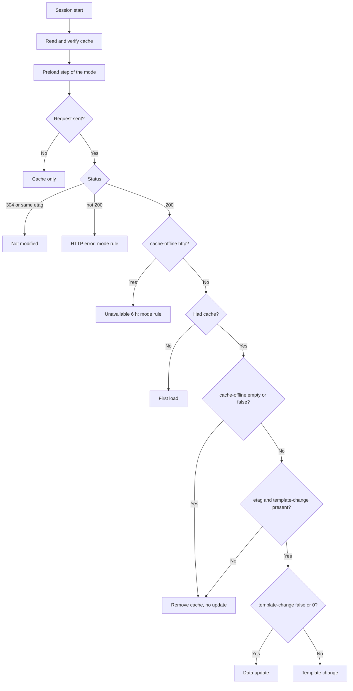

# Legacy protocol: client behavior

::: warning Legacy mode — temporary
This page describes the **legacy mode** (compatibility with the VasSonic legacy protocol). It ships as an optional module, is **deprecated from 1.0** and is **removed in 1.5**. New integrations use the [Rivqen protocol](/engineering/protocol/markup). See [Modes and legacy deprecation](/engineering/protocol/versioning).
:::

This page specifies the observable behavior of a legacy protocol client: session identity, the session flow, Quick and Standard modes, result codes, and how the page receives data updates.

**Status:** <Badge type="tip" text="FACT" /> from the upstream Android and iOS clients at `59936bef`, code reading (WP-02 S1; checked again row by row in WP-01 S1 T-01). <Badge type="warning" text="RESEARCH" /> A row that depends on the order of independent events (client ready, the intercepted request, the network head, the end of the body) is RESEARCH until a client trace with a controlled order confirms it (WP-01 S1 T-05). A trace overrides code reading.

Paths below are relative to `upstream:sonic-android/sdk/src/main/java/com/tencent/sonic/sdk/` unless they start with `sonic-iOS/`. Short names in the tables:

| Short | File |
|---|---|
| `QSS` | `QuickSonicSession.java` |
| `STD` | `StandardSonicSession.java` |
| `SS` | `SonicSession.java` |
| `SV` | `SonicServer.java` |
| `SU` | `SonicUtils.java` |
| `SE` | `SonicEngine.java` |
| `CFG` | `SonicSessionConfig.java` |
| `SC` | `SonicConfig.java` |
| `STR` | `SonicSessionStream.java` |

[[toc]]

## 1. Session identity

Upstream derives a **session id** from the URL. The id names the cache files.

| Step | Android (`SonicRuntime.java:75-113`) | iOS (`sonic-iOS/Sonic/Util/SonicUtil.m:31-106`) |
|---|---|---|
| Base | `authority` (host and port) + `path` | `scheme://host` + `path` (no port) |
| Query parameters kept | Names that start with `sonic_`, plus names listed in `sonic_remain_params` (`;`-separated) | Same rule, but only if the raw URL string contains `sonic_` somewhere; else no parameter is kept |
| Order of kept parameters | Sorted by name (`TreeSet`) | Dictionary order (not defined) |
| Kept parameter format | `name` + `value`, no separator; first value, percent-decoded | `name=value&`, after a `/`; last value, not decoded |
| Other query parameters | **Ignored** | **Ignored** |
| Hash | MD5, lowercase hex | MD5 of the UTF-8 bytes, lowercase hex |
| Account | If `IS_ACCOUNT_RELATED` (default `true`, `CFG:56`): `<account>_` + MD5, the account in **clear text** outside the hash (`SonicRuntime.java:104-109`) | If an account is set: MD5 of `<account>_<base>`, the account **inside** the hash (`SonicUtil.m:31-39`) |

Details:

1. <Badge type="tip" text="FACT" /> Android: an account of `null` gives the prefix `null_`, an empty account gives `_` (string concatenation at `SonicRuntime.java:106`). iOS ignores an empty account when it is set, so a set account cannot be cleared to empty (`sonic-iOS/Sonic/Engine/SonicEngine.m:85-98`).
2. <Badge type="tip" text="FACT" /> Android hashes the bytes of the platform default charset (`SU:697-707`). <Badge type="warning" text="RESEARCH" /> The Android default charset is UTF-8; the T-04/T-05 function runs confirm it.
3. <Badge type="warning" text="RESEARCH" /> Neither SDK changes the case of the host. Whether `Uri.getAuthority` (Android) or `NSURL.host` (iOS) does is platform behavior; the function runs settle it.
4. The exact rules of each platform and their edge cases are in [divergences](/engineering/protocol/legacy-divergences#_2-client-divergences) D-20 and D-21.

::: danger Consequences that Rivqen must not copy silently
1. Two URLs that differ only in a normal query parameter (for example `?id=1` and `?id=2`) share one session id and one cache entry, unless the page lists the parameter in `sonic_remain_params`.
2. On Android, `http` and `https` versions of a URL share one id (the scheme is not part of it).
3. On Android, the account string appears in clear text in cache file names (`SonicFileUtils.java:104-133`).
:::

**Rivqen rule:** the legacy session id is computed exactly as upstream **only** to build compatible request state (validators). The Rivqen [cache key](/engineering/cache/identity) is separate and always includes the partition and the full canonical URL. <Badge type="info" text="DESIGN" />

## 2. Session flow

This section describes the Android SDK. The iOS SDK has no Quick or Standard mode; its differences are in [divergences](/engineering/protocol/legacy-divergences#_2-client-divergences) §2.

### 2.1 Upstream state model

<Badge type="tip" text="FACT" /> An upstream session has **four states** only: none (`0`), running (`1`), ready (`2`) and destroy (`3`) (`SS:97-123`). Both modes share them.

| State | Entered when | Evidence |
|---|---|---|
| none | The session is created | `SS:262` |
| running | `start()` (from none) or `refresh()` (from ready) | `SS:504-529`, `SS:583-617` |
| ready | The session data can answer the intercepted request. The flow sets it at its end; a mode can set it earlier to wake a waiting intercept. Standard sets it at once when a cache exists | `SS:571-572`, `STD:200-208` |
| destroy | `destroy()` succeeds, at once or after the session thread and file saves end (force after 6 s) | `SS:1383-1442` |

The state change is a compare-and-set that wakes a waiting intercept (`SS:944-955`). The engine tracks only running (adds the session to its running map) and destroy (removes it) (`SE:361-374`). Ready does not mean "page shown".

Boolean flags carry the rest of the behavior (`SS:262-315`, `QSS:136-141`):

| Flag | Meaning |
|---|---|
| `wasInterceptInvoked` | The WebView asked for the main document through the client |
| `clientIsReady` | The app called `clientReady()` (Quick uses it as a gate) |
| `wasLoadUrlInvoked` (Quick) | The session called `loadUrl` |
| `wasLoadDataInvoked` (Quick) | The session gave the cached page to the client as data |
| `wasOnPageFinishInvoked` | The app reported page finish for the session URL |
| `clientIsReload` | `refresh()` started the current flow |
| `isWaitingForSessionThread`, `isWaitingForSaveFile`, `isWaitingForDestroy` | Block or delay `destroy()` |
| `wasNotified` | Logging only; it never blocks a notification |

Result codes start at `-1` (`SS:195`, `SS:207`).

### 2.2 Common steps

The flow runs on the session thread (`SS:504-580`).

<Badge type="tip" text="FACT" /> Rules from the code:

| # | Rule | Evidence |
|---|---|---|
| F1 | The cache is verified before use: metadata needs an etag and an HTML SHA-1, the file must not be empty, and its SHA-1 (or size) must match. On failure the cache is removed and the flow runs as "no cache" | `SonicCacheInterceptor.java:68-115` |
| F2 | The mode's preload step runs before any network (Quick: a message to show the cache or call `loadUrl`; Standard: the cached page becomes the pending intercept stream) | `SS:543-548`, `QSS:390-408`, `STD:200-216` |
| F3 | No request is sent when the network is not valid, or when `SUPPORT_CACHE_CONTROL` is on (default off, `CFG:72`) and the cache is still fresh. Only the preload step acts; result codes stay `-1` | `SS:552-566`, `SS:663-674` |
| F4 | A `200` whose etag equals the request etag is handled as `304` | `SV:122-127` |
| F5 | A connection error and a status other than `200` or `304` take the same branch | `SS:679-681`, `SS:718-724`, `SonicSessionConnection.java:457-483` |
| F6 | `cache-offline: http` (any case) makes the session id unavailable for 6 h (`SC:30`): `createSession` returns `null` in that time. The mode acts only if a cache existed | `SS:729-745`, `SE:198-214`, `SE:283-292` |
| F7 | With a cache: `cache-offline` absent, empty or `false` (any case) removes the cache and delivers no update | `SS:753-758` |
| F8 | With a cache: a missing etag or `template-change` removes the cache and delivers no update | `SS:760-769` |
| F9 | `template-change` values `false` and `0` (exact case) mean data update; every other value means template change | `SS:771-776` |
| F10 | `Set-Cookie` of every response status goes to the runtime before the status branch (section 2.9) | `SS:679-694` |
| F11 | A `sonic-link` response header starts the subresource preload | `SS:704-709` |
| F12 | The cache is written only when `cache-offline` is exactly `true` or `store` and, with `SUPPORT_CACHE_CONTROL`, no `no-cache`, `no-store` or `must-revalidate` | `SU:575-593` |
| F13 | Default timeouts: connect 5 s, read 15 s; the intercept waits at most 30 s for the session | `CFG:30-35`, `QSS:456-471`, `STD:159-174` |
| F14 | The `false` branches in the template-change handlers of both modes are never reached, because F7 returns first | `QSS:582-584`, `STD:297-299` |

### 2.3 Client surface

<Badge type="tip" text="FACT" /> The SDK imports no WebView class. The app implements the abstract client; every page action is a call on it (`SonicSessionClient.java:94-132`).

| Session calls on the client | Quick | Standard |
|---|---|---|
| `loadUrl(url, extras)` | `QSS:212, 227, 243, 334, 356, 376` | `STD:84, 96, 124` |
| `loadDataWithBaseUrlAndHeader(...)` | `QSS:253, 289, 328, 359, 371` | Never |
| `loadDataWithBaseUrl(...)`, `clearHistory()` | Never | Never |

| App calls | Effect | Evidence |
|---|---|---|
| `SonicEngine.createSession(url, config)` | Creates the session or takes a preloaded one; starts it if `AUTO_START_WHEN_CREATE` (default on) | `SE:198-214`, `CFG:67` |
| `session.bindClient(client)` | The first client wins | `SS:1187-1195` |
| `client.clientReady()` | Quick: opens the gate (section 3.1); Standard: starts if needed and calls `loadUrl` | `QSS:426-439`, `STD:119-130` |
| `client.requestResource(url)` | The main URL (host and path, any case, no query or scheme) goes to the session; other URLs go to the subresource loader | `SS:1213-1228`, `SS:1309-1326` |
| `client.pageFinish(url)` | Sets `wasOnPageFinishInvoked`; only the template-change read uses it | `SS:1293-1300` |
| `client.getDiffData(callback)` | Stores the page callback and sends the result again | `QSS:410-424`, `STD:132-146` |
| `session.refresh()` | Ready to running; resets the intercept flag and the codes; sets `clientIsReload` | `SS:583-617` |
| `session.destroy()` | Section 2.6 | `SS:1379-1442` |

### 2.4 Result notification

<Badge type="tip" text="FACT" /> The session stores the source and final codes, then calls the page callback only if the call asks for it ("notify") and the page already called `getDiffData` (`SS:1086-1185`). Otherwise the page gets the result when it calls `getDiffData`.

1. A final code `-1` sends nothing.
2. Final code `200`: the stored diff must carry `local_refresh_time`. If not (empty diff), nothing is sent. If the diff is older than **30 s**, nothing is sent (`SS:1111-1129`).
3. During a `refresh()` the callback is delayed so that two callbacks are at least 2 s apart (`SS:1163-1183`).
4. After a send, the stored diff is cleared (`SS:1162`).

<Badge type="warning" text="RESEARCH" /> When the callback runs (the later of the result and `getDiffData`) depends on the order of the events.

### 2.5 Stream cut (`FX-LEG-INTERRUPTED`)

| Point | Behavior | Evidence |
|---|---|---|
| Read error on the session thread, before an intercept | The read returns failure; no stream, no message (Q20, S2). The WebView gets `null` and loads the URL itself | `SV:314-321`, `SV:382-408` |
| Read error while the WebView reads the bridge stream | The read returns the bytes already copied, then the next read throws `IOException` (Q22, S17) | `STR:167-198`, `STR:219-240` |
| Close after an error | The stream reports "not complete"; the session writes no cache | `STR:112-155`, `SV:458-469`, `SS:969-1009` |
| Clean end of stream | Counts as complete; the page is cached if F12 allows it | `STR:177-186`, `SS:984-994` |

<Badge type="warning" text="RESEARCH" /> Whether the platform HTTP stack reports a short body as an error or as a clean end is NOT FOUND in the SDK; T-05 records it.

### 2.6 Destroy during a session

<Badge type="tip" text="FACT" /> `destroy()` (`SS:1383-1442`):

1. Drops the client, closes the pending stream, clears the diff and the Quick pending message.
2. If no session-thread work and no stream-close save is open: state destroy, wakes a waiting intercept, disconnects the server, leaves the running map.
3. Otherwise it waits; a forced destroy follows after 6 s or when the work ends (`SS:928-934`). A forced destroy does not disconnect the server (`SS:1414`).
4. After `destroy()` starts, no message reaches the client (`SS:410-429`). A waiting intercept gets `null` (`QSS:475-488`, `STD:178-195`).
5. The flow checks destroy once, after the connection (`SS:698-702`).
6. The 1.5 s delayed save of a first load or template change does not block destroy and stops if the session is destroyed (`SS:1011-1024`). So a page closed within 1.5 s loses that cache write. The stream-close save blocks destroy (`SS:980-994`). The data-update save runs on the session thread and ends (`QSS:742-762`, `STD:493-515`).

<Badge type="warning" text="RESEARCH" /> A stream set after destroy is dropped by the intercept without a close (possible leak); T-05 scenario CS-18 checks the timing.

### 2.7 Second session for one id (`FX-LEG-CONCURRENT`)

<Badge type="tip" text="FACT" />

| Rule | Evidence |
|---|---|
| Engine entry points are synchronized | `SE:165`, `SE:198`, `SE:301`, `SE:327` |
| `createSession` first takes a preloaded session of the same id (it replaces the URL). A preloaded session older than 3 min, or with another mode or local-server flag, is destroyed | `SE:202-204`, `SE:225-247`, `SS:862-868`, `CFG:45` |
| A running session of the same id makes `createSession` return `null`. The running map loses an id only on destroy, so a ready session also blocks | `SE:257-276`, `SE:361-374` |
| No queue or merge of two sessions exists. The app must load the page without a session | NOT FOUND in the SDK |
| At most 5 preloaded sessions | `SE:174`, `SC:24` |

### 2.8 Account change (`FX-LEG-AUTH-CHANGE`)

<Badge type="tip" text="FACT" /> The id (with the account) is computed once at `createSession` and is final (`SE:200`, `SS:349`). A running session keeps the files and metadata of the old account. A new session gets the new id, so the cache of the other account is not read. A preloaded session of the old account is not picked for the new one; it expires after 3 min. With `IS_ACCOUNT_RELATED` off, all accounts share one cache. No code detects an account change (NOT FOUND).

### 2.9 Cookies (`FX-LEG-COOKIE-VARIANCE`, client part)

<Badge type="tip" text="FACT" />

| Point | Behavior | Evidence |
|---|---|---|
| Request cookie | Read from the runtime when the session is **created** (`GET_COOKIE_WHEN_SESSION_CREATE`, default on); else when the request is built. A preloaded or late session sends the old value | `SS:485-493`, `SS:631-640`, `SC:74` |
| `Cookie` field | Sent only if not empty | `SonicSessionConnection.java:370-375` |
| `Set-Cookie` | For every status (including `304`, errors and `http`), the values go to the runtime | `SS:679-694`, `SS:1250-1269` |
| Thread | In a new thread if an intercept runs at that moment on a thread other than `Chrome_FileThread`; else at once | `SS:1213-1228`, `SS:1239-1241` |
| Headers given to the WebView | `Set-Cookie`, `Cache-Control`, `Expires`, `Etag` and multi-valued fields are removed | `SU:422-443` |
| Cache key | Has no cookie | `SonicRuntime.java:75-113` |

<Badge type="warning" text="RESEARCH" /> Whether WebView subresource requests see cookies that the runtime sets in the new thread depends on timing.

## 3. Quick and Standard modes

The upstream default is **Quick** (`CFG:88`). The engine makes a Quick session for mode `1` and a Standard session for every other value (`SE:257-264`).

| | Quick (`QuickSonicSession`) | Standard (`StandardSonicSession`) |
|---|---|---|
| How the page is loaded | The session calls `loadDataWithBaseUrlAndHeader` with the cached or rebuilt HTML; `loadUrl` when it has no complete page | **Only** `loadUrl`; the document is returned by request interception |
| Cached page display | Given to the client as data when the preload message runs (after `clientReady()`) | Returned as the intercepted response stream; the session is ready at once |
| Response headers for the WebView (CSP etc.) | Passed in the call, but a plain `loadDataWithBaseURL` drops them; upstream itself warns about the security risk (`QSS:40-43`) | Available, because the intercepted response carries headers (`STD:183-186`) |
| Data update delivery | Diff to the page if the cache was **already given as data** (`wasLoadDataInvoked`); otherwise the rebuilt HTML is loaded as data | Diff to the page if the WebView **already intercepted** (`wasInterceptInvoked`); otherwise the rebuilt HTML replaces the pending stream |
| Evidence | `QSS:144-199`, `QSS:238-382` | `STD:74-216` |

::: warning Security note
Upstream itself documents that Quick mode loses response headers such as `Content-Security-Policy` when it loads HTML as data (`QSS:40-43`). Rivqen does not load sensitive pages without their security headers. <Badge type="info" text="DESIGN" />
:::

How to read the tables:

- Each mode has one table in two parts with the same row IDs: part A (input) and part B (result). Row IDs are stable: lab scenarios and fixtures cite them.
- **Order** names the event that comes first when the outcome depends on it.
- **Codes** are `src / final`. "notify" means the result is sent to the page callback at once (section 2.4); "silent" means the page gets it only through `getDiffData`.
- **Write** is the cache write: "1.5 s" = a delayed save task (`SS:1011-1017`); "close" = the save when the WebView closes a stream that it read to the end (`SS:969-1009`); "thread" = files and metadata written on the session thread. Every write also needs F12.
- **Status** is <Badge type="tip" text="FACT" /> when the code settles the row and <Badge type="warning" text="RESEARCH" /> when the order of events or a platform behavior decides it. Lane T-05 adds the trace result.

### 3.1 Quick mode outcomes

<Badge type="tip" text="FACT" /> Gate: until `clientReady()`, Quick keeps the newest preload, first-load, data-update, template-change, error or unavailable message in **one slot**; a newer message replaces the older one (`QSS:156-160`). `clientReady()` handles the slot, or starts the session if nothing is waiting and it has not started (`QSS:426-439`). Result messages (`304`, refresh) are not held. `removeMessages` on the main queue cannot remove a held message (`QSS:495`, `:509`, `:551`, `:624`, `:723`).

**Part A — input**

| ID | Cache | Server | Order | Status |
|---|---|---|---|---|
| Q1 | none | first load | Body complete before the preload `loadUrl` runs | <Badge type="warning" text="RESEARCH" /> |
| Q2 | none | first load | Preload `loadUrl` and intercept first | <Badge type="warning" text="RESEARCH" /> |
| Q3 | none | first load, empty body | Before any intercept | <Badge type="warning" text="RESEARCH" /> |
| Q4 | none | HTTP error or no connection | — | <Badge type="tip" text="FACT" /> |
| Q5 | none | `cache-offline: http` | — | <Badge type="tip" text="FACT" /> |
| Q6 | none | first load, `cache-offline` not `true` or `store` | As Q1 or Q2 | <Badge type="tip" text="FACT" /> |
| Q7 | yes | `304`, or `200` with the request etag | — | <Badge type="tip" text="FACT" /> |
| Q8 | yes | data update | Cache given as data first; diff not empty | <Badge type="warning" text="RESEARCH" /> |
| Q9 | yes | data update with `store`, or diff failed | Cache given as data first | <Badge type="warning" text="RESEARCH" /> |
| Q10 | yes | data update | Network first | <Badge type="warning" text="RESEARCH" /> |
| Q11 | yes | data update, rebuild fails | Network first | <Badge type="warning" text="RESEARCH" /> |
| Q12 | yes | template change, not `store` | Cache given as data first | <Badge type="warning" text="RESEARCH" /> |
| Q13 | yes | template change with `store` | Cache given as data first | <Badge type="warning" text="RESEARCH" /> |
| Q14 | yes | template change | Network first | <Badge type="warning" text="RESEARCH" /> |
| Q15 | yes | HTTP error or no connection | — | <Badge type="tip" text="FACT" /> |
| Q16 | yes | `cache-offline: http` | — | <Badge type="tip" text="FACT" /> |
| Q17 | yes | `cache-offline` absent, empty or `false` | — | <Badge type="tip" text="FACT" /> |
| Q18 | yes | etag or `template-change` missing | — | <Badge type="tip" text="FACT" /> |
| Q19 | any | template change during `refresh()` | — | <Badge type="tip" text="FACT" /> |
| Q20 | none | first load, read error | Before any intercept | <Badge type="tip" text="FACT" /> |
| Q21 | any | no request (F3) | — | <Badge type="tip" text="FACT" /> |
| Q22 | none | first load, read error | During the bridge stream | <Badge type="warning" text="RESEARCH" /> |

**Part B — result**

| ID | Client action | Codes | Write | Lines |
|---|---|---|---|---|
| Q1 | Data: the full page with the response headers (note 1) | 1000 / 304, silent | 1.5 s (note 1) | `QSS:286-291`, `:611-645` |
| Q2 | `loadUrl`; the intercept gets the bridge stream (bytes read so far, then the network) or the full body | 1000 / 1000, notify | close | `QSS:238-247`, `:275-295`, `:441-491` |
| Q3 | None (note 2) | -1 / -1 | none | `QSS:277-283`, `:611-628`; `SV:394-400` |
| Q4 | None; the preload `loadUrl` stands and the intercept gets `null`, so the WebView loads itself (note 3) | -1 / -1 | none | `SS:718-724`; `QSS:493-506` |
| Q5 | None, as Q4; the id is unavailable for 6 h | -1 / -1 | none | `SS:729-745` |
| Q6 | As Q1 or Q2 | As Q1 or Q2 | none | `QSS:636-644`; `SS:984-998` |
| Q7 | The cached page as data when the preload runs; nothing else | 304 / 304, notify | none | `SS:711-716`, `:828-840`; `QSS:249-258` |
| Q8 | None; the diff is kept for the page | 200 / 200, notify | thread (note 4) | `QSS:697-707`, `:311-318`, `:736-762` |
| Q9 | None; no diff | 200 / 304, notify | `store`: thread; diff failed: removed | `QSS:701-704`, `:319-322`, `:736-740` |
| Q10 | Data: the rebuilt page with the response headers; the diff is dropped. `store` does not change it | 200 / 304, silent | thread | `QSS:722-727`, `:324-331` |
| Q11 | `loadUrl` (template missing or `html-sha1` mismatch) | 200 / 1000, silent | removed | `QSS:333-335`, `:736-740`; `SU:301-330` |
| Q12 | Body complete: data, the new page; else `loadUrl` and the intercept gets the bridge stream (note 5) | 2000 / 2000, silent | 1.5 s or close | `QSS:351-362`, `:530-592` |
| Q13 | None | 2000 / 304, notify | 1.5 s or close | `QSS:363-366` |
| Q14 | Data: the new page; with no page text, `loadUrl` | 2000 / 304 silent; `loadUrl`: 2000 / 1000 | 1.5 s or close | `QSS:367-378` |
| Q15 | None; the cached page stays (note 3) | -1 / -1 | none; cache kept | `QSS:493-499`, `:207-214` |
| Q16 | `loadUrl` once: a normal load replaces the cached page | -1 / -1 | none; cache kept | `SS:729-745`; `QSS:508-512`, `:222-229` |
| Q17 | None; the cached page stays | -1 / -1 | removed | `SS:753-758` |
| Q18 | As Q17 | -1 / -1 | removed | `SS:760-769` |
| Q19 | None (no load call) | 2000 / 2000, notify | 1.5 s | `QSS:549-563`; `SS:583-617`, `:775` |
| Q20 | None; the preload `loadUrl` stands; the intercept gets `null` | -1 / -1 | none | `QSS:611-616`; `SV:382-408` |
| Q21 | Only the preload: the cached page as data, or `loadUrl` | -1 / -1 | none | `SS:550-566`, `:663-674` |
| Q22 | The WebView gets the bytes so far, then `IOException` | 1000 / 1000, notify | none | `STR:167-240`; `SS:996-1004` |

Notes:

1. <Badge type="warning" text="RESEARCH" /> Q1 happens when the client is not ready yet (the first-load message replaces the held preload), or when the preload message is still in the queue (it is removed). The session posts the 1.5 s save only if, at that moment, the main thread has not yet handled the first-load message (`QSS:638`). If it has, no save follows: a page given as data is never intercepted, so no stream closes. **Probable upstream defect:** a Quick first load can miss its cache write.
2. <Badge type="warning" text="RESEARCH" /> A first-load message "without data" while no intercept happened arises only with an empty `200` body (the read ends at once, `SV:394-400`). If the preload `loadUrl` has not run yet, it is removed or replaced and **nothing loads**. If it ran, the intercept later gets an empty stream. **Probable upstream defect.**
3. With `RELOAD_IN_BAD_NETWORK` on (default **off**, `CFG:61`), the error removes the preload message and the session calls `loadUrl` once (`QSS:493-499`, `:207-214`). With a cache, this normal load replaces the cached page.
4. <Badge type="warning" text="RESEARCH" /> The branch is chosen on the session thread (`QSS:697`), but the preload runs on the main thread. If the preload runs between the check and the message, the update arrives with the page but no diff: the page reports 200 / 304 and keeps the old cache on screen. **Probable upstream defect: the data update is lost.** The write: if the diff failed or the rebuilt page is empty, the cache is removed instead (`QSS:736-740`). The local data file becomes the full server data (`QSS:755`).
5. <Badge type="warning" text="RESEARCH" /> In the template change, the session reads the new body until the app reports page finish for the cached page (`QSS:538`). The template-change handler also drops the page callback, so the page must call `getDiffData` again (`QSS:380-381`).

### 3.2 Standard mode outcomes

<Badge type="tip" text="FACT" /> No gate: `clientReady()` starts the session if needed and calls `loadUrl` at once on the main thread, or posts it (`STD:119-130`). With a cache, the cached page is the pending stream and the session is ready before any network (`STD:200-208`), so the intercept does not wait. The intercept sets its flag on every call and returns the pending stream once (`STD:148-198`).

**Part A — input**

| ID | Cache | Server | Order | Status |
|---|---|---|---|---|
| S1 | none | first load | Intercept first, or body complete first | <Badge type="warning" text="RESEARCH" /> |
| S2 | none | first load, read error | Before any intercept | <Badge type="tip" text="FACT" /> |
| S3 | none | HTTP error or no connection | — | <Badge type="tip" text="FACT" /> |
| S4 | none or yes | `cache-offline: http` | — | <Badge type="tip" text="FACT" /> |
| S5 | yes | `304`, or `200` with the request etag | — | <Badge type="tip" text="FACT" /> |
| S6 | yes | data update, `true` or `false` | Intercept first | <Badge type="warning" text="RESEARCH" /> |
| S7 | yes | data update, `true` or `false` | Network first | <Badge type="warning" text="RESEARCH" /> |
| S8 | yes | data update, `store` or another value | — | <Badge type="tip" text="FACT" /> |
| S9 | yes | template change, `true` or `false` | Intercept first | <Badge type="warning" text="RESEARCH" /> |
| S10 | yes | template change, `store` or another value | Intercept first | <Badge type="warning" text="RESEARCH" /> |
| S11 | yes | template change | Network first | <Badge type="warning" text="RESEARCH" /> |
| S12 | yes | template change, empty body | Network first | <Badge type="warning" text="RESEARCH" /> |
| S13 | yes | HTTP error or no connection | — | <Badge type="tip" text="FACT" /> |
| S14 | yes | `cache-offline` absent, empty or `false` | — | <Badge type="tip" text="FACT" /> |
| S15 | yes | etag or `template-change` missing | — | <Badge type="tip" text="FACT" /> |
| S16 | any | template change during `refresh()` | — | <Badge type="warning" text="RESEARCH" /> |
| S17 | none | first load, read error | During the bridge stream | <Badge type="warning" text="RESEARCH" /> |
| S18 | any | no request (F3) | — | <Badge type="tip" text="FACT" /> |

**Part B — result**

| ID | Client action | Codes | Write | Lines |
|---|---|---|---|---|
| S1 | `loadUrl`; the intercept waits while running, then gets the bridge stream or the full body (note 1) | Intercept first: 1000 / 1000; body first: 1000 / 304; notify | Complete body: 1.5 s **and** close | `STD:119-130`, `:148-198`, `:341-391` |
| S2 | None; the intercept gets `null`, the WebView loads itself | -1 / -1 | none | `STD:341-349`; `SV:382-408` |
| S3 | Callback only; the intercept gets `null` | -1 / -1 | none | `STD:309-317`; `SS:718-724` |
| S4 | Callback only. With a cache, the intercept **still gets the cached page**; without, the WebView loads itself. Unavailable for 6 h | -1 / -1 | none; cache kept | `STD:319-327`; `SS:729-745` |
| S5 | None; the intercept gets the cached page | 304 / 304, notify | none | `SS:828-840`; `STD:200-208` |
| S6 | None; the diff is kept for the page | 200 / 200, notify | thread (note 2) | `STD:442-450`, `:470`, `:487-515` |
| S7 | The rebuilt page replaces the pending stream; the 200 / 200 message is replaced by 200 / 304 (note 3) | 200 / 304, notify | thread | `STD:470-481` |
| S8 | None; the cached page stays the pending stream | -1 / -1 | thread (note 2) | `STD:442`, `:470`, `:487-515` |
| S9 | `loadUrl` again; the second intercept gets the new response stream | 2000 / 2000, notify | 1.5 s or close | `STD:235-307`, `:88-101` |
| S10 | None | 2000 / 304, notify | 1.5 s or close | `STD:271-273` |
| S11 | None; the pending stream is now the new response and the intercept gets it | 2000 / 304, notify | 1.5 s or close | `STD:242-263`, `:275-278` |
| S12 | No message; the pending stream is the empty new response | -1 / -1 | none | `STD:257-265` |
| S13 | Callback only; the intercept gets the cached page | -1 / -1 | none; cache kept | `STD:309-317`, `:200-208` |
| S14 | None; the intercept gets the cached page | -1 / -1 | removed | `SS:753-758` |
| S15 | As S14 | -1 / -1 | removed | `SS:760-769` |
| S16 | None (no load call) (note 4) | 2000 / 304, notify | 1.5 s | `SS:583-592`, `:775`; `STD:257-262` |
| S17 | The WebView gets the bytes so far, then `IOException` | 1000 / 1000, notify | none | `STR:167-240`; `SS:996-1004` |
| S18 | The intercept gets the cached page; without a cache, `null` | -1 / -1 | none | `SS:550-566`, `:663-674` |

Notes:

1. <Badge type="warning" text="RESEARCH" /> "Body first" (1000 / 304) means only that the body was read before the intercept; the page still loads through `loadUrl` and the intercept. With a complete body the session posts the 1.5 s save, and the stream close posts a second save (`STD:382-387`, `SS:984-994`).
2. <Badge type="tip" text="FACT" /> S6 and S8: if F12 does not allow the write (for example `cache-offline: TRUE`, or `Cache-Control: no-store` with `SUPPORT_CACHE_CONTROL`), Standard removes the cache and then writes the files and metadata anyway, because it does not return (`STD:487-515`). Quick returns (`QSS:736-740`).
3. <Badge type="warning" text="RESEARCH" /> The intercept check (`STD:470`) is outside the stream lock. If the intercept takes the cached stream just after the check, the rebuilt stream is never read and the page reports 200 / 304 while the old cache shows. **Probable upstream defect.**
4. <Badge type="warning" text="RESEARCH" /> `refresh()` resets the intercept flag, so the handler reports 2000 / 304 and makes no load call. Whether the app reloads the page itself is outside the SDK.

### 3.3 Differences between the modes

<Badge type="tip" text="FACT" /> Code reading; the timing parts are in the rows above.

| # | Topic | Quick | Standard |
|---|---|---|---|
| M-01 | Load call | Data call mostly; `loadUrl` as fallback (`QSS:253`, `:289`) | `loadUrl` only (`STD:84`, `:96`, `:124`) |
| M-02 | Headers of a cached page | Passed in the data call; lost by a plain data load | Real headers in the intercepted response (`STD:183-186`) |
| M-03 | Cached page shown | When the preload message runs, after `clientReady()` | At the intercept; ready at once (`STD:200-208`) |
| M-04 | Intercept wait | Up to 30 s while running (`QSS:456-471`) | Same, but no wait with a cache |
| M-05 | Second intercept | Returns `null` (`QSS:442-449`) | Flag set again; stream given once (`STD:157`, `:192`) |
| M-06 | Client-ready gate | One-slot hold, newest wins (`QSS:156-160`) | None (`STD:119-130`) |
| M-07 | Thread of the load | Main-thread messages | `loadUrl` at once if on the main thread, else posted (`STD:123-128`) |
| M-08 | Template-change reload | Data call with the new page, or `loadUrl` (`QSS:351-362`) | `loadUrl` only (`STD:92-97`) |
| M-09 | HTTP error | `loadUrl` only with `RELOAD_IN_BAD_NETWORK` (`QSS:493-499`) | Callback only (`STD:309-317`) |
| M-10 | `cache-offline: http` with a cache | `loadUrl` replaces the cached page (`QSS:222-229`) | The cached page is still served (`STD:319-327`) |
| M-11 | Data update, page not shown | Data call with the rebuilt page (`QSS:324-331`) | Rebuilt page replaces the pending stream (`STD:470-481`) |
| M-12 | Data update, write not allowed | Cache removed, return (`QSS:736-740`) | Removed, then written anyway (`STD:487-515`) |
| M-13 | First-load save | Only if neither `loadUrl` nor an intercept happened; else on close (`QSS:637-641`) | Always when complete; plus close: two saves (`STD:382-387`) |
| M-14 | First-load 1000 / 304 | Only when the session gives the full page as data (`QSS:286-291`) | When the body is complete before the intercept (`STD:353-358`) |
| M-15 | `store` on data update | 200 / 304 with no diff (`QSS:701-704`, `:319-322`); a page not shown still gets the rebuilt page | No message; codes stay `-1`; old stream served (`STD:442`, `:470`) |
| M-16 | Page callback after a template change | Dropped; the page must call `getDiffData` again (`QSS:380-381`) | Kept |

## 4. Result codes

| Code | Meaning | Android constant | iOS constant |
|---|---|---|---|
| `-1` | Unknown | `SONIC_RESULT_CODE_UNKNOWN` | — |
| `1000` | First load | `SONIC_RESULT_CODE_FIRST_LOAD` | `SonicStatusCodeFirstLoad` |
| `2000` | Template change | `SONIC_RESULT_CODE_TEMPLATE_CHANGE` | `SonicStatusCodeTemplateUpdate` |
| `200` | Data update | `SONIC_RESULT_CODE_DATA_UPDATE` | `SonicStatusCodeDataUpdate` |
| `304` | Cache hit, nothing to do | `SONIC_RESULT_CODE_HIT_CACHE` | `SonicStatusCodeAllCached` |

Evidence: `SS:163-186`; `sonic-iOS/Sonic/SonicConstants.h:28-48`.

Each session reports a **source** code and a **final** code. The source code names the branch of the flow (first load, data update, template change, not modified). The final code tells the page what it shows now: `304` means the page already shows the current content, because the session loaded it directly (example: data update before the page was shown → 200 / 304). The source code is not always the server answer: Quick 1000 / 1000 and 1000 / 304 differ only by the local order of events. `-1` means that no branch reported a result (errors, `http`, cache removed, no request).

## 5. Delivering data to the page

### 5.1 Bridge

<Badge type="tip" text="FACT" /> The upstream Android sample exposes a Java object named `sonic` with `addJavascriptInterface` (`upstream:sonic-android/sample/src/main/java/com/tencent/sonic/demo/BrowserActivity.java:172`). The page calls `window.sonic.getDiffData()`; the native side answers by calling the global JS function `getDiffDataCallback(json)` through a `javascript:` URL (`…/SonicJavaScriptInterface.java:45-71`). A second method, `getDiffData2(callbackName)`, takes the callback name from the page and puts it into the `javascript:` URL.

::: danger Not copied into Rivqen
`addJavascriptInterface` exposes methods to every frame of the page, and building a `javascript:` URL from a page-supplied name is an injection risk. Rivqen provides the same **message** to legacy pages through the secure [JS bridge](/engineering/platforms/js-bridge) and an optional compatibility shim with the same JavaScript names. <Badge type="info" text="DESIGN" />
:::

### 5.2 Message format

| Key | Android | iOS | Meaning |
|---|---|---|---|
| `code` | integer | string; `"304"` whenever `cache-offline` is `store` | Final result code |
| `srcCode` | integer | string | Source result code |
| `result` | string with the JSON of the changed blocks; final `200` only | pretty-printed JSON string; final `200`, a diff, and not `store` | Changed blocks |
| `local_refresh_time` | number: age of the diff in ms; final `200` and age > 0 only | string: cache refresh time (ms since 1970, whole seconds); always present | Freshness |
| `extra` | `<etag key>` (default `eTag`), `template-tag`, `cache-offline` from the current response; `isReload` | `eTag` and `template-tag` from the cached config; `cache-offline` from the response (`""` if absent); `isReload` | Diagnostics |

Evidence: `SS:1086-1185`; `sonic-iOS/Sonic/Session/SonicSession.m:652-696`.

Rules from the code:

1. <Badge type="tip" text="FACT" /> Android sends nothing for a diff older than **30 seconds** or for an empty diff (`SS:1111-1129`). iOS has no such check (`SonicSession.m:636-696`).
2. <Badge type="tip" text="FACT" /> Android diff: every server key whose value, as a string, differs from the local value; a missing local value counts as `""`, so a new key with an empty value is not in the diff (`SU:251-299`). iOS diff: only keys that **already exist** locally; if that diff is empty, iOS sends the **full** server data (`sonic-iOS/Sonic/Util/SonicUtil.m:210-228`, `sonic-iOS/Sonic/Cache/SonicCache.m:363-370`).
3. <Badge type="tip" text="FACT" /> `cache-offline: store` gives no diff on **both** platforms: Android Quick reports 200 / 304 (`QSS:701-704`, `:319-322`), Android Standard sends no message (`STD:442`), iOS sets `code` to `"304"` (`SonicSession.m:662-668`).
4. <Badge type="tip" text="FACT" /> iOS `isReload` is always `"false"`: the flag behind it is never set in the SDK (`SonicSession.m:48`, `:687`).
5. <Badge type="warning" text="RESEARCH" /> Android `isReload` is an `AtomicBoolean` put into an org.json object (`SS:1145`); org.json probably writes it as the string `"true"` or `"false"`. A header that is absent probably removes its `extra` key (org.json `put` with `null`). The T-05 function runs settle both. iOS pretty-print whitespace and key order: NOT FOUND in the SDK (Apple library behavior).

### 5.3 iOS integration (Q-03)

<Badge type="tip" text="FACT" /> Source: code reading at `59936bef` in WP-02 S1 (H-110). No old device was needed. Q-03 is closed. The iOS client does not use a `WKWebView`. Its sample uses a `UIWebView` and a global network hook.

| Step | What upstream does | Evidence |
|---|---|---|
| Hook | The sample app registers one global `NSURLProtocol` subclass at start-up | `upstream:sonic-iOS/SonicSample/SonicSample/AppDelegate.m:35` |
| Web view | The sample page controller loads the page in a `UIWebView` | `upstream:sonic-iOS/SonicSample/SonicSample/SonicWebViewController.m:71` |
| Which requests | The protocol accepts only a request that is marked for a live session. All other requests pass | `upstream:sonic-iOS/Sonic/Network/SonicURLProtocol.m:32-45` |
| Delivery | The protocol gives the cached or rebuilt HTML to the web view through the callbacks of its protocol client | `upstream:sonic-iOS/Sonic/Network/SonicURLProtocol.m:84-138` |
| Cached page | The session builds a synthetic `200` response for a cached page | `upstream:sonic-iOS/Sonic/Session/SonicSession.m:615-629` |
| First load | The protocol passes the live network events of the request on, including a failure | `upstream:sonic-iOS/Sonic/Session/SonicSession.m:569-608` |
| Diff to the page | The sample adds an export object named `sonic` to the JavaScript context of the private `UIWebView` internals | `upstream:sonic-iOS/SonicSample/SonicSample/SonicWebViewController.m:105-114` |
| Callback | The page gets the diff through the global function `getDiffDataCallback` | `upstream:sonic-iOS/SonicSample/SonicSample/SonicJSContext.m:25-38` |
| Result | The session builds the result (codes and changed blocks, section 5.2) | `upstream:sonic-iOS/Sonic/Session/SonicSession.m:636-696` |

::: danger Not used by Rivqen
`UIWebView` is no longer accepted in the App Store. A global `NSURLProtocol` does not see the requests of a `WKWebView` through public API. The JavaScript context of a `UIWebView` is a private structure. Rivqen uses a `WKWebView` with public APIs only (U-10, [ADR-003](/engineering/architecture/adr/#adr-003)). <Badge type="info" text="DESIGN" />
:::

## 6. Local server mode (VasSonic 2.0)

If the server does not speak the legacy protocol and `SUPPORT_LOCAL_SERVER` is on (default **off**, `CFG:78`), the client computes `etag` and `template-tag` itself from the full response and simulates the server decision (`SV:129-187`; `upstream:assets/Sonic2.0.md`). iOS has the same mode, also off by default; its rules differ ([divergences](/engineering/protocol/legacy-divergences#_2-client-divergences) D-39).

Consequences: the client must download the **full** HTML every time. Only the WebView rendering is saved, not the bytes.

## 7. Subresource preload (VasSonic 3.0)

| Item | Upstream behavior | Evidence |
|---|---|---|
| Declaration | Response header `sonic-link: url1;url2;…` or a client-side custom header | `upstream:assets/VasSonic3.0_preload.md` §1.1 |
| Lifetime | `max-age` query parameter on each resource URL | same, §1.3 |
| Storage | `/sdcard/SonicResource/` (external storage), MD5 of URL as file name | same, §1.3 |
| Verification | SHA-1 of file content (default) or size | `SC:61` |
| Limit | 60 MB, checked every 24 h | `SC:40-45` |

::: warning
External storage is readable by other apps on old Android versions. Rivqen stores all resources in app-private storage. <Badge type="info" text="DESIGN" />
:::

## 8. Cache defaults (Android)

| Setting | Value | Evidence |
|---|---|---|
| Session cache max size | 30 MB | `SC:35` |
| Resource cache max size | 60 MB | `SC:40` |
| Cache check interval | 24 h | `SC:45` |
| Max cache age with `Cache-Control` | 5 min | `SC:55` |
| Verify cache files with SHA-1 | on | `SC:61` |
| Files per session | `<id>.html`, `<id>.tpl`, `<id>.data`, `<id>.header` | `SonicFileUtils.java:45-60` |
| Metadata | SQLite table with session id, etag, template tag, html SHA-1, unavailable time, size, update time, expiry, hit count | `SonicDataHelper.java:89-100` |

## Related

- [Legacy protocol wire contract](/engineering/protocol/legacy-wire)
- [Session state machine](/engineering/core/session-fsm)
- [Divergences](/engineering/protocol/legacy-divergences)
