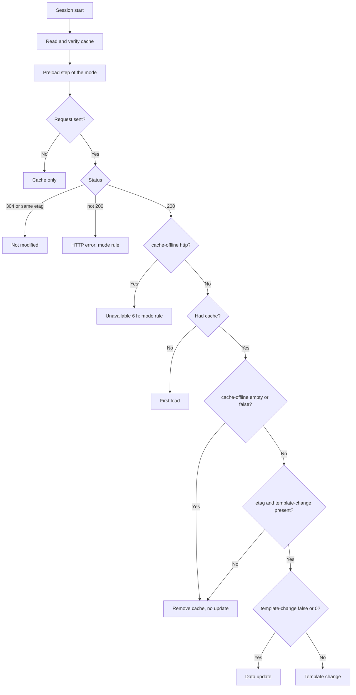

# Legacy protocol: client behavior

::: warning Legacy mode — temporary
This page describes the **legacy mode** (compatibility with the VasSonic legacy protocol). It ships as an optional module, is **deprecated from 1.0** and is **removed in 1.5**. New integrations use the [Rivqen protocol](/engineering/protocol/markup). See [Modes and legacy deprecation](/engineering/protocol/versioning).
:::

This page specifies the observable behavior of a legacy protocol client: session identity, the session flow, Quick and Standard modes, result codes, and how the page receives data updates. Sections 1 to 8 describe upstream; section 9 gives the Rivqen canonical client rules (`CL-01`…) that the client fixtures check.

**Status:** <Badge type="tip" text="FACT" /> from the upstream Android and iOS clients at `59936bef`, code reading (WP-02 S1; checked again row by row in WP-01 S1 T-01). <Badge type="warning" text="RESEARCH" /> A row that depends on the order of independent events (client ready, the intercepted request, the network head, the end of the body) stays RESEARCH until a client trace with a controlled order confirms it. <Badge type="tip" text="FACT" /> The Android traces and the function runs of WP-01 S1 T-05 confirm the rows marked with a scenario ID ([client trace report](/engineering/protocol/legacy-client-traces)). A trace overrides code reading.

Paths below are relative to `upstream:sonic-android/sdk/src/main/java/com/tencent/sonic/sdk/` unless they start with `sonic-iOS/`. Short names in the tables:

| Short | File |
|---|---|
| `QSS` | `QuickSonicSession.java` |
| `STD` | `StandardSonicSession.java` |
| `SS` | `SonicSession.java` |
| `SV` | `SonicServer.java` |
| `SU` | `SonicUtils.java` |
| `SE` | `SonicEngine.java` |
| `CFG` | `SonicSessionConfig.java` |
| `SC` | `SonicConfig.java` |
| `STR` | `SonicSessionStream.java` |

[[toc]]

## 1. Session identity

Upstream derives a **session id** from the URL. The id names the cache files.

| Step | Android (`SonicRuntime.java:75-113`) | iOS (`sonic-iOS/Sonic/Util/SonicUtil.m:31-106`) |
|---|---|---|
| Base | `authority` (host and port) + `path` | `scheme://host` + `path` (no port) |
| Query parameters kept | Names that start with `sonic_`, plus names listed in `sonic_remain_params` (`;`-separated) | Same rule, but only if the raw URL string contains `sonic_` somewhere; else no parameter is kept |
| Order of kept parameters | Sorted by name (`TreeSet`) | Dictionary order (not defined) |
| Kept parameter format | `name` + `value`, no separator; first value, percent-decoded | `name=value&`, after a `/`; last value, not decoded |
| Other query parameters | **Ignored** | **Ignored** |
| Hash | MD5, lowercase hex | MD5 of the UTF-8 bytes, lowercase hex |
| Account | If `IS_ACCOUNT_RELATED` (default `true`, `CFG:56`): `<account>_` + MD5, the account in **clear text** outside the hash (`SonicRuntime.java:104-109`) | If an account is set: MD5 of `<account>_<base>`, the account **inside** the hash (`SonicUtil.m:31-39`) |

Details:

1. <Badge type="tip" text="FACT" /> Android: an account of `null` gives the prefix `null_`, an empty account gives `_` (string concatenation at `SonicRuntime.java:106`). iOS ignores an empty account when it is set, so a set account cannot be cleared to empty (`sonic-iOS/Sonic/Engine/SonicEngine.m:85-98`).
2. <Badge type="tip" text="FACT" /> Android hashes the bytes of the platform default charset (`SU:697-707`). <Badge type="tip" text="FACT" /> On the API 28 image the default charset is UTF-8 (function cases FN-ID-13, FN-CHARSET-07).
3. <Badge type="tip" text="FACT" /> Neither SDK changes the case of the host, and neither platform parser does: `Uri.getAuthority` (API 28) and `NSURL.host` (Foundation of macOS 26.6) keep it, so `Shop.Example.COM` and `shop.example.com` give two session ids (FN-ID-01, FN-ID-03). The `NSURL` of old iOS is NOT FOUND.
4. The exact rules of each platform and their edge cases are in [divergences](/engineering/protocol/legacy-divergences#_2-client-divergences) D-20 and D-21.

::: danger Consequences that Rivqen must not copy silently
1. Two URLs that differ only in a normal query parameter (for example `?id=1` and `?id=2`) share one session id and one cache entry, unless the page lists the parameter in `sonic_remain_params`.
2. On Android, `http` and `https` versions of a URL share one id (the scheme is not part of it).
3. On Android, the account string appears in clear text in cache file names (`SonicFileUtils.java:104-133`).
:::

**Rivqen rule:** the legacy session id is computed exactly as upstream **only** to build compatible request state (validators). The Rivqen [cache key](/engineering/cache/identity) is separate and always includes the partition and the full canonical URL. <Badge type="info" text="DESIGN" />

## 2. Session flow

This section describes the Android SDK. The iOS SDK has no Quick or Standard mode; its differences are in [divergences](/engineering/protocol/legacy-divergences#_2-client-divergences) §2.

### 2.1 Upstream state model

<Badge type="tip" text="FACT" /> An upstream session has **four states** only: none (`0`), running (`1`), ready (`2`) and destroy (`3`) (`SS:97-123`). Both modes share them.

| State | Entered when | Evidence |
|---|---|---|
| none | The session is created | `SS:262` |
| running | `start()` (from none) or `refresh()` (from ready) | `SS:504-529`, `SS:583-617` |
| ready | The session data can answer the intercepted request. The flow sets it at its end; a mode can set it earlier to wake a waiting intercept. Standard sets it at once when a cache exists | `SS:571-572`, `STD:200-208` |
| destroy | `destroy()` succeeds, at once or after the session thread and file saves end (force after 6 s) | `SS:1383-1442` |

The state change is a compare-and-set that wakes a waiting intercept (`SS:944-955`). The engine tracks only running (adds the session to its running map) and destroy (removes it) (`SE:361-374`). Ready does not mean "page shown".

Boolean flags carry the rest of the behavior (`SS:262-315`, `QSS:136-141`):

| Flag | Meaning |
|---|---|
| `wasInterceptInvoked` | The WebView asked for the main document through the client |
| `clientIsReady` | The app called `clientReady()` (Quick uses it as a gate) |
| `wasLoadUrlInvoked` (Quick) | The session called `loadUrl` |
| `wasLoadDataInvoked` (Quick) | The session gave the cached page to the client as data |
| `wasOnPageFinishInvoked` | The app reported page finish for the session URL |
| `clientIsReload` | `refresh()` started the current flow |
| `isWaitingForSessionThread`, `isWaitingForSaveFile`, `isWaitingForDestroy` | Block or delay `destroy()` |
| `wasNotified` | Logging only; it never blocks a notification |

Result codes start at `-1` (`SS:195`, `SS:207`).

### 2.2 Common steps

The flow runs on the session thread (`SS:504-580`).

<Badge type="tip" text="FACT" /> Rules from the code:

| # | Rule | Evidence |
|---|---|---|
| F1 | The cache is verified before use: metadata needs an etag and an HTML SHA-1, the file must not be empty, and its SHA-1 (or size) must match. On failure the cache is removed and the flow runs as "no cache" | `SonicCacheInterceptor.java:68-115` |
| F2 | The mode's preload step runs before any network (Quick: a message to show the cache or call `loadUrl`; Standard: the cached page becomes the pending intercept stream) | `SS:543-548`, `QSS:390-408`, `STD:200-216` |
| F3 | No request is sent when the network is not valid, or when `SUPPORT_CACHE_CONTROL` is on (default off, `CFG:72`) and the cache is still fresh. Only the preload step acts; result codes stay `-1` | `SS:552-566`, `SS:663-674` |
| F4 | A `200` whose etag equals the request etag is handled as `304` | `SV:122-127` |
| F5 | A connection error and a status other than `200` or `304` take the same branch | `SS:679-681`, `SS:718-724`, `SonicSessionConnection.java:457-483` |
| F6 | `cache-offline: http` (any case) makes the session id unavailable for 6 h (`SC:30`): `createSession` returns `null` in that time. The mode acts only if a cache existed | `SS:729-745`, `SE:198-214`, `SE:283-292` |
| F7 | With a cache: `cache-offline` absent, empty or `false` (any case) removes the cache and delivers no update | `SS:753-758` |
| F8 | With a cache: a missing etag or `template-change` removes the cache and delivers no update | `SS:760-769` |
| F9 | `template-change` values `false` and `0` (exact case) mean data update; every other value means template change | `SS:771-776` |
| F10 | `Set-Cookie` of every response status goes to the runtime before the status branch (section 2.9) | `SS:679-694` |
| F11 | A `sonic-link` response header starts the subresource preload | `SS:704-709` |
| F12 | The cache is written only when `cache-offline` is exactly `true` or `store` and, with `SUPPORT_CACHE_CONTROL`, no `no-cache`, `no-store` or `must-revalidate` | `SU:575-593` |
| F13 | Default timeouts: connect 5 s, read 15 s; the intercept waits at most 30 s for the session | `CFG:30-35`, `QSS:456-471`, `STD:159-174` |
| F14 | The `false` branches in the template-change handlers of both modes are never reached, because F7 returns first | `QSS:582-584`, `STD:297-299` |

### 2.3 Client surface

<Badge type="tip" text="FACT" /> The SDK imports no WebView class. The app implements the abstract client; every page action is a call on it (`SonicSessionClient.java:94-132`).

| Session calls on the client | Quick | Standard |
|---|---|---|
| `loadUrl(url, extras)` | `QSS:212, 227, 243, 334, 356, 376` | `STD:84, 96, 124` |
| `loadDataWithBaseUrlAndHeader(...)` | `QSS:253, 289, 328, 359, 371` | Never |
| `loadDataWithBaseUrl(...)`, `clearHistory()` | Never | Never |

| App calls | Effect | Evidence |
|---|---|---|
| `SonicEngine.createSession(url, config)` | Creates the session or takes a preloaded one; starts it if `AUTO_START_WHEN_CREATE` (default on) | `SE:198-214`, `CFG:67` |
| `session.bindClient(client)` | The first client wins | `SS:1187-1195` |
| `client.clientReady()` | Quick: opens the gate (section 3.1); Standard: starts if needed and calls `loadUrl` | `QSS:426-439`, `STD:119-130` |
| `client.requestResource(url)` | The main URL (host and path, any case, no query or scheme) goes to the session; other URLs go to the subresource loader | `SS:1213-1228`, `SS:1309-1326` |
| `client.pageFinish(url)` | Sets `wasOnPageFinishInvoked`; only the template-change read uses it | `SS:1293-1300` |
| `client.getDiffData(callback)` | Stores the page callback and sends the result again | `QSS:410-424`, `STD:132-146` |
| `session.refresh()` | Ready to running; resets the intercept flag and the codes; sets `clientIsReload` | `SS:583-617` |
| `session.destroy()` | Section 2.6 | `SS:1379-1442` |

### 2.4 Result notification

<Badge type="tip" text="FACT" /> The session stores the source and final codes, then calls the page callback only if the call asks for it ("notify") and the page already called `getDiffData` (`SS:1086-1185`). Otherwise the page gets the result when it calls `getDiffData`.

1. A final code `-1` sends nothing.
2. Final code `200`: the stored diff must carry `local_refresh_time`. If not (empty diff), nothing is sent. If the diff is older than **30 s**, nothing is sent (`SS:1111-1129`).
3. During a `refresh()` the callback is delayed so that two callbacks are at least 2 s apart (`SS:1163-1183`).
4. After a send, the stored diff is cleared (`SS:1162`).

<Badge type="tip" text="FACT" /> Observed: when `getDiffData` came first, a "notify" result reached the callback at once (CS-02, CS-04, CS-13a); when the result came first, the page got it at the next `getDiffData` (CS-01, CS-05). A second `getDiffData` after a data-update message gives the page `{}`: the first send cleared the diff, and the next one fails to parse it (`SS:1112`, `:1148`; CS-04).

### 2.5 Stream cut (`FX-LEG-INTERRUPTED`)

| Point | Behavior | Evidence |
|---|---|---|
| Read error on the session thread, before an intercept | The read returns failure; no stream, no message (Q20, S2). The WebView gets `null` and loads the URL itself | `SV:314-321`, `SV:382-408` |
| Read error while the WebView reads the bridge stream | The read returns the bytes already copied, then the next read throws `IOException` (Q22, S17) | `STR:167-198`, `STR:219-240` |
| Close after an error | The stream reports "not complete"; the session writes no cache | `STR:112-155`, `SV:458-469`, `SS:969-1009` |
| Clean end of stream | Counts as complete; the page is cached if F12 allows it | `STR:177-186`, `SS:984-994` |

<Badge type="tip" text="FACT" /> On API 28 a cut chunked body is an error: the WebView gets the bytes so far (139 decoded bytes of 128 wire bytes) and then `java.io.EOFException`; no cache is written (CS-13a). A cut before the intercept gives `null` (CS-13b).

### 2.6 Destroy during a session

<Badge type="tip" text="FACT" /> `destroy()` (`SS:1383-1442`):

1. Drops the client, closes the pending stream, clears the diff and the Quick pending message.
2. If no session-thread work and no stream-close save is open: state destroy, wakes a waiting intercept, disconnects the server, leaves the running map.
3. Otherwise it waits; a forced destroy follows after 6 s or when the work ends (`SS:928-934`). A forced destroy does not disconnect the server (`SS:1414`).
4. After `destroy()` starts, no message reaches the client (`SS:410-429`). A waiting intercept gets `null` (`QSS:475-488`, `STD:178-195`).
5. The flow checks destroy once, after the connection (`SS:698-702`).
6. The 1.5 s delayed save of a first load or template change does not block destroy and stops if the session is destroyed (`SS:1011-1024`). So a page closed within 1.5 s loses that cache write. The stream-close save blocks destroy (`SS:980-994`). The data-update save runs on the session thread and ends (`QSS:742-762`, `STD:493-515`).

<Badge type="tip" text="FACT" /> CS-18: after `destroy()` during the body the intercept gets `null`, and a destroy 0.5 s after the end leaves no cache (item 6). <Badge type="warning" text="RESEARCH" /> Whether the dropped stream is closed is not visible in the trace.

### 2.7 Second session for one id (`FX-LEG-CONCURRENT`)

<Badge type="tip" text="FACT" />

| Rule | Evidence |
|---|---|
| Engine entry points are synchronized | `SE:165`, `SE:198`, `SE:301`, `SE:327` |
| `createSession` first takes a preloaded session of the same id (it replaces the URL). A preloaded session older than 3 min, or with another mode or local-server flag, is destroyed | `SE:202-204`, `SE:225-247`, `SS:862-868`, `CFG:45` |
| A running session of the same id makes `createSession` return `null`. The running map loses an id only on destroy, so a ready session also blocks | `SE:257-276`, `SE:361-374` |
| No queue or merge of two sessions exists. The app must load the page without a session | NOT FOUND in the SDK |
| At most 5 preloaded sessions | `SE:174`, `SC:24` |

### 2.8 Account change (`FX-LEG-AUTH-CHANGE`)

<Badge type="tip" text="FACT" /> The id (with the account) is computed once at `createSession` and is final (`SE:200`, `SS:349`). A running session keeps the files and metadata of the old account. A new session gets the new id, so the cache of the other account is not read. A preloaded session of the old account is not picked for the new one; it expires after 3 min. With `IS_ACCOUNT_RELATED` off, all accounts share one cache. No code detects an account change (NOT FOUND).

### 2.9 Cookies (`FX-LEG-COOKIE-VARIANCE`, client part)

<Badge type="tip" text="FACT" />

| Point | Behavior | Evidence |
|---|---|---|
| Request cookie | Read from the runtime when the session is **created** (`GET_COOKIE_WHEN_SESSION_CREATE`, default on); else when the request is built. A preloaded or late session sends the old value | `SS:485-493`, `SS:631-640`, `SC:74` |
| `Cookie` field | Sent only if not empty | `SonicSessionConnection.java:370-375` |
| `Set-Cookie` | For every status (including `304`, errors and `http`), the values go to the runtime | `SS:679-694`, `SS:1250-1269` |
| Thread | In a new thread if an intercept runs at that moment on a thread other than `Chrome_FileThread`; else at once | `SS:1213-1228`, `SS:1239-1241` |
| Headers given to the WebView | `Set-Cookie`, `Cache-Control`, `Expires`, `Etag` and multi-valued fields are removed | `SU:422-443` |
| Cache key | Has no cookie | `SonicRuntime.java:75-113` |

<Badge type="warning" text="RESEARCH" /> Whether WebView subresource requests see cookies that the runtime sets in the new thread depends on timing.

## 3. Quick and Standard modes

The upstream default is **Quick** (`CFG:88`). The engine makes a Quick session for mode `1` and a Standard session for every other value (`SE:257-264`).

| | Quick (`QuickSonicSession`) | Standard (`StandardSonicSession`) |
|---|---|---|
| How the page is loaded | The session calls `loadDataWithBaseUrlAndHeader` with the cached or rebuilt HTML; `loadUrl` when it has no complete page | **Only** `loadUrl`; the document is returned by request interception |
| Cached page display | Given to the client as data when the preload message runs (after `clientReady()`) | Returned as the intercepted response stream; the session is ready at once |
| Response headers for the WebView (CSP etc.) | Passed in the call, but a plain `loadDataWithBaseURL` drops them; upstream itself warns about the security risk (`QSS:40-43`) | Available, because the intercepted response carries headers (`STD:183-186`) |
| Data update delivery | Diff to the page if the cache was **already given as data** (`wasLoadDataInvoked`); otherwise the rebuilt HTML is loaded as data | Diff to the page if the WebView **already intercepted** (`wasInterceptInvoked`); otherwise the rebuilt HTML replaces the pending stream |
| Evidence | `QSS:144-199`, `QSS:238-382` | `STD:74-216` |

::: warning Security note
Upstream itself documents that Quick mode loses response headers such as `Content-Security-Policy` when it loads HTML as data (`QSS:40-43`). Rivqen does not load sensitive pages without their security headers. <Badge type="info" text="DESIGN" />
:::

How to read the tables:

- Each mode has one table in two parts with the same row IDs: part A (input) and part B (result). Row IDs are stable: lab scenarios and fixtures cite them.
- **Order** names the event that comes first when the outcome depends on it.
- **Codes** are `src / final`. "notify" means the result is sent to the page callback at once (section 2.4); "silent" means the page gets it only through `getDiffData`.
- **Write** is the cache write: "1.5 s" = a delayed save task (`SS:1011-1017`); "close" = the save when the WebView closes a stream that it read to the end (`SS:969-1009`); "thread" = files and metadata written on the session thread. Every write also needs F12.
- **Status** is <Badge type="tip" text="FACT" /> when the code settles the row and <Badge type="warning" text="RESEARCH" /> when the order of events or a platform behavior decides it. Lane T-05 adds the trace result.

### 3.1 Quick mode outcomes

<Badge type="tip" text="FACT" /> Gate: until `clientReady()`, Quick keeps the newest preload, first-load, data-update, template-change, error or unavailable message in **one slot**; a newer message replaces the older one (`QSS:156-160`). `clientReady()` handles the slot, or starts the session if nothing is waiting and it has not started (`QSS:426-439`). Result messages (`304`, refresh) are not held. `removeMessages` on the main queue cannot remove a held message (`QSS:495`, `:509`, `:551`, `:624`, `:723`).

**Part A — input**

| ID | Cache | Server | Order | Status |
|---|---|---|---|---|
| Q1 | none | first load | Body complete before the preload `loadUrl` runs | <Badge type="tip" text="FACT" /> CS-01 |
| Q2 | none | first load | Preload `loadUrl` and intercept first | <Badge type="tip" text="FACT" /> CS-02 |
| Q3 | none | first load, empty body | Before any intercept | <Badge type="tip" text="FACT" /> CS-20: no load call, the scripted intercept gets an empty stream; probable defect confirmed ([trace report](/engineering/protocol/legacy-client-traces#_5-rows-and-probable-defects)) |
| Q4 | none | HTTP error or no connection | — | <Badge type="tip" text="FACT" /> CS-12 |
| Q5 | none | `cache-offline: http` | — | <Badge type="tip" text="FACT" /> |
| Q6 | none | first load, `cache-offline` not `true` or `store` | As Q1 or Q2 | <Badge type="tip" text="FACT" /> |
| Q7 | yes | `304`, or `200` with the request etag | — | <Badge type="tip" text="FACT" /> CS-03 |
| Q8 | yes | data update | Cache given as data first; diff not empty | <Badge type="tip" text="FACT" /> CS-04; CS-24c (`TRUE`: diff sent, then the cache is removed, D-30) |
| Q9 | yes | data update with `store`, or diff failed | Cache given as data first | <Badge type="tip" text="FACT" /> CS-22 (`store`); the "diff failed" form is not reached |
| Q10 | yes | data update | Network first | <Badge type="tip" text="FACT" /> CS-05 |
| Q11 | yes | data update, rebuild fails | Network first | <Badge type="warning" text="RESEARCH" /> not reached: CS-26 changes the `html-sha1` field of the head, but the SDK takes the value of a data update from the body ([trace report](/engineering/protocol/legacy-client-traces#_5-rows-and-probable-defects)) |
| Q12 | yes | template change, not `store` | Cache given as data first | <Badge type="tip" text="FACT" /> CS-06 |
| Q13 | yes | template change with `store` | Cache given as data first | <Badge type="tip" text="FACT" /> CS-23 |
| Q14 | yes | template change | Network first | <Badge type="tip" text="FACT" /> CS-07; CS-21 (empty new page): the empty page is given as data, not `loadUrl` ([trace report](/engineering/protocol/legacy-client-traces#_5-rows-and-probable-defects)) |
| Q15 | yes | HTTP error or no connection | — | <Badge type="tip" text="FACT" /> CS-11 |
| Q16 | yes | `cache-offline: http` | — | <Badge type="tip" text="FACT" /> CS-24a (`HTTP`), CS-25 (`http`) |
| Q17 | yes | `cache-offline` absent, empty or `false` | — | <Badge type="tip" text="FACT" /> CS-09 |
| Q18 | yes | etag or `template-change` missing | — | <Badge type="tip" text="FACT" /> CS-14 |
| Q19 | any | template change during `refresh()` | — | <Badge type="tip" text="FACT" /> (code reading); not reached in CS-27: the refresh request has the new etag and tag, so the server answers `304` ([trace report](/engineering/protocol/legacy-client-traces#_5-rows-and-probable-defects)) |
| Q20 | none | first load, read error | Before any intercept | <Badge type="tip" text="FACT" /> CS-13b |
| Q21 | any | no request (F3) | — | <Badge type="tip" text="FACT" /> |
| Q22 | none | first load, read error | During the bridge stream | <Badge type="tip" text="FACT" /> CS-13a |

**Part B — result**

| ID | Client action | Codes | Write | Lines |
|---|---|---|---|---|
| Q1 | Data: the full page with the response headers (note 1) | 1000 / 304, silent | 1.5 s (note 1) | `QSS:286-291`, `:611-645` |
| Q2 | `loadUrl`; the intercept gets the bridge stream (bytes read so far, then the network) or the full body | 1000 / 1000, notify | close | `QSS:238-247`, `:275-295`, `:441-491` |
| Q3 | None (note 2) | -1 / -1 | none | `QSS:277-283`, `:611-628`; `SV:394-400` |
| Q4 | None; the preload `loadUrl` stands and the intercept gets `null`, so the WebView loads itself (note 3) | -1 / -1 | none | `SS:718-724`; `QSS:493-506` |
| Q5 | None, as Q4; the id is unavailable for 6 h | -1 / -1 | none | `SS:729-745` |
| Q6 | As Q1 or Q2 | As Q1 or Q2 | none | `QSS:636-644`; `SS:984-998` |
| Q7 | The cached page as data when the preload runs; nothing else | 304 / 304, notify | none | `SS:711-716`, `:828-840`; `QSS:249-258` |
| Q8 | None; the diff is kept for the page | 200 / 200, notify | thread (note 4) | `QSS:697-707`, `:311-318`, `:736-762` |
| Q9 | None; no diff | 200 / 304, notify | `store`: thread; diff failed: removed | `QSS:701-704`, `:319-322`, `:736-740` |
| Q10 | Data: the rebuilt page with the response headers; the diff is dropped. `store` does not change it | 200 / 304, silent | thread | `QSS:722-727`, `:324-331` |
| Q11 | `loadUrl` (template missing or `html-sha1` mismatch) | 200 / 1000, silent | removed | `QSS:333-335`, `:736-740`; `SU:301-330` |
| Q12 | Body complete: data, the new page; else `loadUrl` and the intercept gets the bridge stream (note 5) | 2000 / 2000, silent | 1.5 s or close | `QSS:351-362`, `:530-592` |
| Q13 | None | 2000 / 304, notify | 1.5 s or close | `QSS:363-366` |
| Q14 | Data: the new page; with no page text, `loadUrl` | 2000 / 304 silent; `loadUrl`: 2000 / 1000 | 1.5 s or close | `QSS:367-378` |
| Q15 | None; the cached page stays (note 3) | -1 / -1 | none; cache kept | `QSS:493-499`, `:207-214` |
| Q16 | `loadUrl` once: a normal load replaces the cached page | -1 / -1 | none; cache kept | `SS:729-745`; `QSS:508-512`, `:222-229` |
| Q17 | None; the cached page stays | -1 / -1 | removed | `SS:753-758` |
| Q18 | As Q17 | -1 / -1 | removed | `SS:760-769` |
| Q19 | None (no load call) | 2000 / 2000, notify | 1.5 s | `QSS:549-563`; `SS:583-617`, `:775` |
| Q20 | None; the preload `loadUrl` stands; the intercept gets `null` | -1 / -1 | none | `QSS:611-616`; `SV:382-408` |
| Q21 | Only the preload: the cached page as data, or `loadUrl` | -1 / -1 | none | `SS:550-566`, `:663-674` |
| Q22 | The WebView gets the bytes so far, then `IOException` | 1000 / 1000, notify | none | `STR:167-240`; `SS:996-1004` |

Notes:

1. <Badge type="warning" text="RESEARCH" /> Trace (CS-01): with the body complete before `clientReady`, the message waits in the slot and the 1.5 s save runs (3 of 3 runs), so the defect does not occur in that order. The window that remains is `clientReady` between `QSS:628` and `:638` on the session thread; a script cannot place it. Code reading: Q1 happens when the client is not ready yet (the first-load message replaces the held preload), or when the preload message is still in the queue (it is removed). The session posts the 1.5 s save only if, at that moment, the main thread has not yet handled the first-load message (`QSS:638`). If it has, no save follows: a page given as data is never intercepted, so no stream closes. **Probable upstream defect:** a Quick first load can miss its cache write.
2. <Badge type="warning" text="RESEARCH" /> Not reached in T-05: the upstream servers always send the page body, and no lab page is empty. Code reading: a first-load message "without data" while no intercept happened arises only with an empty `200` body (the read ends at once, `SV:394-400`). If the preload `loadUrl` has not run yet, it is removed or replaced and **nothing loads**. If it ran, the intercept later gets an empty stream. **Probable upstream defect.**
3. With `RELOAD_IN_BAD_NETWORK` on (default **off**, `CFG:61`), the error removes the preload message and the session calls `loadUrl` once (`QSS:493-499`, `:207-214`). With a cache, this normal load replaces the cached page.
4. <Badge type="warning" text="RESEARCH" /> Trace: cache first (CS-04) delivers the diff; network first (CS-05) loads the rebuilt page. The loss needs the preload between `QSS:697` and `:723`, which a script cannot place. After a first load the diff holds **every** block: the first-load data file has the form `{"data": …}` (`SV:436-446`), which the diff does not read as a block map (`SU:251-299`; CS-04). Code reading: the branch is chosen on the session thread (`QSS:697`), but the preload runs on the main thread. If the preload runs between the check and the message, the update arrives with the page but no diff: the page reports 200 / 304 and keeps the old cache on screen. **Probable upstream defect: the data update is lost.** The write: if the diff failed or the rebuilt page is empty, the cache is removed instead (`QSS:736-740`). The local data file becomes the full server data (`QSS:755`).
5. <Badge type="tip" text="FACT" /> The handler drops the page callback: in CS-06 no message came at the result, and the next `getDiffData` gave 2000 / 2000. <Badge type="warning" text="RESEARCH" /> The read until page finish is not in the catalog. Code reading: in the template change, the session reads the new body until the app reports page finish for the cached page (`QSS:538`). The template-change handler also drops the page callback, so the page must call `getDiffData` again (`QSS:380-381`).

### 3.2 Standard mode outcomes

<Badge type="tip" text="FACT" /> No gate: `clientReady()` starts the session if needed and calls `loadUrl` at once on the main thread, or posts it (`STD:119-130`). With a cache, the cached page is the pending stream and the session is ready before any network (`STD:200-208`), so the intercept does not wait. The intercept sets its flag on every call and returns the pending stream once (`STD:148-198`).

**Part A — input**

| ID | Cache | Server | Order | Status |
|---|---|---|---|---|
| S1 | none | first load | Intercept first, or body complete first | <Badge type="tip" text="FACT" /> CS-01, CS-02; CS-20 (empty body: 1000 / 1000, no write) |
| S2 | none | first load, read error | Before any intercept | <Badge type="tip" text="FACT" /> CS-13b |
| S3 | none | HTTP error or no connection | — | <Badge type="tip" text="FACT" /> CS-12 |
| S4 | none or yes | `cache-offline: http` | — | <Badge type="tip" text="FACT" /> CS-24a (`HTTP`), CS-25 (`http`), with a cache |
| S5 | yes | `304`, or `200` with the request etag | — | <Badge type="tip" text="FACT" /> CS-03 |
| S6 | yes | data update, `true` or `false` | Intercept first | <Badge type="tip" text="FACT" /> CS-04 |
| S7 | yes | data update, `true` or `false` | Network first | <Badge type="tip" text="FACT" /> CS-05 |
| S8 | yes | data update, `store` or another value | — | <Badge type="tip" text="FACT" /> CS-22 (`store`); CS-24b, CS-24c, CS-08, CS-10 (another value: `Store`, `TRUE`, `true,store`, `true,http`) |
| S9 | yes | template change, `true` or `false` | Intercept first | <Badge type="tip" text="FACT" /> CS-06 |
| S10 | yes | template change, `store` or another value | Intercept first | <Badge type="tip" text="FACT" /> CS-23 (`store`) |
| S11 | yes | template change | Network first | <Badge type="tip" text="FACT" /> CS-07 |
| S12 | yes | template change, empty body | Network first | <Badge type="tip" text="FACT" /> CS-21 |
| S13 | yes | HTTP error or no connection | — | <Badge type="tip" text="FACT" /> CS-11 |
| S14 | yes | `cache-offline` absent, empty or `false` | — | <Badge type="tip" text="FACT" /> CS-09 |
| S15 | yes | etag or `template-change` missing | — | <Badge type="tip" text="FACT" /> CS-14 |
| S16 | any | template change during `refresh()` | — | <Badge type="warning" text="RESEARCH" /> not reached in CS-27: the refresh request has the new etag and tag, so the server answers `304` ([trace report](/engineering/protocol/legacy-client-traces#_5-rows-and-probable-defects)) |
| S17 | none | first load, read error | During the bridge stream | <Badge type="tip" text="FACT" /> CS-13a |
| S18 | any | no request (F3) | — | <Badge type="tip" text="FACT" /> |

**Part B — result**

| ID | Client action | Codes | Write | Lines |
|---|---|---|---|---|
| S1 | `loadUrl`; the intercept waits while running, then gets the bridge stream or the full body (note 1) | Intercept first: 1000 / 1000; body first: 1000 / 304; notify | Complete body: 1.5 s **and** close | `STD:119-130`, `:148-198`, `:341-391` |
| S2 | None; the intercept gets `null`, the WebView loads itself | -1 / -1 | none | `STD:341-349`; `SV:382-408` |
| S3 | Callback only; the intercept gets `null` | -1 / -1 | none | `STD:309-317`; `SS:718-724` |
| S4 | Callback only. With a cache, the intercept **still gets the cached page**; without, the WebView loads itself. Unavailable for 6 h | -1 / -1 | none; cache kept | `STD:319-327`; `SS:729-745` |
| S5 | None; the intercept gets the cached page | 304 / 304, notify | none | `SS:828-840`; `STD:200-208` |
| S6 | None; the diff is kept for the page | 200 / 200, notify | thread (note 2) | `STD:442-450`, `:470`, `:487-515` |
| S7 | The rebuilt page replaces the pending stream; the 200 / 200 message is replaced by 200 / 304 (note 3) | 200 / 304, notify | thread | `STD:470-481` |
| S8 | None; the cached page stays the pending stream | -1 / -1 | thread (note 2) | `STD:442`, `:470`, `:487-515` |
| S9 | `loadUrl` again; the second intercept gets the new response stream | 2000 / 2000, notify | 1.5 s or close | `STD:235-307`, `:88-101` |
| S10 | None | 2000 / 304, notify | 1.5 s or close | `STD:271-273` |
| S11 | None; the pending stream is now the new response and the intercept gets it | 2000 / 304, notify | 1.5 s or close | `STD:242-263`, `:275-278` |
| S12 | No message; the pending stream is the empty new response | -1 / -1 | none | `STD:257-265` |
| S13 | Callback only; the intercept gets the cached page | -1 / -1 | none; cache kept | `STD:309-317`, `:200-208` |
| S14 | None; the intercept gets the cached page | -1 / -1 | removed | `SS:753-758` |
| S15 | As S14 | -1 / -1 | removed | `SS:760-769` |
| S16 | None (no load call) (note 4) | 2000 / 304, notify | 1.5 s | `SS:583-592`, `:775`; `STD:257-262` |
| S17 | The WebView gets the bytes so far, then `IOException` | 1000 / 1000, notify | none | `STR:167-240`; `SS:996-1004` |
| S18 | The intercept gets the cached page; without a cache, `null` | -1 / -1 | none | `SS:550-566`, `:663-674` |

Notes:

1. <Badge type="tip" text="FACT" /> Trace: body first gives 1000 / 304 and two saves (CS-01); intercept first gives 1000 / 1000 and one save, at the close (CS-02). "Body first" (1000 / 304) means only that the body was read before the intercept; the page still loads through `loadUrl` and the intercept. With a complete body the session posts the 1.5 s save, and the stream close posts a second save (`STD:382-387`, `SS:984-994`).
2. <Badge type="tip" text="FACT" /> S6 and S8: if F12 does not allow the write (for example `cache-offline: TRUE`, or `Cache-Control: no-store` with `SUPPORT_CACHE_CONTROL`), Standard removes the cache and then writes the files and metadata anyway, because it does not return (`STD:487-515`). Quick returns (`QSS:736-740`). Trace (CS-08, CS-10, value `true,http` or `true,store`): Standard writes the page, data and header files but no template file; Quick leaves no cache.
3. <Badge type="warning" text="RESEARCH" /> Trace (CS-05): the intercept got the rebuilt page. The defect needs an intercept between `STD:470` and `:472`, which a script cannot place. Code reading: the intercept check (`STD:470`) is outside the stream lock. If the intercept takes the cached stream just after the check, the rebuilt stream is never read and the page reports 200 / 304 while the old cache shows. **Probable upstream defect.**
4. <Badge type="warning" text="RESEARCH" /> `refresh()` resets the intercept flag, so the handler reports 2000 / 304 and makes no load call. Whether the app reloads the page itself is outside the SDK.

### 3.3 Differences between the modes

<Badge type="tip" text="FACT" /> Code reading; the timing parts are in the rows above.

| # | Topic | Quick | Standard |
|---|---|---|---|
| M-01 | Load call | Data call mostly; `loadUrl` as fallback (`QSS:253`, `:289`) | `loadUrl` only (`STD:84`, `:96`, `:124`) |
| M-02 | Headers of a cached page | Passed in the data call; lost by a plain data load | Real headers in the intercepted response (`STD:183-186`) |
| M-03 | Cached page shown | When the preload message runs, after `clientReady()` | At the intercept; ready at once (`STD:200-208`) |
| M-04 | Intercept wait | Up to 30 s while running (`QSS:456-471`) | Same, but no wait with a cache |
| M-05 | Second intercept | Returns `null` (`QSS:442-449`) | Flag set again; stream given once (`STD:157`, `:192`) |
| M-06 | Client-ready gate | One-slot hold, newest wins (`QSS:156-160`) | None (`STD:119-130`) |
| M-07 | Thread of the load | Main-thread messages | `loadUrl` at once if on the main thread, else posted (`STD:123-128`) |
| M-08 | Template-change reload | Data call with the new page, or `loadUrl` (`QSS:351-362`) | `loadUrl` only (`STD:92-97`) |
| M-09 | HTTP error | `loadUrl` only with `RELOAD_IN_BAD_NETWORK` (`QSS:493-499`) | Callback only (`STD:309-317`) |
| M-10 | `cache-offline: http` with a cache | `loadUrl` replaces the cached page (`QSS:222-229`) | The cached page is still served (`STD:319-327`) |
| M-11 | Data update, page not shown | Data call with the rebuilt page (`QSS:324-331`) | Rebuilt page replaces the pending stream (`STD:470-481`) |
| M-12 | Data update, write not allowed | Cache removed, return (`QSS:736-740`) | Removed, then written anyway (`STD:487-515`) |
| M-13 | First-load save | Only if neither `loadUrl` nor an intercept happened; else on close (`QSS:637-641`) | Always when complete; plus close: two saves (`STD:382-387`) |
| M-14 | First-load 1000 / 304 | Only when the session gives the full page as data (`QSS:286-291`) | When the body is complete before the intercept (`STD:353-358`) |
| M-15 | `store` on data update | 200 / 304 with no diff (`QSS:701-704`, `:319-322`); a page not shown still gets the rebuilt page | No message; codes stay `-1`; old stream served (`STD:442`, `:470`) |
| M-16 | Page callback after a template change | Dropped; the page must call `getDiffData` again (`QSS:380-381`) | Kept |

## 4. Result codes

| Code | Meaning | Android constant | iOS constant |
|---|---|---|---|
| `-1` | Unknown | `SONIC_RESULT_CODE_UNKNOWN` | — |
| `1000` | First load | `SONIC_RESULT_CODE_FIRST_LOAD` | `SonicStatusCodeFirstLoad` |
| `2000` | Template change | `SONIC_RESULT_CODE_TEMPLATE_CHANGE` | `SonicStatusCodeTemplateUpdate` |
| `200` | Data update | `SONIC_RESULT_CODE_DATA_UPDATE` | `SonicStatusCodeDataUpdate` |
| `304` | Cache hit, nothing to do | `SONIC_RESULT_CODE_HIT_CACHE` | `SonicStatusCodeAllCached` |

Evidence: `SS:163-186`; `sonic-iOS/Sonic/SonicConstants.h:28-48`.

Each session reports a **source** code and a **final** code. The source code names the branch of the flow (first load, data update, template change, not modified). The final code tells the page what it shows now: `304` means the page already shows the current content, because the session loaded it directly (example: data update before the page was shown → 200 / 304). The source code is not always the server answer: Quick 1000 / 1000 and 1000 / 304 differ only by the local order of events. `-1` means that no branch reported a result (errors, `http`, cache removed, no request).

## 5. Delivering data to the page

### 5.1 Bridge

<Badge type="tip" text="FACT" /> The upstream Android sample exposes a Java object named `sonic` with `addJavascriptInterface` (`upstream:sonic-android/sample/src/main/java/com/tencent/sonic/demo/BrowserActivity.java:172`). The page calls `window.sonic.getDiffData()`; the native side answers by calling the global JS function `getDiffDataCallback(json)` through a `javascript:` URL (`…/SonicJavaScriptInterface.java:45-71`). A second method, `getDiffData2(callbackName)`, takes the callback name from the page and puts it into the `javascript:` URL.

::: danger Not copied into Rivqen
`addJavascriptInterface` exposes methods to every frame of the page, and building a `javascript:` URL from a page-supplied name is an injection risk. Rivqen provides the same **message** to legacy pages through the secure [JS bridge](/engineering/platforms/js-bridge) and an optional compatibility shim with the same JavaScript names. <Badge type="info" text="DESIGN" />
:::

### 5.2 Message format

| Key | Android | iOS | Meaning |
|---|---|---|---|
| `code` | integer | string; `"304"` whenever `cache-offline` is `store` | Final result code |
| `srcCode` | integer | string | Source result code |
| `result` | string with the JSON of the changed blocks; final `200` only | pretty-printed JSON string; final `200`, a diff, and not `store` | Changed blocks |
| `local_refresh_time` | number: age of the diff in ms; final `200` and age > 0 only | string: cache refresh time (ms since 1970, whole seconds); always present | Freshness |
| `extra` | `<etag key>` (default `eTag`), `template-tag`, `cache-offline` from the current response; `isReload` | `eTag` and `template-tag` from the cached config; `cache-offline` from the response (`""` if absent); `isReload` | Diagnostics |

Evidence: `SS:1086-1185`; `sonic-iOS/Sonic/Session/SonicSession.m:652-696`.

Rules from the code:

1. <Badge type="tip" text="FACT" /> Android sends nothing for a diff older than **30 seconds** or for an empty diff (`SS:1111-1129`). iOS has no such check (`SonicSession.m:636-696`).
2. <Badge type="tip" text="FACT" /> Android diff: every server key whose value, as a string, differs from the local value; a missing local value counts as `""`, so a new key with an empty value is not in the diff (`SU:251-299`). iOS diff: only keys that **already exist** locally; if that diff is empty, iOS sends the **full** server data (`sonic-iOS/Sonic/Util/SonicUtil.m:210-228`, `sonic-iOS/Sonic/Cache/SonicCache.m:363-370`).
3. <Badge type="tip" text="FACT" /> `cache-offline: store` gives no diff on **both** platforms: Android Quick reports 200 / 304 (`QSS:701-704`, `:319-322`), Android Standard sends no message (`STD:442`), iOS sets `code` to `"304"` (`SonicSession.m:662-668`).
4. <Badge type="tip" text="FACT" /> iOS `isReload` is always `"false"`: the flag behind it is never set in the SDK (`SonicSession.m:48`, `:687`).
5. <Badge type="tip" text="FACT" /> Android (API 28, session traces): `isReload` is the string `"false"`; a header that is absent has no `extra` key (the `304` messages have only `cache-offline` and `isReload`); org.json writes `/` as `\/` in `result`; the keys keep insertion order (`local_refresh_time`, `result`, `code`, `srcCode`, `extra`). iOS pretty-print whitespace and key order: NOT FOUND (no iOS message run, H-119).

### 5.3 iOS integration (Q-03)

<Badge type="tip" text="FACT" /> Source: code reading at `59936bef` in WP-02 S1 (H-110). No old device was needed. Q-03 is closed. The iOS client does not use a `WKWebView`. Its sample uses a `UIWebView` and a global network hook.

| Step | What upstream does | Evidence |
|---|---|---|
| Hook | The sample app registers one global `NSURLProtocol` subclass at start-up | `upstream:sonic-iOS/SonicSample/SonicSample/AppDelegate.m:35` |
| Web view | The sample page controller loads the page in a `UIWebView` | `upstream:sonic-iOS/SonicSample/SonicSample/SonicWebViewController.m:71` |
| Which requests | The protocol accepts only a request that is marked for a live session. All other requests pass | `upstream:sonic-iOS/Sonic/Network/SonicURLProtocol.m:32-45` |
| Delivery | The protocol gives the cached or rebuilt HTML to the web view through the callbacks of its protocol client | `upstream:sonic-iOS/Sonic/Network/SonicURLProtocol.m:84-138` |
| Cached page | The session builds a synthetic `200` response for a cached page | `upstream:sonic-iOS/Sonic/Session/SonicSession.m:615-629` |
| First load | The protocol passes the live network events of the request on, including a failure | `upstream:sonic-iOS/Sonic/Session/SonicSession.m:569-608` |
| Diff to the page | The sample adds an export object named `sonic` to the JavaScript context of the private `UIWebView` internals | `upstream:sonic-iOS/SonicSample/SonicSample/SonicWebViewController.m:105-114` |
| Callback | The page gets the diff through the global function `getDiffDataCallback` | `upstream:sonic-iOS/SonicSample/SonicSample/SonicJSContext.m:25-38` |
| Result | The session builds the result (codes and changed blocks, section 5.2) | `upstream:sonic-iOS/Sonic/Session/SonicSession.m:636-696` |

::: danger Not used by Rivqen
`UIWebView` is no longer accepted in the App Store. A global `NSURLProtocol` does not see the requests of a `WKWebView` through public API. The JavaScript context of a `UIWebView` is a private structure. Rivqen uses a `WKWebView` with public APIs only (U-10, [ADR-003](/engineering/architecture/adr/#adr-003)). <Badge type="info" text="DESIGN" />
:::

## 6. Local server mode (VasSonic 2.0)

If the server does not speak the legacy protocol and `SUPPORT_LOCAL_SERVER` is on (default **off**, `CFG:78`), the client computes `etag` and `template-tag` itself from the full response and simulates the server decision (`SV:129-187`; `upstream:assets/Sonic2.0.md`). iOS has the same mode, also off by default; its rules differ ([divergences](/engineering/protocol/legacy-divergences#_2-client-divergences) D-39).

Consequences: the client must download the **full** HTML every time. Only the WebView rendering is saved, not the bytes.

## 7. Subresource preload (VasSonic 3.0)

| Item | Upstream behavior | Evidence |
|---|---|---|
| Declaration | Response header `sonic-link: url1;url2;…` or a client-side custom header | `upstream:assets/VasSonic3.0_preload.md` §1.1 |
| Lifetime | `max-age` query parameter on each resource URL | same, §1.3 |
| Storage | `/sdcard/SonicResource/` (external storage), MD5 of URL as file name | same, §1.3 |
| Verification | SHA-1 of file content (default) or size | `SC:61` |
| Limit | 60 MB, checked every 24 h | `SC:40-45` |

::: warning
External storage is readable by other apps on old Android versions. Rivqen stores all resources in app-private storage. <Badge type="info" text="DESIGN" />
:::

## 8. Cache defaults (Android)

| Setting | Value | Evidence |
|---|---|---|
| Session cache max size | 30 MB | `SC:35` |
| Resource cache max size | 60 MB | `SC:40` |
| Cache check interval | 24 h | `SC:45` |
| Max cache age with `Cache-Control` | 5 min | `SC:55` |
| Verify cache files with SHA-1 | on | `SC:61` |
| Files per session | `<id>.html`, `<id>.tpl`, `<id>.data`, `<id>.header` | `SonicFileUtils.java:45-60` |
| Metadata | SQLite table with session id, etag, template tag, html SHA-1, unavailable time, size, update time, expiry, hit count | `SonicDataHelper.java:89-100` |

## 9. Rivqen canonical client rules

This section gives the Rivqen canonical result of a legacy client session: the profile `legacy-canonical` of the client fixtures (DL-110, DL-111, DL-112). A person can write a client fixture and know its expected result from these rules alone. The fixture format is in `fixtures/legacy/README.md` ("Client fixtures") and in [fixtures](/engineering/protocol/fixtures) §1.

**Status:** <Badge type="info" text="DESIGN" /> WP-01 S2 T-01. A rule with a source names a decision (DL), a session FSM rule, a cache rule or a page section. Every proposal of section 9.10 is recorded (DL-113…DL-118, H-124, H-125). The rules describe observable effects only (R-3): requests, web view actions, page messages, codes, cookie calls and the abstract cache record. They do not define FSM states (R-1); WP-08 maps them to the [session FSM](/engineering/core/session-fsm).

How to read the rules:

- Rule IDs `CL-nn` are stable once published. The client model (T-04) and the fixtures (T-06) cite them. A changed rule keeps its ID; a removed rule keeps its row with "Removed".
- "Fixture" in the last column means that a client fixture or a function fixture checks the rule (generator check 10). "—" means a convention of the model or a rule that no catalog fixture reaches yet.
- Words: the **document** is the HTML that the session gives to the web view: the cached page, the page of the response, the rebuilt page of a data update, or the new page of a template change. **Delivered** means that the web view got the document: by `load_data`, or as the answer of an intercepted request. A **normal load** means that the web view loads the URL itself (FSM-06). A **visible entry** is a cache record of the session key that passes CL-12 and CL-40.

### 9.1 Fixture model

| ID | Rule | Source | Check |
|---|---|---|---|
| CL-01 | **Steps.** The model runs the steps in order. After each step it completes every effect that the step allows: a request gets its response at once, unless `hold`, `cut`, `server_down` or a network that is not valid stops it. A response arrives as two events, the head and then the end of the body; the session acts on the head first. `wait` checks that its event occurred (else a case error). `settle` ends a phase and advances the clock (CL-04). So the order of independent events is an input of the case, not a rule | DL-100, DL-104, R-2 | — |
| CL-02 | **Lab runtime.** The account, the cookie and the network validity come from `config` and change only by `set_account`, `set_cookie` and `set_network`. A `cookie_set` call of the client is recorded; it does not change the cookie that the runtime returns (the lab runtime has no cookie jar, CS-17) | CONTRACT §3 | — |
| CL-03 | **Configuration.** `account` gives the partition (CL-05); `cookie` and `network_valid` set the runtime (CL-02); `accept_diff` sets the `accept-diff` value (CL-09); `unavailable_time_ms` is the `http` period (CL-19); `support_local_server` turns on CL-37. These keys have no canonical effect: `account_related` (identity rule 2: a partition is required), `reload_in_bad_network` (DL-107: no reload), `support_cache_control` (DL-108 D-41: RFC 9111 always), `auto_start` (the request goes at `create_session`, CL-09), `get_cookie_when_session_create` (CL-11), `cache_verify_with_sha1` (CL-40, always), `connect_timeout_ms`, `read_timeout_ms` (no deadline in the model, CL-20) | Identity §3, DL-107, DL-108, [Android](/engineering/platforms/android) §3 | Fixture |
| CL-04 | **Clock.** The model clock starts at 0 ms and advances only by `settle.ms`. CL-19 (the `http` period) and CL-28 (the diff age) use it | DL-106 (D-36), DL-107 (D-47) | — |

### 9.2 Session, partition and request

| ID | Rule | Source | Check |
|---|---|---|---|
| CL-05 | **Session key.** A session opens for the key of the partition (the account at `create_session`; `null` is a partition of its own, never `public`), the URL and the Vary values (CL-12). The client computes no legacy session id (D-20, D-21): the key is the Rivqen [cache key](/engineering/cache/identity). The `public` partition is off (identity rule 3, default) | Section 1 (Rivqen rule), identity §1–§3, ADR-005 (D-20) | Fixture |
| CL-06 | **Partition change** (`FX-LEG-AUTH-CHANGE`). A `set_account` with another value stops every open session of the old partition at once: no later web view call, message, cookie call or commit; a waiting intercept gets `null`; a stream in delivery ends incomplete; a later response is ignored; its result stays as it was. The entries of the old partition are removed. A new session uses the new partition | Identity rule 4, FSM-01, FSM §4 (`PartitionChanged`), R-CACHE-04 | Fixture |
| CL-07 | **Second session for one key** (`FX-LEG-CONCURRENT`). While a session of a key is open (until its `destroy`), `create_session` for the same key opens no session (`opened: false`); the web view loads normally; later steps without `session` act on the last opened session. A session of another partition or URL opens | P-01 | Fixture |
| CL-08 | **Disabled key.** During the `http` period of a key (CL-19), `create_session` for that key opens no session and sends nothing; the web view loads normally | DL-107 (D-47) | Fixture |
| CL-09 | **Request.** An open session sends one request at `create_session` (and at `refresh`, CL-35) when the network is valid: one `cookie_get` (CL-11), then `GET` with the target = path and query of the URL. Fields: `accept-diff: true` (`false` when `accept_diff` is off); with a visible entry also `if-none-match` = the stored etag and `template-tag` = the stored template tag; without one neither field (upstream Android sends both with an empty value); `cookie` when the cookie is not empty (CL-11); no `sonic-sdk-version`. The model also sends `accept-encoding: gzip` to the server model (transport, not in the projection) | [Legacy wire](/engineering/protocol/legacy-wire) §2, U-08, [Android](/engineering/platforms/android) §3 | Fixture |
| CL-10 | **Network not valid** (Q21, S18). No request and no cookie call. With a visible entry: the cached page is the document (CL-20) and the entry stays. Without: normal load. Codes `-1 / -1` | DL-107 (error with a cached page; D-50) | Fixture |
| CL-11 | **Cookies** (`FX-LEG-COOKIE-VARIANCE`). (1) One `cookie_get` immediately before each request, also when the connection is then refused (DL-121); no `cookie` field when the value is `null` or empty. (2) Each response that arrives while the session is open, of any status and also of an older refresh generation (CL-35 ignores it only for the document, the codes and the cache; DL-121) (also `304`, errors, `http`, a response that is not a legacy response), with `Set-Cookie` or `Set-Cookie2` lines: one `cookie_set` with the URL and the values in order, before the session acts on that response. (3) These fields never go to the web view or the cache (CL-21). (4) A session that did not open, or that stopped (CL-06, CL-34), makes no cookie call | DL-108 (D-52), legacy wire §8, P-02 | Fixture |
| CL-12 | **Vary.** A commit stores the request values of the fields that the response `Vary` names, as `vary` of the record (lowercase names, sorted; `null` for an absent field). The legacy request fields `accept-diff`, `if-none-match` and `template-tag` do not count. An entry is visible to a request only when the request has the same values. `Vary: *` gives no commit. A commit for other values adds an entry for the URL; one for the same values replaces it | Identity §1 (`vary_values`), P-03 | Fixture |

### 9.3 Response classification

| ID | Rule | Source | Check |
|---|---|---|---|
| CL-13 | **Order of the tests.** The first match decides: (1) a refused connection, a connection error or a read error before the head → CL-18; (2) a `304`, or a `200` whose etag equals the request `if-none-match` (CL-15), with a visible entry → CL-17; (3) a status other than `200` → CL-18; (4) not a legacy response (CL-14, CL-16) or an empty body (CL-32) → that rule; (5) `cache-offline: http` → CL-19; (6) no visible entry → CL-25; (7) `template-change` `false` or `0` → CL-27, else CL-31. A body that ends with an error after the head → CL-33 | DL-105, DL-107 | — |
| CL-14 | **Legacy response test.** A `200` is a legacy response only when each of the four fields has at least one line, all lines of the field have one value, and the value is not empty: the etag field (the field that `sonic-etag-key` names when it is present and not empty, else `etag`), `template-tag`, `template-change`, `cache-offline`. Names compare ASCII case-insensitively. So an absent or empty `cache-offline` fails the test (P-04). Not a legacy response: normal load (when the cached page was delivered, a `load_url` and the next intercept `null`), no commit, the entry of the key removed, codes `-1 / -1`. Function `is_legacy_response` | DL-105 (D-28, D-32, D-33), P-04 | Fixture |
| CL-15 | **Field values.** `template-change`: exactly `false` or `0` is a data update; every other value is a template change (D-29). `cache-offline`: ASCII lowercase, then `true`, `false`, `store`, `http`; another value counts as `false` (D-30). Etag: remove one leading `W/` (exact case), then one pair of outer `"` when both are present; compare byte for byte (D-31). A `Cache-Control` line with the directive `no-store` counts as `cache-offline: false` (`http` still wins). Functions `template_change`, `etag` | DL-105, DL-108 (D-41), legacy wire §7 rule 2, U-07 | Fixture |
| CL-16 | **Text and charset.** The charset is the `charset` parameter of `Content-Type` (RFC 9110 §8.3, token or quoted string, ASCII lowercase); default `utf-8`. The legacy rules apply only to a `utf-8` body that is valid UTF-8; another response is handled as not a legacy response (CL-14). Function `charset` | DL-105 (D-44), P-05 | Fixture |
| CL-17 | **Not modified.** The cached page is the document: it stays shown, or CL-20 delivers it. Codes `304 / 304`. The entry stays; its page fields are updated by the page fields of the response (RFC 9111 §4.3.4): each name of the response replaces the stored lines of that name. A `304` without a visible entry is handled by CL-18 | DL-105 (D-45), DL-108 (D-51), FSM §4 | Fixture |
| CL-18 | **Errors** (Q4, Q15, S3, S13). A refused connection, a connection error, a read error before the head, or a status other than `200` and `304`. With a visible entry: the cached page stays shown (or CL-20 delivers it), the entry stays, no reload. Without: normal load. Codes `-1 / -1` | DL-107 (D-50) | Fixture |
| CL-19 | **`cache-offline: http`** (Q5, Q16, S4). The entry of the key is removed; the key is disabled for `unavailable_time_ms` (default 6 h) of the model clock (CL-08); normal load in both presentations, also when the cached page was delivered. Codes `-1 / -1` | DL-107 (D-47), legacy wire §7 rule 3 | Fixture |

### 9.4 Delivery, codes and messages

| ID | Rule | Source | Check |
|---|---|---|---|
| CL-20 | **Document and delivery.** (1) A session has at most one current document. With a visible entry, the cached page is the current document from `create_session`; an outcome that comes before the delivery replaces it. (2) Quick, at `client_ready`: a complete current document → `load_data` (URL = the session URL; fields of CL-21); else `load_url`. (3) Standard, at `client_ready`: `load_url`. (4) The first intercept before any delivery, or the first intercept after a `load_url` of the session, gets the current document: complete when its body has ended, else a stream that ends with the body. With no document yet, the intercept waits for the response head; then it gets the document, or `null` when the outcome has none. (5) Every other intercept gets `null`: after a `load_data`, after the document was already given, after a stop. (6) A normal load ends the current document: before the delivery, Quick calls `load_url` at `client_ready` and the intercept gets `null`, Standard gives `null` to the intercept; after the delivery of a cached page, the session calls `load_url` and the next intercept gets `null`. (7) Before `bind_client` and `client_ready` the session makes no web view call: the state at `client_ready` decides (no one-slot hold, M-06). (8) The model has no deadline: a waiting intercept is answered by a later event, or gets `null` when the session stops | FSM §3 (presentation policies), FSM §4 rows 3–4, [Android](/engineering/platforms/android) §3 steps 3–4, P-06 | Fixture |
| CL-21 | **Page fields.** The fields of a document (in `load_data`, in an intercept answer and in the cache record) are the response field lines without: `Set-Cookie`, `Set-Cookie2`; the hop-by-hop fields (`Connection`, `Keep-Alive`, `Proxy-Connection`, `TE`, `Trailer`, `Transfer-Encoding`, `Upgrade` and the names that `Connection` lists); `Cache-Control`, `Expires`; `Content-Encoding`, `Content-Length` (the document is decoded); the legacy control fields (the etag field, `sonic-etag-key`, `template-tag`, `template-change`, `cache-offline`); `Vary`, `CDN-Cache-Control`, `Surrogate-Control`. Every other field stays, for example `Content-Security-Policy`. A rebuilt page has the page fields of the data response; a cached page has the stored ones. Quick gives them with `load_data`; an adapter that cannot give them to its web view uses the Standard actions (U-05) | DL-108 (D-52), U-05, P-07 | Fixture |
| CL-22 | **Codes.** The source code names the outcome: `1000` first load, `2000` template change, `200` data update, `304` not modified; `-1` when there is no outcome (CL-10, CL-14, CL-16, CL-18, CL-19, CL-29, CL-32, CL-33, a stopped session). The final code is set with the source code: `304` when the web view has not received a document of the session yet (it will get the current document complete), or when the first document that it received is the current document and was complete at the delivery; else equal to the source code. CL-28 and CL-30 can change it to `304`. A result is set when the outcome is decided: at the head for a `304`, at the end of a complete body for the other outcomes | Legacy client §4, FSM §3 (codes mapped in the shim), P-08 | Fixture |
| CL-23 | **Results and messages.** (1) No message before a result, and none for a final code `-1`. (2) `get_diff` registers the page callback and, when the session has a message, sends it at once (`message` action). (3) When a result is set and a callback is registered, the message goes at once. (4) A later `get_diff` gets the same message again (P-09), within the age rule of CL-28. (5) A reload (CL-14, CL-19, CL-29, CL-31, CL-33) drops the registered callback: the new document registers its own (P-10). (6) No spacing between messages (D-37). (7) A stopped session sends nothing. (8) `results` gives the codes of each session at its `destroy` step | DL-106 (D-26, D-37), P-09, P-10 | Fixture |
| CL-24 | **Message text.** The JSON object `{"result":…,"code":…,"srcCode":…,"extra":{…}}` without white space. `code`, `srcCode`: integers. `result`: only for a final `200` with a diff that is not empty: the JSON text of the diff (keys in server data order) as a string. `extra`: the etag field under the key `eTag` (or the name that `sonic-etag-key` gives), `template-tag`, `cache-offline` (the raw value) of the response that set the result, each only when present, then `isReload` (`"true"` in a refresh generation, CL-35, else `"false"`). Strings as `JSON.stringify` writes them: `/` is not escaped, non-ASCII characters stay UTF-8. `local_refresh_time` is not part of the compared text (CONTRACT §6). Function `message` (`null`: no message) | DL-106 (D-26), P-11 | Fixture |

### 9.5 Outcomes

| ID | Rule | Source | Check |
|---|---|---|---|
| CL-25 | **First load** (Q1, Q2, Q6, S1). No visible entry, a legacy `200`: the page of the response is the current document (CL-20). Commit at the end of the body (CL-26) only when the body is complete, `cache-offline` is `true` or `store`, there is no `no-store`, `Vary` is not `*`, the SHA-1 of the page equals the etag (CL-15) and the SHA-1 of the client template (CL-41) equals `template-tag`. Else no commit; the page is still shown. Codes: `1000` and the final code of CL-22. `store` keeps the final code of CL-22 (D-48: only the update paths) | FSM-07, DL-108, P-12 | Fixture |
| CL-26 | **Commit.** One commit for an outcome, at the end of a complete and valid document, whatever the web view did (no delayed save, no second save at a stream close). A `destroy` after the commit keeps it; nothing commits after a stop. A commit replaces the entry of its key (CL-12) at once (R-CACHE-05). The record content: CL-38 | FSM-07, FSM §4 rows 1 and 5, R-CACHE-05 | Fixture |
| CL-27 | **Data update** (Q8, Q10, S6, S7). The rebuilt page is the stored template with each placeholder replaced by the value of the server `data` member (C-08 rebuild rule); it must pass CL-29. When the cached page was delivered: the diff goes to the page (CL-23), codes `200 / 200`. Else the rebuilt page is the current document, codes `200 / 304` (CL-22). Diff: every key of the server data whose value differs from the stored value or that the stored data does not have, in server data order (D-25). After the commit: page = the rebuilt page, data = the full server data (D-35), the template unchanged, etag and template tag of the response, page fields of the response. With `cache-offline` `false` (also another value, D-30, or `no-store`): deliver in the same way, then remove the entry; no commit (D-46) | DL-106 (D-25, D-35), DL-107 (D-46), FSM §4 rows 3–4 | Fixture |
| CL-28 | **Empty diff and diff age.** An empty diff sends no message, and the final code becomes `304` (D-34). A message with a diff that is older than 30 000 ms of the model clock at the moment of its delivery is not sent, and no later message follows; when the page never got that diff, the final code becomes `304` (D-36) | DL-106 (D-34, D-36) | Fixture |
| CL-29 | **Rebuild check** (Q11). A data update needs: the response `template-tag` equal to the stored template tag; a body that is a JSON object with a `data` member that is an object of string values; a rebuilt page whose SHA-1 equals the `html-sha1` member and the response etag. Else: normal load (CL-20 item 6), the entry removed, no commit, codes `-1 / -1` | DL-108 (D-49), P-13 | Fixture |
| CL-30 | **`cache-offline: store`** (Q9, Q13, S8, S10, M-15). A data update or a template change with `store`: commit as with `true`. When the cached page was delivered: no diff and no reload; the final code is `304`. Else the current document is delivered as in CL-27 or CL-31. So the codes are `200 / 304` or `2000 / 304`; the message has no `result` | DL-106 (D-48), legacy wire §7, P-14 | Fixture |
| CL-31 | **Template change** (Q12, Q14, S9, S11). The page of the response is the new document. When the cached page was delivered: at the end of the complete body, Quick calls `load_data` with the new document and Standard calls `load_url`, and the next intercept gets the new document complete; codes `2000 / 2000`; the callback is dropped (CL-23). Else the new document is the current document (CL-20), codes `2000 / 304`. Commit at the end of the body with the client template (CL-41) when CL-25 allows it; with `false`: deliver, then remove the entry. A body that ends with an error: CL-33 | FSM §1 (`TemplateChanged` → `FullReady`), FSM-07, P-15 | Fixture |
| CL-32 | **Empty body** (Q3, S12). A legacy `200` with a body of 0 bytes is no document: as CL-14 (normal load, no commit, the entry removed, `-1 / -1`) | INV-05, P-16 | Fixture |
| CL-33 | **Stream cut** (`FX-LEG-INTERRUPTED`; Q20, Q22, S2, S17). A body that ends with an error is not complete: no commit. A stream that the web view already receives ends incomplete (`complete: false`); then the session calls `load_url` and the next intercept gets `null` (normal load). Before the delivery: normal load without an entry (D-50), the cached page with a visible entry (CL-18). Codes `-1 / -1` | FSM-06, FSM-07, DL-107 (D-50), P-17 | Fixture |
| CL-34 | **Destroy.** After `destroy` the session does nothing: no web view call, message, cookie call or commit; a waiting intercept gets `null`; a stream in delivery ends incomplete; a later response is ignored. The key is free for a new session (CL-07) | FSM-04, FSM §4 (`cancel`) | Fixture |
| CL-35 | **Refresh** (Q19, S16). `refresh` on an open session starts a new generation: the result is reset to `-1 / -1`, a response of the old generation is ignored, a new request goes with the validators of the visible entry and a new `cookie_get`. The document of the old generation counts as delivered. So a `304` gives `304 / 304`, a data update a diff (`200 / 200`), a template change a reload (CL-31, `2000 / 2000`). `isReload` is `"true"` for its result. No spacing (D-37) | FSM-01, FSM-02, DL-106 (D-37), P-18 | Fixture |
| CL-36 | **Page finished.** `page_finished` changes nothing in the projection | P-19 | — |
| CL-37 | **Local server** (D-39). Only with `support_local_server` and only for a `200` that is not a legacy response (CL-14): the Android rule. Off by default (D-38). No lab scenario reaches it yet | DL-109 | — |

### 9.6 Cache

| ID | Rule | Source | Check |
|---|---|---|---|
| CL-38 | **Abstract record.** The cache is a set of records, at most one for each key (CL-05, CL-12): `partition`, `url`, `vary`, `etag`, `template_tag`, the page, the template, the data block map and the page fields (CL-21). A fixture sees the records only at `snapshot_cache` steps. File names and file layout are not part of the result (D-42 not reproduced) | DL-108 (D-42), DL-110 | Fixture |
| CL-39 | **Freshness and `no-store`.** The client sends the request each time the network is valid: there is no fresh-entry skip. `no-store` gives no commit and removes the entry (CL-15). `private` and `no-cache` allow the commit | DL-108 (D-41), U-07, R-CACHE-02, P-20 | Fixture |
| CL-40 | **Integrity.** An entry is used only when the SHA-1 of its page equals its etag and the SHA-1 of its template equals its template tag. Else the entry is removed and the session runs as without an entry | [Freshness](/engineering/cache/policy) §2 rule 3, R-CACHE-06, P-12 | Fixture |

### 9.7 Functions

| ID | Rule | Source | Check |
|---|---|---|---|
| CL-41 | **Split** (D-22, D-23, D-24). The client split is the canonical server split C-06 to C-08 of [legacy wire](/engineering/protocol/legacy-wire#canonical-server) §10: case-insensitive markers, the name of the opening marker, the title rule of C-06; `data` has `{title}` first, then the blocks in document order. A repeated block name gives the error token `duplicate-block-name` (DL-075, DL-121). Function `split` | ADR-005, [markers](/engineering/protocol/legacy-markers) §4 | Fixture |
| CL-42 | **Diff** (D-25). The diff of CL-27. `local` `null` gives the full server data. A value that is not a string (local or server) gives the error token `value-not-string` (the session: CL-29). Function `diff` | ADR-005 (D-25), DL-106 | Fixture |
| CL-43 | **Session id** (D-20, D-21). No canonical value: the canonical client computes no session id (CL-05). The platform profiles `legacy-android` and `legacy-ios` reproduce their platform. Function `session_id` (`none` in `legacy-canonical`) | ADR-005 (D-20) | Fixture |

### 9.8 Row map

Rows of section 3 and their rules:

| Rows | Rules |
|---|---|
| Q1, Q2, S1 | CL-20, CL-22, CL-25, CL-26 |
| Q3, S12 | CL-32 |
| Q4, Q15, S3, S13 | CL-18 |
| Q5, Q16, S4 | CL-19, CL-08 |
| Q6 | CL-25 (no commit) |
| Q7, S5 | CL-17 |
| Q8, S6 | CL-27, CL-23 |
| Q9 | CL-30 (`store`); CL-29 (diff failed) |
| Q10, S7 | CL-27, CL-22 |
| Q11 | CL-29 |
| Q12, S9 | CL-31, CL-23 |
| Q13, S10 | CL-30 |
| Q14, S11 | CL-31, CL-22 |
| Q17, S14 | CL-14 (absent or empty); CL-27 (`false`) |
| Q18, S15 | CL-14 |
| Q19, S16 | CL-35, CL-31 |
| Q20, Q22, S2, S17 | CL-33 |
| Q21, S18 | CL-10 |
| S8 | CL-30 (`store`); CL-27 (another value counts as `false`). The traced form `true,http` or `true,store` (two lines with different values, D-33) is CL-14 |

Mode differences M-01 to M-16 (section 3.3): one canonical value for both presentations, except the load call.

| Row | Canonical value | Rules |
|---|---|---|
| M-01 | Quick: `load_data` of a complete document, else `load_url`; Standard: `load_url` | CL-20 |
| M-02 | The page fields in both | CL-21 |
| M-03 | Quick at `client_ready`; Standard at the intercept | CL-20 |
| M-04 | No wait with a document; else wait for the head | CL-20 |
| M-05 | `null` | CL-20 |
| M-06 | No hold: the state at `client_ready` decides | CL-20 |
| M-07 | Not compared (threads, DL-110) | — |
| M-08 | Quick `load_data`, Standard `load_url`, after the complete body | CL-31 |
| M-09 | No reload in both | CL-18 |
| M-10 | Normal load in both | CL-19 |
| M-11 | The rebuilt page is the document in both | CL-27 |
| M-12 | No commit, entry removed in both | CL-27, CL-15 |
| M-13 | One commit at the end of the body | CL-26 |
| M-14 | CL-22 | CL-22 |
| M-15 | Commit, no refresh, final `304` | CL-30 |
| M-16 | Dropped in both | CL-23 |

Client divergences ([divergences](/engineering/protocol/legacy-divergences#_2-client-divergences) §2):

| D | Rules | D | Rules |
|---|---|---|---|
| D-20 | CL-05, CL-43 | D-36 | CL-28 |
| D-21 | CL-43 | D-37 | CL-23, CL-35 |
| D-22…D-24 | CL-41 | D-39 | CL-37 |
| D-25 | CL-27, CL-42 | D-41 | CL-39, CL-15 |
| D-26 | CL-24 | D-42 | CL-38 |
| D-27 | — (platform pages) | D-44 | CL-16 |
| D-28 | CL-14 | D-45 | CL-17 |
| D-29…D-31 | CL-15 | D-46 | CL-27, CL-31 |
| D-32, D-33 | CL-14 | D-47 | CL-19, CL-08 |
| D-34 | CL-28 | D-48 | CL-30, CL-25 |
| D-35 | CL-27 | D-49 | CL-29 |
| D-50 | CL-18, CL-33 | D-51 | CL-17 |
| D-52 | CL-21, CL-11 | | |

D-38, D-40 and D-43 are not divergences. The subresource preload (`sonic-link`, D-43, F11) is not in the client model.

Catalog rows ([fixtures](/engineering/protocol/fixtures) §3): `FX-LEG-INTERRUPTED` CL-33 (CL-18 with an entry); `FX-LEG-CONCURRENT` CL-07, CL-34; `FX-LEG-AUTH-CHANGE` CL-05, CL-06; client part of `FX-LEG-COOKIE-VARIANCE` CL-11, CL-12, CL-21.

### 9.9 Expected results of the stored scenarios

<Badge type="info" text="DESIGN" /> For the reviewer: the canonical result of each stored scenario under the rules above (no file yet; T-06 writes the fixtures, T-04 generates the files). "Same" means the same web view calls, codes and cache as the Android trace; the request fields always differ (CL-09: no empty validators, no `sonic-sdk-version`), so every trace-backed fixture needs a `--ANDROID` profile fixture.

| ID | Canonical result (both modes unless named) |
|---|---|
| CS-01 | Q: `load_data` a, intercept `null`; S: `load_url`, intercept a complete; `1000 / 304`; one commit |
| CS-02 | `load_url`, intercept a as a stream; `1000 / 1000` at once; one commit |
| CS-03 | Q: `load_data` a, intercept `null`; S: intercept a; `304 / 304` twice; entry kept |
| CS-04 | Cached a delivered, diff with `{price}` only (D-35), `200 / 200`; the second `get_diff` gets it again (P-09); commit b |
| CS-05 | Rebuilt b delivered, `200 / 304`; commit b |
| CS-06 | Q: `load_data` a, then `load_data` c; S: intercept a, then `load_url`; `2000 / 2000` at the next `get_diff` (callback dropped); commit c |
| CS-07 | c delivered, `2000 / 304`; commit c |
| CS-08, CS-10 | `true,http` and `true,store` on two lines: not a legacy response (CL-14): normal load, entry removed, `-1 / -1` |
| CS-09 | No `cache-offline`: CL-14, as CS-08 |
| CS-11 | Cached a delivered, entry kept, `-1 / -1` |
| CS-12, CS-13b | Normal load: `load_url`, intercept `null`, `-1 / -1` |
| CS-13a | Stream ends incomplete, then `load_url`; `-1 / -1`; no commit |
| CS-14 | No etag: CL-14, as CS-08 |
| CS-15 | The second session does not open; the first as CS-02 |
| CS-16 | After the first `set_account`: the entry of account 1 removed; first load for account 2 (`1000 / 304`). The second `set_account` stops the held session; the entry of account 2 removed; last snapshot empty |
| CS-17 | First load, then `304`; `cookie_set` after each response; no `set-cookie` in the page fields or the record |
| CS-18 | Session 1 stops during the body: its stream ends incomplete, no commit; session 2 commits at the end of the body, the destroy 0.5 s later keeps it |

### 9.10 Proposals

<Badge type="info" text="DESIGN" /> Proposals for the architect, in the four-part form of the decision log. Each one is a proposal until a decision-log row records it. **Recorded on 2026-11-07:** P-01 DL-113, P-04 DL-114, P-12 DL-115, the other architect proposals DL-116, CL-06 DL-117, the projection additions DL-118; P-02 and P-03 H-124 (A), P-10, P-17 and P-18 H-125 (A). So every rule of this section is the canonical rule. "Human" marks a proposal that touches security or compatibility (H-120); section 9.11 asks those as two questions.

**P-01 Second session for one key** (R-4, CL-07). Class: architect.

1. VasSonic: while a session of the same id runs or is ready (until destroy), a new session is refused; a preloaded session is taken over; there is no queue or merge (§2.7; CS-15).
2. Why different: the legacy client of Rivqen has no preload; the key is the partition, the URL and the Vary values, not the session id.
3. Skeptic: R-CACHE-07 asks to share identical requests; a refusal makes no second request, so there is nothing to share. The second web view loads normally: it loses speed, not correctness (INV-05). A shared session would be a second design of the FSM before WP-08 (R-1).
4. Proposal: CL-07.

**P-02 Cookie flow** (R-4, CL-11). Class: human (security).

1. VasSonic: the request cookie is read when the session is created (default), so a later change is not sent; the `Set-Cookie` values of every status go to the runtime, in another thread while an intercept runs; the stored header file keeps `Set-Cookie`; the web view fields do not have it (§2.9, D-52; CS-17).
2. Why different: the request must carry the cookie that the web view would send at that moment; the page and its subresources need the cookies of the response before they run; a stored `Set-Cookie` would set an old cookie again (D-52 already says "never stored").
3. Skeptic: a later read costs nothing (the request is built at the time it is sent). A browser also stores the cookies of an error response. The cookie jar rules (domain, path, expiry) stay with the platform store; a fixture records only the calls (CL-02).
4. Proposal: CL-11 items 1 to 4.

**P-03 Vary on the legacy request fields** (CL-12). Class: human (security: cache identity).

1. VasSonic: the client does not read `Vary`; the key is the session id.
2. Why different: identity §1 puts the Vary values in the key; the canonical server adds `vary: template-tag` for shared caches (C-15, U-12). The client takes `template-tag` and `if-none-match` from its own entry, so the next request never has the values of the request that stored the entry (the first load has none): with these names in the key, no entry is ever visible.
3. Skeptic: a name left out of the key could give one variant for another. These three fields select only the form of the response (full page or data); the client stores the full or rebuilt page, which does not depend on them, and checks it (CL-29, CL-40). `Cookie`, `Accept-Language` and every other name still count, so cookie and partition isolation stay.
4. Proposal: CL-12.

**P-04 Absent `cache-offline`** (D-28 and D-46, CL-14). Class: architect (fail closed; it resolves two decisions).

1. VasSonic: Android handles an absent field as `false` (cache removed, no update); iOS needs the field for a legacy response.
2. Why different: DL-105 (D-28) makes a `200` without the four fields a normal load; DL-107 (D-46) says "`false` or absent: deliver the update". Both cannot hold for "absent".
3. Skeptic: a normal load costs one request more than the update. Without `cache-offline` the response is not a proven legacy response, so its body is not a trusted data body.
4. Proposal: D-28 wins. Absent or empty → CL-14; D-46 covers `false` and every other value (D-30).

**P-05 Text that is not UTF-8** (CL-16). Class: architect.

1. VasSonic: Android decodes with the `charset` parameter (default: the platform charset); iOS defaults to UTF-8 (D-44).
2. Why different: the canonical server passes other charsets through (C-03), and the split rules are defined on UTF-8 text.
3. Skeptic: a legacy server with another charset loses acceleration; the page still loads.
4. Proposal: CL-16.

**P-06 Delivery** (CL-20; M-01, M-03 to M-06). Class: architect.

1. VasSonic: Quick gives the cached page as data after the client is ready, through a one-slot hold; an intercept gets the pending stream, once in Standard, `null` for a second one in Quick; the path depends on "given as data" (Quick) or "intercepted" (Standard).
2. Why different: FSM §4 wants one result for every order of "web view ready" and "network complete"; the session needs one current document and one delivery rule.
3. Skeptic: in the harness, an intercept after a data load is an artifact: a real web view asks for a `data:` URL (CS-19), so `null` changes no real page. "Delivered" in place of "page loaded" (FSM §4 rows 3–4) fits the legacy bridge: the page asks for the diff when its script runs (`get_diff`).
4. Proposal: CL-20.

**P-07 Page fields** (CL-21). Class: architect (it keeps the security fields, U-05).

1. VasSonic: Android stores all fields and removes `Set-Cookie`, `Cache-Control`, `Expires`, `Etag` and repeated fields for the web view; it keeps `content-encoding: gzip` and `transfer-encoding: chunked` with a decoded stream (trace report §6 item 5); iOS removes another set before it stores.
2. Why different: the web view gets decoded bytes, so the content coding and the length are wrong; the client consumes the legacy control fields; `Vary` is part of the key.
3. Skeptic: a removed field could be needed by the page; only the listed fields go, and `Content-Security-Policy` and every other end-to-end field stay.
4. Proposal: the set of CL-21 (D-52 plus the content coding, the length, the legacy control fields and `Vary`).

**P-08 Final code** (CL-22; M-14). Class: architect (it keeps the upstream meaning of §4).

1. VasSonic: a final `304` means that the session itself loaded the current content; Quick `1000 / 1000` and `1000 / 304` differ only by the local order (§4).
2. Why different: Rivqen needs one rule without SDK flags.
3. Skeptic: a legacy page reads `code` to choose an action. The rule gives the upstream code in each row that a trace confirms (Q1, Q2, Q7, Q8, Q10, Q12, Q14, S1, S5, S6, S7, S9, S11); it differs only where the upstream code comes from a defect (Q11, Q22) or a `store` path (M-15).
4. Proposal: CL-22.

**P-09 Repeated message** (CL-23 item 4). Class: architect.

1. VasSonic: Android sends `{}` to a second `getDiffData` after a data-update message (the diff is cleared and the next send fails to parse it; CS-04); for other codes it sends the same message again (CS-01).
2. Why different: `{}` is a probable upstream defect (trace report §6 item 2).
3. Skeptic: a page that applies the diff twice sets the same block values again; the 30 s age rule still drops an old diff.
4. Proposal: the same message again.

**P-10 Page callback after a reload** (CL-23 item 5; M-16). Class: human (compatibility).

1. VasSonic: Quick drops the page callback in a template change; Standard keeps it (M-16; CS-06).
2. Why different: a reload replaces the document; the callback belongs to a document that no longer exists; the new document asks with its own `get_diff`.
3. Skeptic: a Standard legacy page that waits for a push after a template change gets the message only after its own call; legacy pages call `getDiffData` when they load.
4. Proposal: a reload drops the callback in both presentations.

**P-11 Message text** (CL-24). Class: architect.

1. VasSonic: Android writes the keys in insertion order (`local_refresh_time`, `result`, `code`, `srcCode`, `extra`), writes `/` as `\/`, and leaves out the `extra` key of an absent field (D-26; trace report §6 item 7).
2. Why different: DL-106 fixes the types, not the text; the fixtures compare the text (CONTRACT §6, S2).
3. Skeptic: `\/` and `/` are the same JSON string; a page parses the JSON, so the text form does not change its behavior.
4. Proposal: CL-24 (the Android key order; `JSON.stringify` strings).

**P-12 Commit and entry integrity** (CL-25, CL-40). Class: architect (fail closed).

1. VasSonic: Android checks the cache before use (F1: etag and HTML SHA-1 present, file SHA-1); it stores the server tags without a comparison with its own split.
2. Why different: the next data update rebuilds the page from the stored template, and the server computes its tag from its own template; an entry with another template can only fail later.
3. Skeptic: a server whose split differs from the canonical split (D-04 to D-06 of `legacy-java`, `legacy-php`) loses the cache write; the page is still shown. A conforming server loses nothing.
4. Proposal: commit and use an entry only when SHA-1(page) = etag and SHA-1(template) = template tag.

**P-13 Data update checks and codes** (CL-29; Q11). Class: architect.

1. VasSonic: on an `html-sha1` mismatch Quick calls `loadUrl` and reports `200 / 1000`, and the cache is removed.
2. Why different: DL-108 (D-49) gives the action but no codes; `200 / 1000` tells the page "first load" although the session loaded nothing.
3. Skeptic: `-1 / -1` is the code of every other normal load (CL-14, CL-18, CL-19).
4. Proposal: also require the stored template tag and a data object of strings; a failure gives a normal load, the entry removed, `-1 / -1`.

**P-14 `store`** (CL-30; M-15). Class: architect.

1. VasSonic: Quick reports `200 / 304` without a diff and still loads the rebuilt page when the page is not shown; Standard sends no message on a data update (codes `-1`, old stream served) and `2000 / 304` on a template change; iOS sets `code` to `"304"` for every result (D-48).
2. Why different: legacy wire §7: `store` stores and does not refresh the current page; DL-106 (D-48): final `304` on the update paths.
3. Skeptic: to deliver the current document when nothing is shown yet is not a refresh; Quick does it upstream.
4. Proposal: CL-30.

**P-15 Template-change reload** (CL-31; M-08). Class: architect.

1. VasSonic: Quick loads the new page as data when the body is complete, else calls `loadUrl` and gives the bridge stream, and reads until page finish (Q12 note 5); Standard calls `loadUrl`, and the second intercept gets the new response.
2. Why different: a partial new page must not replace a complete shown page.
3. Skeptic: the reload comes later by the body time; the shown page stays meanwhile.
4. Proposal: reload only after the complete body; no page-finish read (P-19).

**P-16 Empty body** (CL-32; Q3, S12). Class: architect.

1. VasSonic: Quick loads nothing (probable defect, Q3 note 2); Standard serves the empty stream with `-1 / -1` (S12).
2. Why different: an empty document is a white page (INV-05).
3. Skeptic: a server that sends an empty page on purpose gets a normal load, which shows the same empty page.
4. Proposal: CL-32.

**P-17 Stream cut** (CL-33; `FX-LEG-INTERRUPTED`). Class: human (compatibility).

1. VasSonic: the web view gets the bytes so far, then an `IOException`; codes `1000 / 1000` and messages; no cache; a cut before the intercept gives `null` (Q20, Q22, S2, S17; CS-13a, CS-13b).
2. Why different: a partial page is a broken page; the FSM goes from `Streaming` to `Fallback` on a bad stream, and `Fallback` ends in a normal load (FSM-06, INV-05).
3. Skeptic: the reload sends the `GET` again (safe) and can show a short blank. The page loses the `1000` message, which a legacy page does not need for a first load.
4. Proposal: CL-33.

**P-18 Refresh** (CL-35; Q19, S16). Class: human (compatibility).

1. VasSonic: `refresh` resets the intercept flag and the codes; a template change during a refresh makes no load call (Quick `2000 / 2000`, Standard `2000 / 304`); callbacks are at least 2 s apart (D-37).
2. Why different: FSM-01 makes a reload a new generation; the user asked for the current page, so a template change must show it.
3. Skeptic: the reload replaces a page that the user sees; that is the purpose of a refresh.
4. Proposal: CL-35.

**P-19 Page finished** (CL-36). Class: architect.

1. VasSonic: only the template-change read uses the page-finish report (§2.3; Q12 note 5).
2. Why different: P-15 removes that read.
3. Skeptic: none.
4. Proposal: no effect.

**P-20 Always revalidate** (CL-39; F3). Class: architect.

1. VasSonic: with `SUPPORT_CACHE_CONTROL` on (default off) a fresh cache sends no request.
2. Why different: the canonical server sends `no-cache` (C-09), and D-52 stores no `Cache-Control`, so the client cannot know the freshness later.
3. Skeptic: RFC 9111 allows, but does not require, a reuse without validation; the cost is one conditional request, which is usually a `304` or a data response.
4. Proposal: CL-39.

### 9.11 Questions for the human

<Badge type="info" text="DESIGN" /> Decided on 2026-11-07: HQ-1 is H-124, answer **A**; HQ-2 is H-125, answer **A** ([sprint record](/engineering/plan/sprints/WP-01-S2)).

| Question | Options |
|---|---|
| HQ-1 (security): cookies and the cache key of the legacy client (P-02, P-03) | **A (recommended):** P-02 and P-03: the cookie is read before each request, every `Set-Cookie` goes to the cookie store before the session uses the response and never to the web view or the cache, and `Vary` names other than the three legacy request fields are part of the key. **B:** upstream timing (the cookie read when the session is created) and no `Vary` in the key. Cost: with `Vary: Cookie` a page can show the snapshot of another cookie value in the same partition. **C:** A, and the three legacy names also count. Cost: no cache hit with any server that follows C-15 (every canonical server), so the legacy acceleration is off |
| HQ-2 (compatibility): a normal load where upstream leaves a partial or old page (P-17, P-18, P-10) | **A (recommended):** a normal load after a cut stream, a reload for a template change in a refresh, the page callback dropped at a reload. **B:** the upstream behavior: the partial or old page stays, with the upstream codes and messages. Cost: a broken or old page can stay on screen (INV-05) |

## Related

- [Legacy protocol wire contract](/engineering/protocol/legacy-wire)
- [Session state machine](/engineering/core/session-fsm)
- [Divergences](/engineering/protocol/legacy-divergences)
