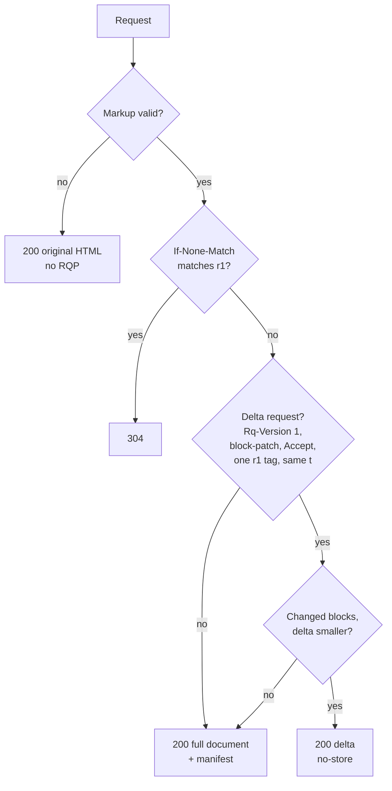

# Example: Server

`examples/server-demo` is a small Node.js server. It shows the Rivqen protocol (RQP) from the server side: block markup, manifest, `304`, block patch and safe fallback.

**Status:** <Badge type="info" text="DESIGN" /> This page describes the demo after its `rqp/1` alignment in [WP-17 S2](/engineering/plan/sprints/WP-17-S2) (task T-04): rqp/1 revisions, the `Rq-Have` field and a stateless server. Until that change is merged, the demo in the repository uses the draft headers. The demo is reference behavior for WP-17, not the final server SDK.

[[toc]]

## 1. Requirements

- Node.js 22 or later
- `curl` for the steps in section 5
- No other services. The server keeps the demo data in memory. It keeps no state per client.

## 2. Start the server

1. Go to the example folder.
2. Install the dependencies.
3. Start the server.

```bash
cd examples/server-demo
npm install
npm start
```

4. Make sure that the server writes `server.started` to the log.

The server listens on `127.0.0.1:8787`. To change the port, set `PORT`.

## 3. Endpoints

| Method | Path | Result |
|---|---|---|
| `GET` | `/catalog` | The demo page: full document, `304`, or a delta |
| `POST` | `/__demo/next-data` | Changes price and stock. Localhost only. |
| `POST` | `/__demo/next-template` | Adds a menu item (template change). Localhost only. |
| `GET` | `/healthz` | `{ "ok": true, "state": … }` |

## 4. How the server answers `/catalog`

The server follows the response selection of [negotiation §4](/engineering/protocol/negotiation#_4-response-selection-server).



Every client gets the same full document: a browser without RQP also gets the manifest, `Rq-Version: 1` and the `ETag` `"r1.…"`. The browser ignores the manifest script.

## 5. Try it by hand

1. Get the full document as an RQP client. Keep the headers and the body.

```bash
curl -s -D headers.txt -o page.html http://127.0.0.1:8787/catalog \
  -H 'Rq-Version: 1' -H 'Rq-Capabilities: (block-patch)'
```

2. Read the page revision from the `ETag` and the template revision from the manifest.

```bash
ETAG=$(grep -i '^etag:' headers.txt | cut -d' ' -f2 | tr -d '\r')
TPL=$(grep -o 't1\.[A-Za-z0-9_-]\{43\}' page.html | head -1)
echo "$ETAG $TPL"
```

3. Send the revision back. Make sure that the status is `304`.

```bash
curl -si http://127.0.0.1:8787/catalog -H "If-None-Match: $ETAG" | head -1
```

4. Change the data.

```bash
curl -s -X POST http://127.0.0.1:8787/__demo/next-data
```

5. Ask for a delta from your revision.

```bash
curl -si http://127.0.0.1:8787/catalog \
  -H 'Rq-Version: 1' -H 'Rq-Capabilities: (block-patch)' \
  -H 'Accept: text/html, application/vnd.rivqen.delta+json' \
  -H "If-None-Match: $ETAG" -H "Rq-Have: t=$TPL"
```

6. Make sure that the response has `Content-Type: application/vnd.rivqen.delta+json`, `Cache-Control: no-store` and no `ETag`.

Step 5 sends `Rq-Have` without the member `b` (the block digest prefixes), so the delta has an operation for every block (all-blocks fallback, H-7). A real client sends `b`, and the delta has only the changed blocks. If you omit any of the fields of step 5, the server sends the full document.

## 6. Run the tests

```bash
npm test
```

The tests check the markup analysis, the revisions, the manifest, the response selection (full document, `304`, delta), the request field parsers and the patch content.

## 7. Measure bytes

1. Start the server in one terminal.
2. Run the measurement in another terminal.

```bash
npm run measure -- --out ../../evidence/benchmarks/rqp-bytes.json
```

The script makes four visits (cold, unchanged, data changed, template changed) with three strategies: plain, HTTP ETag and RQP. To add the upstream legacy server, set `LEGACY_URL` and `LEGACY_PAGES` (see `tools/upstream-lab`).

The latest results are on the [Performance](/guide/performance#measured-bytes) page.

## 8. Logs and errors

The server writes one JSON line per event. It follows [Errors and logging](/engineering/architecture/errors-logging):

- Each request has a `request_id`, a `mode` (full document, delta, `304` or passthrough) and `duration_ms`.
- Only allowlisted fields go to the log. Query strings are removed from paths.
- If the markup is invalid, the server logs `rqp.analyze_failed` with the error code and sends the original HTML. The page never breaks.

## 9. Limits of the demo

- The demo data is in memory. A restart resets it.
- The server keeps no history of revisions: the request has the client's revisions and block digests, so a delta from any older page with the same template is possible.
- The demo does not compress responses, so its `ETag` is strong. A server that compresses sends `W/"r1.…"` ([negotiation §5.1](/engineering/protocol/negotiation#_5-1-full-document)).
- It is not a production server. Use the server SDKs when they are released.

## Related

- [Markup](/engineering/protocol/markup)
- [Negotiation](/engineering/protocol/negotiation)
- [Manifest and patch](/engineering/protocol/manifest-patch)
