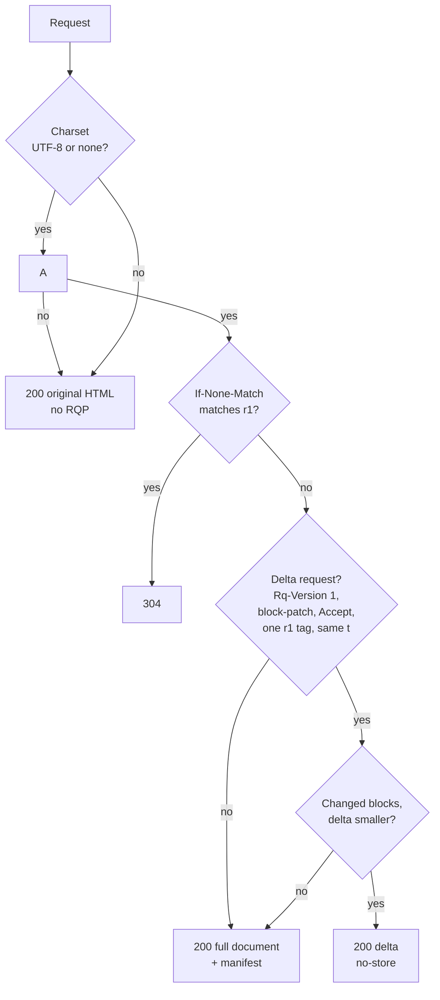

# Example: Server

`examples/server-demo` is a small Node.js server. It shows the Rivqen protocol (RQP) from the server side: block markup, manifest, `304`, block patch and safe fallback.

**Status:** <Badge type="tip" text="FACT" /> The demo follows `rqp/1` ([WP-17 S2](/engineering/plan/sprints/WP-17-S2), tasks T-04 and T-08): rqp/1 revisions, the `Rq-Have` field and a stateless server. The 104 tests pass, and the demo passes all 91 server protocol fixtures (checked 2026-10-20, Node.js 22 or later; WP-17 S4: the patch content rule, the attribute rule of H-77 and H-83, and the implied head of H-79a; WP-17 S5: `noscript` in `PATCH_FORBIDDEN`, H-96; WP-17 S6: the short manifest and the short envelope, H-103 and H-104). The commands in section 5 were run once against the demo (section 5, "Recorded output"). The demo is reference behavior for WP-17, not the final server SDK.

[[toc]]

## 1. Requirements

- Node.js 22 or later
- `curl` for the steps in section 5
- No other services. The server keeps the demo data in memory. It keeps no state per client.

## 2. Start the server

1. Go to the example folder.
2. Install the dependencies.
3. Start the server.

```bash
cd examples/server-demo
npm install
npm start
```

4. Make sure that the server writes `server.started` to the log.

The server listens on `127.0.0.1:8787`. To change the port, set `PORT`.

## 3. Endpoints

| Method | Path | Result |
|---|---|---|
| `GET` | `/catalog` | The demo page: full document, `304`, or a delta |
| `POST` | `/__demo/next-data` | Changes price and stock. Localhost only; needs the header `Rq-Demo-Action: 1` and, when the request has `Origin`, the demo's own origin (else `403`). |
| `POST` | `/__demo/next-template` | Adds a menu item (template change). Same protection as `next-data`. |
| `GET` | `/healthz` | `{ "ok": true, "state": … }` |

<Badge type="tip" text="FACT" /> Every route answers only a request whose `Host` header is the host of `ORIGIN`, compared without case. The default port of the origin scheme (`:443` for https, `:80` for http) is the same authority as no port, so both forms are accepted (RFC 9110 sections 4.2.1 and 4.2.2); any other port gets `421`. Any other request gets `421` with no body, and the server changes nothing (DL-036).

## 4. How the server answers `/catalog`

<Badge type="tip" text="FACT" /> The server follows the response selection of [negotiation §4](/engineering/protocol/negotiation#_4-response-selection-server).



<Badge type="tip" text="FACT" /> The page must be UTF-8 (H-62). When the `Content-Type` of the page has a `charset` parameter that is not a label of UTF-8 in the [WHATWG Encoding Standard](https://encoding.spec.whatwg.org/) (for example `iso-8859-1`), or has more than one field line or more than one media type (RQP-26, [negotiation §4](/engineering/protocol/negotiation#_4-response-selection-server), charset rule), the server sends the page unchanged, without RQP. The full document always has exactly one `Content-Type` line with the value `text/html; charset=utf-8` (H-66), whatever the `Content-Type` text of the page was (no `charset`, `utf8` or `"UTF-8"`). A delta keeps its own content type.

Every client gets the same full document: a browser without RQP also gets the manifest, `Rq-Version: 1` and the `ETag` `"r1.…"`. The browser ignores the manifest script.

<Badge type="tip" text="FACT" /> The manifest element is the first thing in the head: the server inserts it immediately after the `<head>` start tag of the page (H-72). Only white space, comments, DOCTYPE tokens, `<html>` start tags and ignored end tags can come before `<head>` ([manifest and patch §1.7](/engineering/protocol/manifest-patch#_1-7-delivery-in-the-document), server item 2). A page without a `<head>` start tag whose first head content (`<meta>`, `<title>`, `<link>`, `<script>`, `<style>`, `<base>`, `<basefont>`, `<bgsound>` or `<noframes>`) comes first has an implied head: the server inserts the manifest immediately before that start tag (H-79a). Any other page (for example with text, `<noscript>`, `<template>` or `<body>` first) is sent unchanged, without RQP. The head does not need a `</head>` end tag. Details: [manifest and patch §1.7](/engineering/protocol/manifest-patch#_1-7-delivery-in-the-document).

Where the code is:

| File | Content |
|---|---|
| `src/rqp.js` | `handle(request, appResponse, pageBytes, config)`: the response selection (steps 1 to 9), the manifest, the page revision with the policy line, the delta |
| `src/markup.js` | The markup analysis: calls the Node.js parser candidate `tools/rqp-markup/node` in process. Adds the insertion point (after the head start tag of the document, H-72, or before the start tag that implies the head, H-79a) and the patch content rule (H-56, H-78: `PATCH_FORBIDDEN`, `FOREIGN_ALLOWED` and the attribute rule of H-59, H-73, H-77, H-83). It is a second implementation (DL-036, DL-046), not a copy of `tools/rqp-protocol` |
| `src/fields.js`, `src/sf.js` | The request fields and a Structured Field parser |
| `src/app.js`, `src/server.js` | The HTTP adapter and the start script. The public origin comes from `ORIGIN`, not from the connection |

<Badge type="tip" text="FACT" /> The demo manifest has four members and no default member (H-103, [manifest and patch §1.2](/engineering/protocol/manifest-patch#_1-2-fields)). It has no block list and no template revision: the client computes them and checks them through `page_revision`. The demo has no `policy` and no `limits`: its policy is the default, and a `max_patch_bytes` hint of 262 144 is not smaller than the server limit (DL-057, DL-058). A configuration with such members still gives a manifest without them; `membersOf` in `src/rqp.js` drops them.

```json
{"protocol":"rqp/1","origin":"https://shop.example.com","path":"/catalog","page_revision":"r1.kQSg0GU87wq6jDSiFlsmQmk68argQjG5MSAqEYUUFic"}
```

The delta has two members (H-104). Example from the data change of section 5 (shortened to two operations):

```json
{"next_revision":"r1.MsBRD8KQI7P_bbGJFLFAWugmPrg5iEz0MNpNZcVc0-0","operations":[{"block_id":"title","content":"Shop — Catalog (125.00)"},{"block_id":"price","content":"125.00"}]}
```

## 5. Try it by hand

1. Get the full document as an RQP client. Keep the headers and the body.

```bash
curl -s -D headers.txt -o page.html http://127.0.0.1:8787/catalog \
  -H 'Rq-Version: 1' -H 'Rq-Capabilities: (block-patch)'
```

2. Read the page revision from the `ETag`. The manifest has no template revision (H-103), so compute it as a client does: remove the manifest element, then run the markup analysis of the demo on the original document.

```bash
ETAG=$(grep -i '^etag:' headers.txt | cut -d' ' -f2 | tr -d '\r')
TPL=$(node -e "
import('./src/markup.js').then(({ analyzePage }) => {
  const html = require('fs').readFileSync('page.html', 'utf8')
    .replace(/<script type=\"application\\/rivqen-manifest\\+json\">[^<]*<\\/script>/, '');
  console.log(analyzePage(Buffer.from(html)).template_revision);
});")
echo "$ETAG $TPL"
```

Run the `node` command in `examples/server-demo`, with `page.html` in the same directory (or give its path).

3. Send the revision back. Make sure that the status is `304`.

```bash
curl -si http://127.0.0.1:8787/catalog -H "If-None-Match: $ETAG" | head -1
```

4. Change the data.

```bash
curl -s -X POST http://127.0.0.1:8787/__demo/next-data -H 'Rq-Demo-Action: 1'
```

5. Ask for a delta from your revision.

```bash
curl -si http://127.0.0.1:8787/catalog \
  -H 'Rq-Version: 1' -H 'Rq-Capabilities: (block-patch)' \
  -H 'Accept: text/html, application/vnd.rivqen.delta+json' \
  -H "If-None-Match: $ETAG" -H "Rq-Have: t=$TPL"
```

6. Make sure that the response has `Content-Type: application/vnd.rivqen.delta+json`, `Cache-Control: no-store` and no `ETag`.

Recorded output (2026-10-20, Node.js 22 or later, Rq-Have without `b`; the revisions are values of this run and change when the demo page changes):

| Step | Output that matters |
|---|---|
| 1 | `HTTP/1.1 200 OK`, `content-type: text/html; charset=utf-8`, `cache-control: no-cache`, `etag: "r1.kQSg0GU87wq6jDSiFlsmQmk68argQjG5MSAqEYUUFic"`, `rq-version: 1`, `content-length: 19731`, no `Vary`. The manifest is 165 bytes (origin `http://127.0.0.1:8787`) |
| 2 | The `ETag` above and `t1.dMGS3KdBw6hmMK_VrD06B55NQwoItge4Ig1Wwh-bigM` |
| 3 | `HTTP/1.1 304 Not Modified` |
| 4 | `{"data":1,"template":0}` |
| 5, 6 | `HTTP/1.1 200 OK`, `content-type: application/vnd.rivqen.delta+json`, `rq-version: 1`, `cache-control: no-store`, `content-length: 293`, no `etag`. The body starts with `{"next_revision":"r1.MsBR…","operations":[{"block_id":"title"` and has four operations |

Step 5 sends `Rq-Have` without the member `b` (the block digest prefixes), so the delta has an operation for every block (all-blocks fallback, H-7). A real client sends `b`, and the delta has only the changed blocks. If you omit any of the fields of step 5, the server sends the full document.

## 6. Run the tests

```bash
npm test
```

<Badge type="tip" text="FACT" /> The 101 tests check, by behavior:

- the response selection: full document, `304`, delta, the size rules, the patch content rule (H-56, H-78), invalid pages, the charset rule, a weak `ETag` with a content coding, no state between requests;
- the known answers of `spec/rqp/examples/kat`: the full documents, both page revisions and the example patches;
- the request fields and the Structured Field parser;
- the insertion point of the manifest (after the head start tag, H-72, or before the start tag that implies the head, H-79a) and the patch content rule: `PATCH_FORBIDDEN`, `FOREIGN_ALLOWED`, event handlers, `javascript:`, `vbscript:` and `data:` URLs except raster images in `img`, `source` and `video` (H-83), and character references at the scheme decision byte (H-77);
- differential tests against the reference of `tools/rqp-protocol` (tests only): 20 000 random blocks for the patch content rule and 20 000 random documents for the insertion point;
- the HTTP adapter on a loopback socket: first visit, revisit, data change, template change, the `Host` check (`421`);
- the protocol fixtures: the test runs `node tools/rqp-protocol/check.mjs --server src/rqp.js`. All 91 server fixtures pass (`FX-RQ-P*`), also the SHOULD cases (the eight `FX-RQ-P35` cases and `FX-RQ-P36-LIMITS-SERVER-LIMIT`).

To run the fixtures alone, run this command in `examples/server-demo`:

```bash
node ../../tools/rqp-protocol/check.mjs --server src/rqp.js
```

## 7. Measure bytes

1. Start the server in one terminal.
2. Run the measurement in another terminal.

```bash
npm run measure -- --out ../../evidence/benchmarks/rqp-bytes-2026-10-20.json
```

The script makes four visits (cold, unchanged, data changed, template changed) with three strategies: plain, HTTP ETag and RQP. The RQP client of the script sends `If-None-Match` and `Rq-Have` with the digest prefixes `b`, and applies each delta to its block list. After a full document it removes the manifest element and runs the markup analysis, as a client does (H-103). Run on 2026-10-20 (gzip bytes: cold 2,357, unchanged 0, data changed 221, template changed 2,377; raw delta 293): `evidence/benchmarks/rqp-bytes-2026-10-20.json`. The script sends the `Host` of `ORIGIN` (or of `DEMO_URL`). To add the upstream legacy server, set `LEGACY_URL` and `LEGACY_PAGES` (see `tools/upstream-lab`).

The latest results are on the [Performance](/guide/performance#measured-bytes) page.

## 8. Logs and errors

The server writes one JSON line per event. It follows [Errors and logging](/engineering/architecture/errors-logging):

- Each request has a `request_id`, a `mode` (full document, delta, `304` or passthrough) and `duration_ms`.
- Only allowlisted fields go to the log. Query strings are removed from paths.
- If the markup is invalid, the server logs `rqp.analyze_failed` with the error code and sends the original HTML. The page never breaks.

## 9. Limits of the demo

- The demo data is in memory. A restart resets it.
- The server keeps no history of revisions: the request has the client's revisions and block digests, so a delta from any older page with the same template is possible.
- The demo does not compress responses, so its `ETag` is strong. A server that compresses sends `W/"r1.…"` ([negotiation §5.1](/engineering/protocol/negotiation#_5-1-full-document)).
- The server evaluates `If-None-Match` only. It does not evaluate `If-Match`, `If-Unmodified-Since`, `If-Modified-Since` or `If-Range`, and it sends the full document (status `200`) for a `Range` request.
- The markup analysis is the Node.js parser candidate of WP-17 S1. It is a conformance tool, not a server SDK.
- It is not a production server. Use the server SDKs when they are released.

## Related

- [Markup](/engineering/protocol/markup)
- [Negotiation](/engineering/protocol/negotiation)
- [Manifest and patch](/engineering/protocol/manifest-patch)
