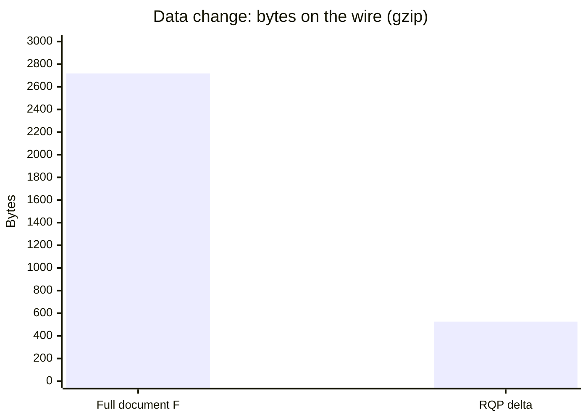

# Performance

This page shows two things: **measured** bytes from the server demo, and an **interactive model** of load time. They are different kinds of evidence. Do not mix them.

**Status:** <Badge type="tip" text="FACT" /> byte table is measured · <Badge type="warning" text="RESEARCH" /> timing is a model until the device stand runs (WP-19)

[[toc]]

## 1. Where the speed-up comes from

Rivqen saves time in three ways:

1. **Parallel start.** The page request starts at the same time as the web view. A plain web view starts the request only after it is ready.
2. **Cache first.** On a revisit, the cached page shows at once. Revalidation runs in the background.
3. **Small updates.** When only data changes, only the changed blocks travel. The template stays in the cache.

Rivqen does **not** make the first visit smaller. The first visit sends the full document with the manifest. In the measured run (section 3), the first visit has the same bytes for the plain strategy and for RQP, because the demo "plain" strategy also sends this document.

## 2. Interactive model

Select a scenario and move the sliders. The bars show when each step runs. The red line marks first content.

<ClientOnly>
  <LoadTimeline />
</ClientOnly>

### Formulas

The model uses these formulas. All values are in milliseconds.

| Term | Formula |
|---|---|
| Handshake | `2 × RTT` (TCP + TLS 1.3), or `0` with a reused connection |
| Transfer | `size_bytes × 8 ÷ bandwidth_bps × 1000` |
| Fetch | `handshake + RTT + server + transfer` |
| Plain, first content | `webview_init + fetch(full) + render` |
| Rivqen cold, first content | `max(webview_init, fetch(full)) + render` |
| Rivqen warm, first content | `max(webview_init, cache_read) + render` |

::: warning Limits of the model
The model has no DNS time, no TCP slow start, no CPU contention, no JavaScript cost and no WebView process start variance. Real gains are smaller on fast networks and with a pre-warmed web view. Use it to understand the mechanism, not to promise a number.
:::

## 3. Measured bytes {#measured-bytes}

Source: `evidence/benchmarks/rqp-bytes-2026-10-19.json`, made with `npm run measure` in [`examples/server-demo`](/guide/examples/server). Run date: 2026-10-19. This run is the wire format before H-103 and H-104; the values after them are in [After H-103 and H-104](#after-p1). The earlier run of 2026-10-12 is `evidence/benchmarks/rqp-bytes.json` (no legacy column). Page: the demo catalog with four blocks (`title`, `price`, `stock`, `cart`). The page source is 19,538 bytes. The served document with the manifest is 20,250 bytes. Compression: Node.js zlib defaults, computed locally on the decoded body. <Badge type="tip" text="FACT" />

### Body bytes per visit (gzip, before H-103…H-109)

| Visit | Plain (no revalidation) | HTTP ETag | Rivqen (RQP) | RQP response |
|---|---:|---:|---:|---|
| 1. Cold | 2,707 | 2,707 | 2,707 | Full HTML + manifest |
| 2. Revisit, unchanged | 2,707 | 0 | 0 | `304` |
| 3. Data changed | 2,718 | 2,718 | **526** | Delta, changed blocks only |
| 4. Template changed | 2,733 | 2,733 | 2,733 | Full HTML + manifest |

### All encodings for the data change (before H-103…H-109)

| Strategy | Raw | gzip | Brotli |
|---|---:|---:|---:|
| Full document F (no delta) | 20,250 | 2,718 | 1,625 |
| Rivqen delta (RQP) | 836 | 526 | 467 |

### Legacy column (upstream VasSonic server) {#legacy-column}

<Badge type="tip" text="FACT" /> Measured on 2026-10-19 (human decision H-82; question Q-22 closed). The unmodified upstream Node.js server (`sonic-nodejs` middleware with `sonic_differ` 1.0.7, upstream commit `59936bef`) served the same catalog page. The page has the legacy markers (`<!--sonicdiff-ID-->`) in place of `data-rq-block` and has no manifest. The lab ran in Docker, bound to 127.0.0.1. The client sent `accept-diff: true`, then `If-None-Match` and `template-tag` from the first answer. The legacy run has no template-change visit. Sizes are of the decoded body, with the same local gzip and Brotli.

| Visit | Legacy raw | Legacy gzip | Legacy Brotli | RQP raw | RQP gzip | RQP Brotli |
|---|---:|---:|---:|---:|---:|---:|
| 1. Cold | 19,593 | 2,232 | 1,252 | 20,250 | 2,707 | 1,686 |
| 2. Revisit, unchanged (`304`) | 0 | 0 | 0 | 0 | 0 | 0 |
| 3. Data changed | 497 | 316 | 260 | 836 | 526 | 467 |

<Badge type="tip" text="FACT" /> Correction (2026-10-20, WP-17 S6 byte study, `evidence/rqp-bytes/report.md` §3.1 F-1): the first legacy run put markers around the `<title>`. The legacy server applies its title rule first, so the marker rule then overwrote the title entry, and the data change of that run (512 / 294 / 253) was a broken update that a legacy client discards. The table has the like-for-like values of the byte study lab run (the same page, the title as the implicit legacy title block). `measure.js` no longer marks the title.

<Badge type="tip" text="FACT" /> Legacy is smaller than RQP in this run. Cold: 18 % smaller with gzip (2,232 vs 2,707) and 26 % with Brotli. Data changed: 40 % smaller with gzip (316 vs 526) and 44 % with Brotli (260 vs 467). The byte study splits these differences: the cold difference is the manifest (485 bytes gzip), the data change difference is mostly the per-operation hashes and the revisions (`evidence/rqp-bytes/report.md`). Unchanged: equal. Possible reasons <Badge type="info" text="DESIGN" />: the RQP document carries a manifest, and each RQP operation carries a block hash and revision fields; the legacy answer carries the changed data only. The raw cold sizes differ by 609 bytes, but this is not only the manifest, because the two pages use different block markers. This run does not isolate each cause, and it does not measure the cost of the RQP safety checks against their benefit.

### After H-103 and H-104 {#after-p1}

<Badge type="tip" text="FACT" /> The human decisions H-103 and H-104 ([WP-17 S6](/engineering/plan/sprints/WP-17-S6) §1, proposal P1 of `evidence/rqp-bytes/report.md` §6) remove from the wire what the client computes itself: the block list and the template revision of the manifest, the default members of `policy` and `limits`, and every envelope member except `next_revision` and the operations (`block_id`, `content`) (H-107 then replaced `next_revision` with `binding`: "After H-107" below). Measured on 2026-10-20 with the reference server step (`tools/rqp-protocol/src/server.mjs`, `handle()`) on the demo catalog page of the byte study (`tools/rqp-protocol/study/bytes/src/pages.mjs`, data steps 0 and 1), with the method of the study (Node.js 26.8.2, zlib 1.2.12, Brotli 1.2.0). The legacy values are the like-for-like lab values above. Raw / gzip / Brotli:

| Visit | RQP before | RQP after (P1) | Legacy |
|---|---:|---:|---:|
| 1. Cold | 20,250 / 2,707 / 1,686 | 19,731 / 2,357 / 1,296 | 19,593 / 2,232 / 1,252 |
| 2. Revisit, unchanged | `304`, 0 | `304`, 0 | `304`, 0 |
| 3. Data changed | 836 / 526 / 467 | 293 / 221 / 171 | 497 / 316 / 260 |

<Badge type="tip" text="FACT" /> The server demo gives the same values after H-103 and H-104: `evidence/benchmarks/rqp-bytes-2026-10-20.json` (`npm run measure`, 2026-10-20): cold 19,731 / 2,357 / 1,296, unchanged `304`, data change 287 / 217 / 169 (a delta with 4 operations; run again after H-107…H-109 and DL-063, which add only response header fields to D: `nosniff` and `Vary: Rq-Nonce`, about 40 header bytes), template change 19,774 / 2,377 / 1,420. In the demo the manifest is 193 bytes (19,731 − 19,538 page bytes; the study uses the same origin `http://127.0.0.1:8787`).

<Badge type="tip" text="FACT" /> The manifest element is 193 bytes (before: 712). The cold value is the P1 value of the study (2,357 gzip, 1,296 Brotli). The data change is 1 byte gzip more and 25 bytes Brotli less than the study value (220 / 196) at the same raw size: the study modeled the envelope with the `next_revision` of the old manifest members (with the default `policy` and `limits`), and the 43 random characters of the new `next_revision` compress differently. The demo server (`examples/server-demo`) sends the short form since task T-02b of S6; `npm run measure` gives the demo values above.

<Badge type="tip" text="FACT" /> **After H-107.** The human decision H-107 (S6 security review F1) replaces the envelope member `next_revision` with `binding`, a value of the same length over the URL, the base revision and the next revision ([manifest and patch §2.2](/engineering/protocol/manifest-patch#_2-2-fields)). The member name is 6 bytes shorter; F, the manifest and the `304` do not change. Measured on 2026-10-20 with the reference server step on the demo page and the demo URL `http://127.0.0.1:8787/catalog` (the method above), data step 0 → 1: before 293 / 221 / 171, after 287 / 215 / 205. The 43 characters of the binding are other random characters than the 43 of `next_revision`, and Brotli on a body of about 290 bytes depends on them: over all 25 data steps of the demo (0 → 1 to 24 → 25), raw is always 6 bytes smaller, gzip has the median 215 (before 219) and Brotli the median 169 (before 171), with a range of 164 to 205 (before 166 to 203). So H-107 costs no bytes; the step 0 → 1 value of Brotli is at the top of the range. The demo has sent `binding` since task T-04b of S6; its run gives 287 / 217 / 169, inside that range.

<Badge type="tip" text="FACT" /> **After H-108 (request header bytes).** The human decision H-108 (S6 security re-review B1) adds a client nonce to every delta request: the `Rq-Have` member `n`, 16 random bytes ([negotiation §3.4](/engineering/protocol/negotiation#_3-4-rq-have)). The bodies (F, D, `304`) do not change: the binding keeps its length. The request costs 30 more bytes in HTTP/1.1 form (`, n=:` + 24 base64 characters + `:`). As an HPACK header block on a new HTTP/2 connection (the method of `evidence/rqp-bytes/report.md` §3.5: Node.js 26.8.2, a local proxy counts the header block bytes) the revisit request of the demo page grows from 276 bytes by 23 to 27 bytes (median 25, mean 24.8, 200 random nonces); with 64 blocks the same (median 24). On a warm connection the cost is larger: the value of `Rq-Have` is new for every request, so HPACK cannot reuse it from its table. Two more revisits of the demo page on one connection send 164 bytes each in place of 60 (measured 2026-10-20, T-06a). Body bytes, the numbers in this section, do not change.

<Badge type="tip" text="FACT" /> **After H-109 (request header bytes).** The human decision H-109 moves the nonce out of `Rq-Have` into its own request field `Rq-Nonce` ([negotiation §3.9](/engineering/protocol/negotiation#_3-9-rq-nonce)). The bodies and the binding do not change. `Rq-Have` is again the same for every request from one snapshot, so on a warm HTTP/2 connection only the nonce is new. Request header bytes of a revisit (all request fields of the byte study request, `evidence/rqp-bytes/report.md` §3.5 and §10; HPACK: median of 200 random nonces, Node.js 26.8.2, nghttp2 1.70.0; "warm" is the second and the third revisit on one connection; measured 2026-10-20, T-08a):

| Request | No nonce (H-107) | `n` (H-108) | `Rq-Nonce` (H-109) |
|---|---:|---:|---:|
| Demo, HTTP/1.1 | 367 | 397 | 405 |
| Demo, HPACK new | 276 | 301 | 306 |
| Demo, HPACK warm | 60 | 164 | 83 |
| 64 blocks, HTTP/1.1 | 1,007 | 1,037 | 1,045 |
| 64 blocks, HPACK new | 790 | 814 | 820 |
| 64 blocks, HPACK warm | 58 | 677 | 82 |

The nonce costs 38 bytes in HTTP/1.1 form (8 more than the member `n`: the field name), 30 bytes on a new HTTP/2 connection (5 or 6 more than `n`), and 23 or 24 bytes on a warm connection, where `n` cost 104 bytes (demo) and 619 bytes (64 blocks). Body bytes, the numbers in this section, do not change.

### What the numbers say

1. On a data change, the RQP delta is **81 % smaller** than the full document F with gzip (526 vs 2,718 bytes) and 71 % smaller with Brotli (467 vs 1,625 bytes). After H-103 and H-104 it is 91 % smaller with gzip (221 vs 2,363 bytes, F of the new page) and 87 % smaller with Brotli (171 vs 1,300 bytes).
2. On an unchanged revisit, RQP and plain HTTP ETag are equal: both send `304`. The gain there is time (cache first), not bytes.
3. On the first visit and on a template change, RQP and the "plain" strategy send the same bytes. The demo "plain" strategy sends the full document F with the manifest, so the run does not measure the cost of the manifest against a page without it. The legacy column gives an upper bound of this cost for the cold visit (475 bytes gzip, 434 bytes Brotli, with other differences included; the manifest alone: 485 bytes gzip).
4. Before H-103 and H-104, the upstream legacy server sent fewer bytes than RQP on the cold visit and on a data change (see the legacy column). After them (reference server, [After H-103 and H-104](#after-p1)), RQP sends 125 bytes more than legacy on the cold visit (2,357 vs 2,232 gzip) and 95 bytes fewer on the data change of the demo (221 vs 316 gzip; after H-107 215, 101 fewer; the demo run after H-109 gives 217, 99 fewer). RQP does not claim a byte advantage over legacy for the cold visit.

::: info Bytes are not time
These values count body bytes only, without headers and TLS framing. For a small page on a fast network, the byte saving changes little. The saving grows with page size, slow networks and frequent data changes.
:::

## 4. Next measurements

The device stand (WP-19) will measure time to first content, LCP, energy and memory on real Android and iOS devices. The method is in [Benchmarks](/engineering/quality/benchmarks): at least 30 runs per scenario, p50/p90/p95, bootstrap confidence intervals, raw traces published.

## Related

- [How it works](/guide/how-it-works)
- [Examples](/guide/examples/)
- [Engineering: Benchmarks](/engineering/quality/benchmarks)
