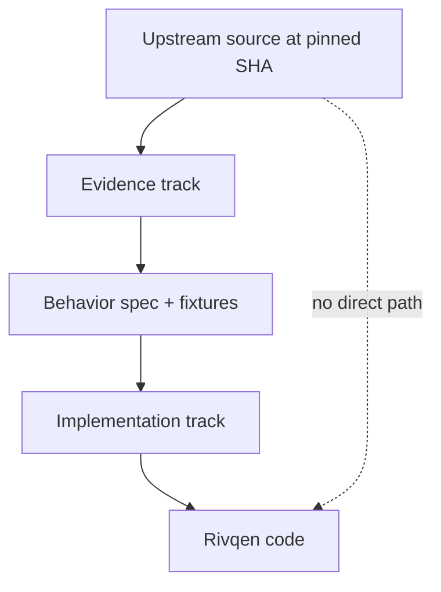

# Clean-room provenance

Rivqen re-implements the **behavior** of the legacy protocol. It does not copy the **expression** (source code) of Tencent VasSonic. This page defines the rules that keep the two apart.

**Status:** <Badge type="danger" text="GATE" /> Mandatory for every contributor and every AI agent.

[[toc]]

## 1. Why clean room

Upstream VasSonic is BSD-3-Clause licensed, with some Android source code under Apache-2.0. Copying would be legally possible with notices, but a clean-room process gives Rivqen:

- A clear, single license for all its code.
- No inherited design defects from 2017–2019 code.
- A specification that is independent of any one implementation.
- A simple answer to provenance questions from integrators and auditors.

## 2. Two tracks

| Track | Who | Reads upstream code? | Produces |
|---|---|---|---|
| **Evidence** | Source archaeologist (human or agent) | Yes | Behavior descriptions in own words, file:line references, captured traces, fixtures |
| **Implementation** | Core, platform and server engineers | **No**, they work from the spec and fixtures | Rivqen code |

Where the same person must work in both tracks (small team), they follow the rules in section 3 strictly and record it in the PR.

## 3. Rules

| ID | Rule |
|---|---|
| CR-01 | Do not copy, translate, or port upstream source code into Rivqen. Not even "small" helpers. |
| CR-02 | Evidence documents describe behavior in your own words. They cite `upstream:<path>:<line>` at the pinned SHA. |
| CR-03 | Allowed to quote: header names and values, constant names and values, marker strings, regular expressions that define the wire grammar, JSON key names, result codes. These are interface facts needed for interoperability. |
| CR-04 | Do not reuse upstream comments, identifiers of internal (non-protocol) functions as code names, file structure or test code. |
| CR-05 | Do not reuse upstream images, logos, diagrams or the PDF. |
| CR-06 | Implementation work cites the spec section and fixture, not upstream files. |
| CR-07 | AI agents get the spec and fixtures as input for implementation tasks, not upstream code. |
| CR-08 | Before each release, run a code-similarity scan against the upstream repository and review all hits. |

## 4. Records

| Record | Location |
|---|---|
| Pinned upstream SHA and file hashes | `evidence/source-manifest.lock` (WP-01) |
| Studied files list | `evidence/source-manifest.lock` |
| Evidence documents | [Protocol pages](/engineering/protocol/) and [Upstream audit](/research/upstream-vassonic) |
| Similarity scan results | Release audit (WP-21) |

## 5. Upstream lab

<Badge type="tip" text="FACT" /> The evidence track runs upstream code only in the upstream lab (`tools/upstream-lab/`). The lab holds Rivqen code only: harnesses, test pages, a recording proxy, runners. Upstream code comes from a separate read-only checkout at the pinned SHA and is never copied into the repository.

| Rule | Server lab (WP-01 P0, WP-02) | Client lab (WP-01 S1; H-118, H-119) |
|---|---|---|
| Upstream input | The servers of `sonic-java` (binary jar), `sonic-nodejs` (npm package), `sonic-php`, mounted read-only into containers | The Android SDK sources (`sonic-android/sdk/src/main/java`) compiled in place as a source set; the iOS SDK sources (`sonic-iOS/Sonic`) compiled in place for macOS |
| Changes to upstream | None | None: build flags only (`-fno-objc-arc -fobjc-weak` on iOS). The builds check the pinned SHA and the file hashes of `evidence/source-manifest.lock` and stop on any change |
| Rivqen glue | Harness per server, control endpoint | Android: a runtime and a session client written from the [legacy client](/engineering/protocol/legacy-client) page; one Rivqen class in the SDK package (`com.tencent.sonic.sdk.RivqenLabAccess`) calls package-private or protected members, listed in `tools/upstream-lab/android/package-access.json`; it writes no upstream field. iOS: a runner that calls SDK functions, a stand-in header for one UIKit name, and a category declaration of one method that the SDK defines but does not declare (listed as non-public calls in the run metadata) |
| Not read | The upstream sample apps | `sonic-android/sample/`, `sonic-android/sdk/src/androidTest/`, `sonic-iOS/SonicSample/` (CR-04) |
| Lab-only dependencies (not shipped) | Container images, the npm dependencies of the upstream demo, Gson 2.8.2 (pinned) | Android Gradle Plugin 9.5.0 and Gradle 9.8.2 (pinned, verification metadata), `com.android.support:support-annotations:28.0.0` (Apache-2.0) |
| Output | Traces in `evidence/traces/server/` | Traces and function results in `evidence/traces/client/` |

After each lab run the checkout, the containers, the images and the lab SDK root are deleted.

## 6. If upstream material is ever needed

If the maintainers decide to include upstream material (for example a test asset), they must:

1. Record the decision in an ADR.
2. Keep the original copyright and BSD-3-Clause notice next to the material.
3. Add it to `THIRD_PARTY_NOTICES.md`.
4. Add SPDX tags for the original license to those files.
